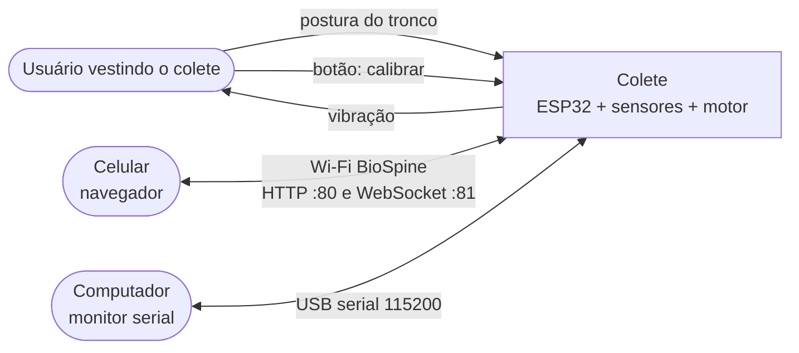
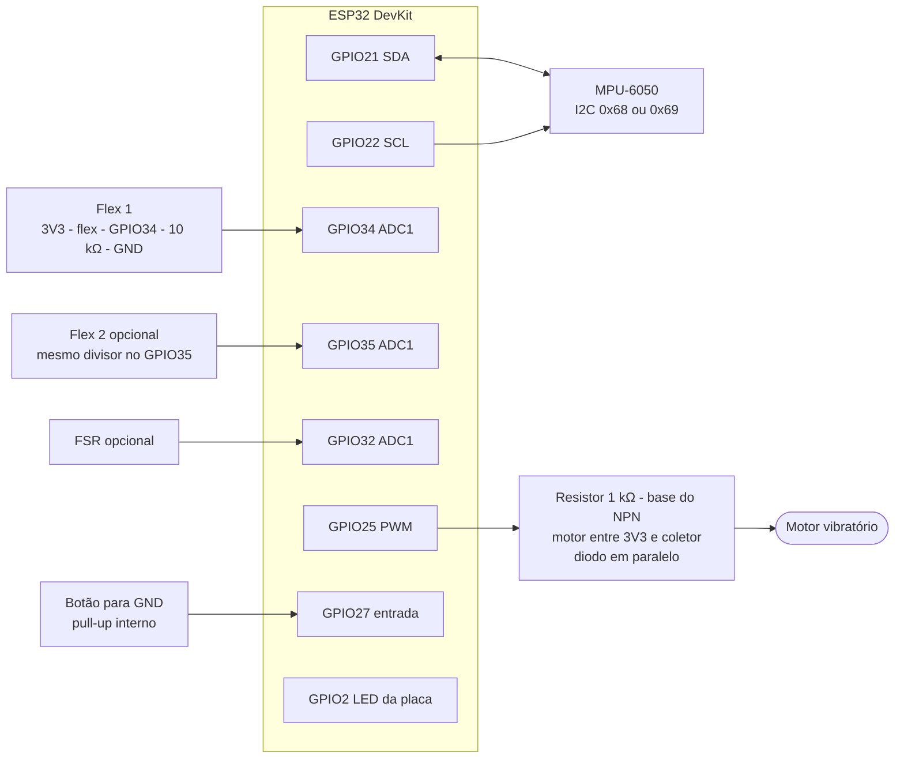

# 01 — Visão geral do sistema

> Código: `src/config.h`, `platformio.ini` · Relacionados: [02 — Arquitetura](02-arquitetura.md), [10 — Decisões](10-decisoes-de-projeto.md), guia de montagem `montagem.pdf` (na pasta acima do repositório)

## 1. O problema e a proposta

O TCC "Colete Ortopédico Inteligente para Monitoramento Postural em Tempo Real" propõe um colete
que percebe quando o tronco sai da postura correta e avisa o usuário com vibração.
A má postura prolongada (celular, computador, horas sentado) causa dor e desvios na coluna; o aviso
na hora em que acontece ajuda a criar consciência corporal (reeducação postural).

Este repositório contém o **software** do colete:

- **Firmware** do ESP32 (C++ com framework Arduino, compilado pelo PlatformIO): lê os sensores,
  decide se a postura está ruim e aciona o motor vibratório.
- **App web embarcado**: uma página servida pelo próprio ESP32, aberta no celular pela rede Wi-Fi do
  colete, que mostra a postura em tempo real e permite calibrar e ajustar o colete.
- **Ferramentas de desenvolvimento**: testes automáticos da lógica, simulador do firmware no PC e
  scripts para gerar o gráfico dos resultados.

Princípio central: **o colete funciona sozinho**. Sem celular e sem computador ele continua
detectando e vibrando. O app só mostra dados e envia comandos ([D-01](10-decisoes-de-projeto.md#d-01)).

## 2. O que o sistema faz

O diagrama mostra quem interage com o colete e por qual meio.



### Requisitos funcionais

| ID | Requisito | Onde está |
|---|---|---|
| RF-01 | Medir a inclinação do tronco com o MPU-6050 (acelerômetro + giroscópio) | `src/mpu.cpp`, `src/sensors.cpp`, `src/tilt.cpp` — [03](03-algoritmo-inclinacao.md) |
| RF-02 | Medir a curvatura da coluna com sensor flex (1 ou 2) | `src/sensors.cpp`, `src/filters.h` — [05](05-sensores-analogicos.md) |
| RF-03 | Calibrar a postura correta da pessoa (botão, serial ou app) | `src/main.cpp`, `src/posture.cpp` — [04](04-deteccao-e-calibracao.md) |
| RF-04 | Detectar má postura com limite, histerese e tempo mínimo | `src/posture.cpp` — [04](04-deteccao-e-calibracao.md) |
| RF-05 | Avisar com o motor vibratório em pulsos | `src/motor.cpp` — [06](06-motor-e-nvs.md) |
| RF-06 | Ajustar parâmetros sem recompilar e guardá-los depois de desligar | `src/settings.cpp`, `src/console.cpp`, `src/protocolo.cpp` — [06](06-motor-e-nvs.md), [07](07-protocolo-e-interfaces.md) |
| RF-07 | Mostrar a postura em tempo real no celular, com gráfico e vista 3D | `src/web.cpp`, `src/web/index.html` — [08](08-app-web.md) |
| RF-08 | Testar cada componente do hardware (`diag`) | `src/console.cpp` — [07](07-protocolo-e-interfaces.md) |
| RF-09 | Exportar dados para a figura de resultados do TCC (Serial Plotter, CSV, PNG) | `src/console.cpp`, `tools/grafico_serial.py`, botão "Baixar CSV" do app — [09](09-simulador-testes-ferramentas.md) |

### Requisitos não funcionais

| ID | Requisito | Como é atendido |
|---|---|---|
| RNF-01 | Funcionar sem celular, sem computador e sem internet | Decisão e alerta rodam no ESP32; Wi-Fi em modo Access Point próprio |
| RNF-02 | Não parar de detectar quando o Wi-Fi trava | Tarefa de controle separada, com prioridade maior que a do `loop()`, onde rodam HTTP, WebSocket e serial ([02](02-arquitetura.md)) |
| RNF-03 | Tolerar montagem incompleta ou com defeito | Detecção automática de MPU, flex, flex 2 e FSR; reconexão do MPU; fallback só com o MPU ([05](05-sensores-analogicos.md)) |
| RNF-04 | Não incomodar à toa | Tempo mínimo de 3 s, histerese, vibração em pulsos, PWM fora da faixa audível |
| RNF-05 | Ser testável sem a placa | Lógica pura separada, testes nativos e simulador ([09](09-simulador-testes-ferramentas.md)) |
| RNF-06 | Baixo custo | Componentes comuns (ESP32 DevKit, GY-521, flex 2.2"), sem nuvem nem app pago |

### Fora do escopo (versão 2)

App nativo (Android/iOS) e Bluetooth, nuvem (banco de dados, MQTT), bateria LiPo com circuito de carga
(a alimentação é por power bank).

## 3. Hardware

| Componente | Função | Observação |
|---|---|---|
| ESP32 DevKit 30 pinos (DOIT, ESP32-WROOM-32) | Microcontrolador: lê sensores, decide, aciona o motor, Wi-Fi | 240 MHz, 520 kB de SRAM, 4 MB de flash, ADC de 12 bits |
| MPU-6050 (módulo GY-521) | IMU: acelerômetro e giroscópio de 3 eixos, via I2C | Configurado em ±2 g e ±250 °/s |
| Sensor flex 2.2" | Curvatura da coluna (resistência sobe ao dobrar) | ~10 kΩ reto, tolerância ±30% |
| 2º sensor flex (opcional) | Curvatura do outro lado | Desligado por padrão |
| FSR (opcional, montagem BioSpine) | Pressão | Só telemetria, não alerta |
| Motor vibratório tipo moeda | Alerta | 3 V, 60 mA |
| Transistor NPN (2N2222 / BC337) + resistor 1 kΩ | Aciona o motor | O GPIO não aguenta 60 mA |
| Diodo 1N4148 / 1N4007 | Proteção contra o pico de tensão do motor (flyback) | Em paralelo com o motor |
| Resistor 10 kΩ | Divisor de tensão do flex | |
| Botão táctil | Calibração | Para GND, com pull-up interno |
| Capacitor 100 µF (opcional) | Evita reset do ESP32 quando o motor liga | |
| Power bank + cabo USB de dados | Alimentação | |

O diagrama mostra as ligações elétricas entre o ESP32 e os periféricos (detalhe físico no `montagem.pdf`).



### Pinagem

O firmware atende **duas montagens ao mesmo tempo** (a do `montagem.pdf`/GUIA e a do README do BioSpine V3),
porque nenhum pino conflita ([D-18](10-decisoes-de-projeto.md#d-18)). O que não estiver ligado é detectado e ignorado.

| Função | Pino | Constante (`src/config.h`) | montagem.pdf | BioSpine V3 |
|---|---|---|---|---|
| MPU-6050 SDA / SCL | 21 / 22 | `PIN_I2C_SDA`, `PIN_I2C_SCL` | sim | sim |
| Flex 1 | 34 | `PIN_FLEX` | sim | flex esquerdo |
| Flex 2 | 35 | `PIN_FLEX2` | reserva | flex direito |
| FSR (pressão) | 32 | `PIN_FSR` | — | sim |
| Motor (via NPN) | 25 | `PIN_MOTOR` | sim | — |
| Botão de calibração | 27 | `PIN_BUTTON` | sim | — |
| LED azul da placa | 2 | `PIN_LED` | — | sim (acende junto com o motor) |

Regras que justificam a escolha dos pinos:

- **Todo sensor analógico no ADC1** (GPIO 32–39). O ADC2 não funciona com o Wi-Fi ligado.
- GPIO34 e GPIO35 são só entrada: servem para sensor, nunca para saída.
- Saídas longe dos pinos de boot (0, 2, 12, 15). O GPIO2 só acende o LED da placa, que já está ligado nele.
- MPU alimentado em 3V3 (níveis de I2C seguros; o GY-521 já tem pull-up).

### Posição no colete

- **MPU-6050**: centro das costas, entre as escápulas, sobre a coluna, bem preso. Componentes para fora e
  pinos para baixo (o eixo Y do sensor aponta para cima). A calibração compensa pequenos desalinhamentos.
- **Flex**: na vertical, ao longo da coluna torácica, onde ela mais curva quando a pessoa "corcunda".
- **Motor**: encostado no corpo, perto do ombro ou da nuca.
- **ESP32 e power bank**: num bolso na parte de baixo do colete.

## 4. Plataforma de software

| Item | Versão / valor | Onde |
|---|---|---|
| Plataforma PlatformIO | `espressif32@6.9.0` (core Arduino-ESP32 2.0.17) | `platformio.ini` |
| Placa | `esp32dev` | `platformio.ini` |
| WebSocket | `links2004/WebSockets@2.7.3` | `platformio.ini` |
| JSON | `bblanchon/ArduinoJson@7.2.1` | `platformio.ini` |
| Servidor HTTP | `WebServer` (já vem no core) | `src/web.cpp` |
| Página do app | HTML/CSS/JS num arquivo só, embutido na flash (`board_build.embed_txtfiles`) | `src/web/index.html` |
| Testes | Unity, ambiente `native` (roda no PC) | `test/`, `platformio.ini` |
| Biblioteca do MPU | **nenhuma**: driver próprio por registradores ([D-04](10-decisoes-de-projeto.md#d-04)) | `src/mpu.cpp` |

## 5. Estrutura do repositório

```
colete-postural/
├── platformio.ini        ambientes esp32dev (placa) e native (testes no PC)
├── README.md             comandos do dia a dia e resumo
├── VALIDACAO.md          roteiro de teste no hardware
├── AGENTS.md             instruções para agentes de IA (aponta para Documentação/MANUTENCAO.md)
├── Documentação/         esta documentação (.md = fonte; pdf/ = PDFs gerados por gerar_pdf.py)
├── src/
│   ├── main.cpp          setup/loop, tarefa de controle, calibração, botão, fila de eventos
│   ├── app.h             Status e funções app_* (ponte entre loop e tarefa de controle)
│   ├── config.h          pinos, tempos e valores padrão
│   ├── tilt.*            vetor gravidade, filtro complementar, ângulos (lógica pura)
│   ├── posture.*         limite, histerese, tempo mínimo, calibrador (lógica pura)
│   ├── filters.h         média móvel e detecção de sensor presente (lógica pura)
│   ├── mpu.*             driver do MPU-6050
│   ├── sensors.*         leitura de MPU, flex, flex 2 e FSR
│   ├── motor.*           PWM do motor, padrões de pulso, LED
│   ├── settings.*        parâmetros e calibração na NVS
│   ├── console.*         comandos pela serial
│   ├── protocolo.*       JSON do app (roda também no simulador)
│   ├── web.*             Wi-Fi AP, HTTP, WebSocket
│   └── web/              index.html, manifest.json, icon.svg (vão para a flash)
├── test/test_posture/    21 testes da lógica pura
├── sim/                  imitação de Arduino, Wire e Preferences para rodar o firmware no PC
├── tools/                simulador, roteiros, ponte web, gráfico, geração do .bin
└── dist/                 firmware pronto para gravar sem compilar
```

## 6. Uso em resumo

1. Ligar o colete (power bank). Um pulso curto do motor indica que ligou.
2. Vestir, ficar na postura correta e **apertar o botão** (ou "Calibrar postura" no app). Um pulso: "fique parado".
   Cerca de 2,5 s depois, dois pulsos: calibrado. Um pulso longo: mexeu durante a média, repetir.
3. Pronto: se a postura passar do limite por mais de 3 s, o motor vibra em pulsos até a postura voltar.
4. Opcional: no celular, conectar no Wi-Fi `BioSpine` (senha `colete123`) e abrir `http://192.168.4.1`.

Sem calibração o colete **não vibra** ([D-09](10-decisoes-de-projeto.md#d-09)). A calibração fica salva.
Comandos de compilação, gravação e teste: `README.md` do repositório e [09](09-simulador-testes-ferramentas.md).
