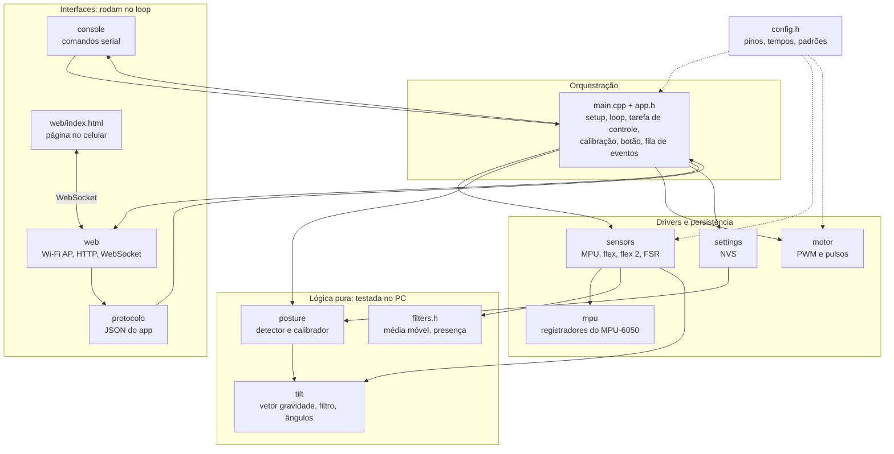
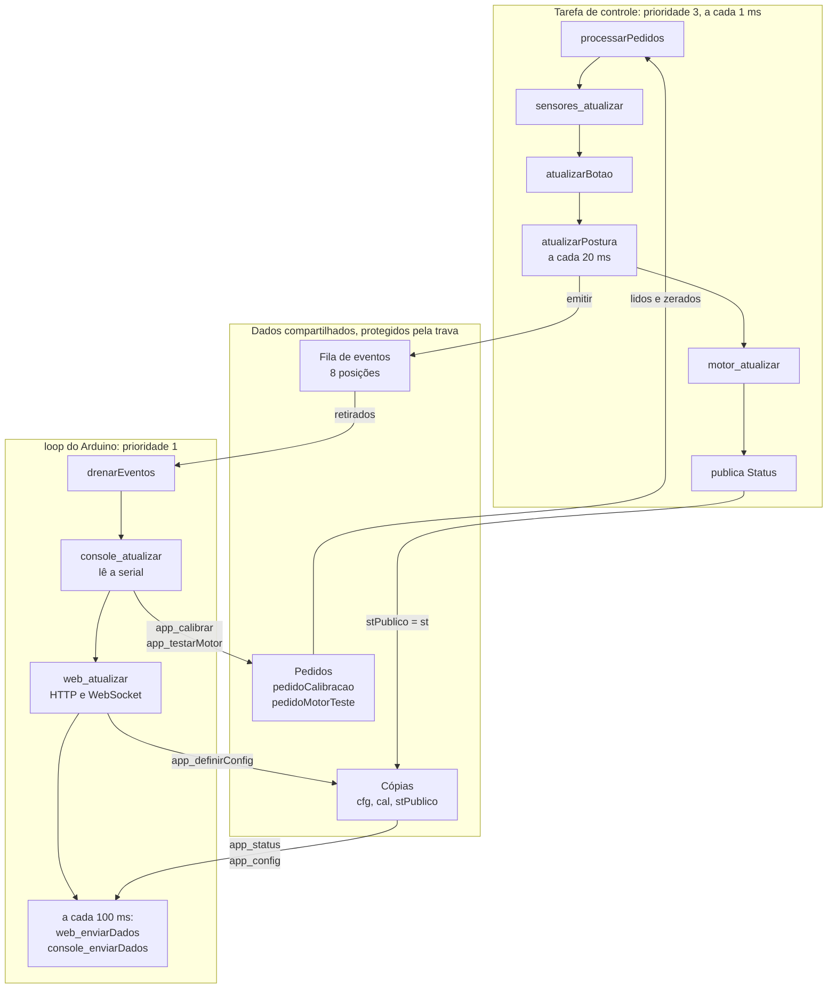
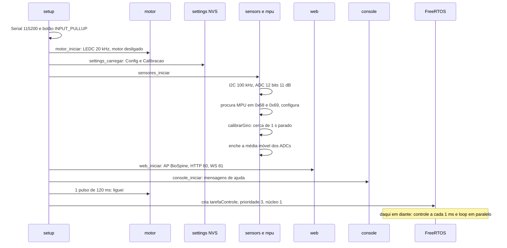
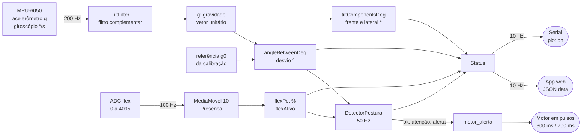

# 02 — Arquitetura do firmware

> Código: `src/main.cpp`, `src/app.h`, todos os módulos de `src/` · Relacionados: [referencia/main.md](referencia/main.md), [10 — Decisões](10-decisoes-de-projeto.md)

## 1. Ideia geral

O firmware é um **pipeline** que se repete o tempo todo:

```
sensores → filtro → postura → motor
```

Em volta dele ficam as **interfaces** (serial e app web), que só leem o estado e fazem pedidos.
Duas escolhas organizam todo o código:

1. **Lógica pura separada do hardware.** O cálculo de inclinação (`tilt`), a decisão de postura (`posture`)
   e os filtros dos sensores (`filters`) não usam nada do Arduino. Por isso rodam e são testados no PC
   ([09](09-simulador-testes-ferramentas.md)).
2. **Duas tarefas.** Uma tarefa de controle, de prioridade maior, faz o pipeline; o `loop()` do Arduino
   cuida do Wi-Fi e da serial. Se o Wi-Fi travar, o colete continua vibrando ([D-12](10-decisoes-de-projeto.md#d-12)).

## 2. Camadas e módulos

Cada caixa é um módulo de `src/` (par `.h`/`.cpp`, ou só `.h`). A seta `A --> B` quer dizer "A usa B".



| Módulo | Papel | Roda em | Referência |
|---|---|---|---|
| `main.cpp`, `app.h` | Liga tudo: `setup`, `loop`, tarefa de controle, calibração, botão, estado compartilhado | as duas tarefas | [referencia/main.md](referencia/main.md) |
| `config.h` | Pinos, períodos, limites e valores padrão em um lugar só | — | [referencia/config.md](referencia/config.md) |
| `tilt` | Álgebra de vetores, filtro complementar sobre a gravidade, desvio, frente/lateral | controle, PC | [referencia/tilt.md](referencia/tilt.md) |
| `posture` | Parâmetros, detector de má postura (limite, histerese, tempo mínimo), calibrador | controle, PC | [referencia/posture.md](referencia/posture.md) |
| `filters.h` | Média móvel, presença com persistência, validade da leitura do ADC | controle, PC | [referencia/filters.md](referencia/filters.md) |
| `mpu` | Driver do MPU-6050 por registradores, offset do giroscópio | controle | [referencia/mpu.md](referencia/mpu.md) |
| `sensors` | Agenda e lê MPU (200 Hz) e ADCs (100 Hz); detecta sensores ligados | controle | [referencia/sensors.md](referencia/sensors.md) |
| `motor` | PWM do motor, alerta em pulsos, sequências de confirmação, LED | controle | [referencia/motor.md](referencia/motor.md) |
| `settings` | Lê e grava parâmetros e calibração na NVS | as duas | [referencia/settings.md](referencia/settings.md) |
| `console` | Comandos da serial, `diag`, saída do plotter, compatibilidade BioSpine | loop | [referencia/console.md](referencia/console.md) |
| `protocolo` | Monta e interpreta o JSON do app; independente do Wi-Fi | loop | [referencia/protocolo.md](referencia/protocolo.md) |
| `web` | Access Point, servidor HTTP (página), servidor WebSocket | loop | [referencia/web.md](referencia/web.md) |

## 3. Duas tarefas

O ESP32 roda FreeRTOS. O core Arduino cria uma tarefa para o `loop()` (prioridade 1, núcleo 1).
O `setup()` cria mais uma, a **tarefa de controle** (`tarefaControle`, prioridade 3, núcleo 1, pilha de 8 kB),
que chama `passoControle(millis())` e dorme 1 ms (`vTaskDelay(1)`), para sempre.

**Por quê:** o envio pelo Wi-Fi pode bloquear o `loop()` por segundos. Quando o celular sai do alcance,
o envio TCP do WebSocket fica esperando o buffer esvaziar. Com tudo numa linha só, o colete pararia de
detectar nesse tempo. Separado assim, a tarefa de controle sempre ganha a CPU (prioridade maior) e o
alerta não depende do Wi-Fi.

O diagrama (simplificado: cada seta mostra um exemplo de chamada) mostra o que cada tarefa faz e os três canais
protegidos entre elas. As exceções sem trava estão na seção 6.



### Regras de convivência

| Dado | Escrito por | Lido por | Como |
|---|---|---|---|
| `cfg` (Config) | loop (`app_definirConfig`) | controle (a cada passo) e loop | cópia sob a trava |
| `cal` (Calibracao) | controle (`concluirCalibracao`) | controle e loop | cópia sob a trava |
| `stPublico` (Status) | controle (fim de cada passo) | loop (`app_status`) | cópia sob a trava |
| `pedidoCalibracao`, `pedidoMotorTeste` | loop | controle | lidos e zerados sob a trava |
| fila de eventos | controle (`emitir`) | loop (`drenarEventos`) | anel de 8 posições sob a trava |

- A trava é um `portMUX` (seção crítica do FreeRTOS). Dentro dela só há **cópias de structs pequenas**:
  nada de serial, Wi-Fi ou NVS, porque a seção crítica desliga as interrupções do núcleo.
- **A tarefa de controle nunca chama `Serial` nem `web_*`.** Quando precisa avisar algo, chama `emitir()`,
  que põe um evento na fila. O loop retira e entrega para a serial (`console_evento`) e para o app (`web_evento`).
  Se a fila estiver cheia (8 eventos sem o loop retirar), o evento novo é descartado: o colete continua
  funcionando, só a mensagem se perde.
- A tarefa de controle trabalha numa cópia local do status (`st`) e só publica no fim do passo. O loop
  nunca vê um status pela metade.
- O **estado** de `sensors`, `motor`, `tilt`, `posture` e `filters` (filtro, detector, calibrador, médias, fases do
  motor) é usado só pela tarefa de controle (e pelo `setup()`, antes de a tarefa existir), por isso não tem trava
  própria. O loop também chama funções **sem estado** de `posture` (`validarParams`, `estadoNome`, `paramsPadrao`),
  o que é seguro. As leituras de `sensors` feitas pelo loop estão na seção 6.

### Modo simulador

Com `-DSIMULADOR` (compilação para o PC, `tools/sim.sh`), não há FreeRTOS: a trava vira vazia e o próprio
`loop()` chama `passoControle()` antes do resto. Todo o resto do código é o mesmo que roda na placa
([09](09-simulador-testes-ferramentas.md)).

## 4. Inicialização

O diagrama mostra a ordem do `setup()`. O motor é configurado primeiro, então o pino do motor já fica em
nível baixo (motor desligado) durante a espera de ~1 s do giroscópio. A configuração e a calibração salvas são
carregadas antes do `console_iniciar`, que já usa a calibração para o lembrete "Calibração pendente".



## 5. Ciclo de controle e fluxo de dados

`passoControle` roda a cada ~1 ms, mas cada etapa tem o seu período, controlado por `millis()` (sem `delay`):

| Etapa | Período | Constante | Onde |
|---|---|---|---|
| Passo da tarefa de controle | ~1 ms | `vTaskDelay(1)` | `tarefaControle` em `main.cpp` |
| Leitura do MPU + filtro | 5 ms (200 Hz) | `PERIODO_MPU_MS` | `sensores_atualizar` |
| Leitura dos ADCs + média + presença | 10 ms (100 Hz) | `PERIODO_ADC_MS` | `sensores_atualizar` |
| Postura (desvio, detector, calibração, alerta) | 20 ms (50 Hz) | `PERIODO_POSTURA_MS` | `atualizarPostura` |
| Botão (debounce) | cada passo, estável por 50 ms | `BOTAO_DEBOUNCE_MS` | `atualizarBotao` |
| Motor (fases dos pulsos) | cada passo | — | `motor_atualizar` |
| Envio para app e plotter | 100 ms (10 Hz) | `PERIODO_ENVIO_MS` | `loop` |
| JSON contínuo do BioSpine (`START`) | 1 s | — | `console_enviarDados` |
| Nova tentativa de achar o MPU | 2 s | `MPU_REINICIO_MS` | `sensores_atualizar` |
| Heartbeat do WebSocket | 5 s | — | `web_iniciar` |

O diagrama mostra como uma leitura vira vibração e dado no celular.



Os capítulos seguintes explicam cada etapa:
inclinação em [03](03-algoritmo-inclinacao.md), decisão e calibração em [04](04-deteccao-e-calibracao.md),
flex e FSR em [05](05-sensores-analogicos.md), motor e memória em [06](06-motor-e-nvs.md),
serial e protocolo em [07](07-protocolo-e-interfaces.md), página em [08](08-app-web.md).

## 6. Limitações conhecidas da arquitetura

- O loop lê as `Leituras` dos sensores (`sensores()`) direto, sem trava, em dois lugares: na checagem
  do MPU de `app_calibrar` e no `diag`. São leituras de exibição de campos simples; no pior caso o `diag`
  mostra números de dois instantes diferentes.
- O `diag` faz a varredura do barramento I2C (`sensores_scanI2C`) a partir do loop, enquanto a tarefa de controle
  lê o MPU pelo mesmo barramento. Depende da trava interna da biblioteca `Wire` do core; só se confirma no hardware.
- A tarefa de controle não fala com Wi-Fi nem serial, mas tem esperas curtas e conhecidas: timeout do I2C
  (até 20 ms) com o MPU solto, ~150 ms quando o MPU volta (reset do chip em `Mpu6050::iniciar`) e a gravação da
  calibração na NVS.
- A calibração grava na NVS (`settings_salvarCalibracao`) a partir da tarefa de controle. Gravar na flash leva
  alguns milissegundos; acontece só uma vez por calibração, quando a pessoa está parada e o alerta está desligado.
- A concorrência das duas tarefas não é testada no PC (o simulador roda tudo numa linha só). Ela só pode ser
  conferida no hardware: pontos V1.3 e V5.12 do `VALIDACAO.md` e uso prolongado sem travamento nem reset.
