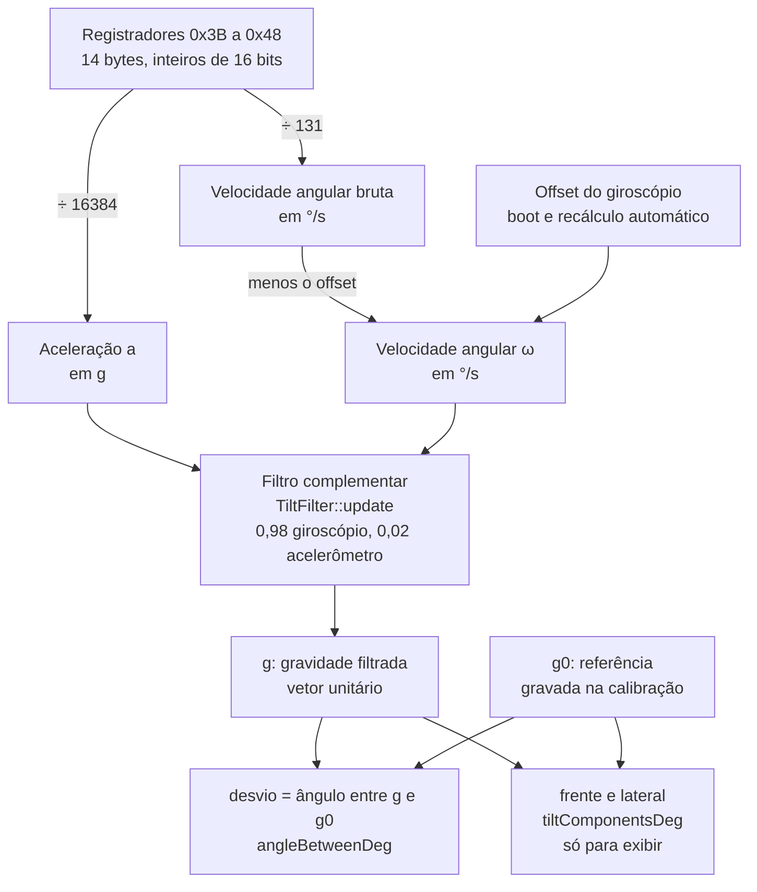
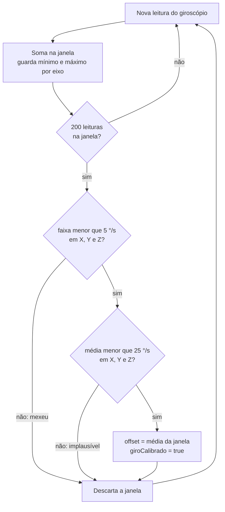

# 03 — Medição da inclinação do tronco

> Código: `src/mpu.h`, `src/mpu.cpp`, `src/sensors.cpp`, `src/tilt.h`, `src/tilt.cpp`, `src/config.h` · Relacionados: [referencia/mpu.md](referencia/mpu.md), [referencia/tilt.md](referencia/tilt.md), [referencia/sensors.md](referencia/sensors.md), [D-04 a D-07](10-decisoes-de-projeto.md#d-04)

## 1. O que precisa ser medido

O colete não precisa saber se o tronco está "na vertical". Precisa saber **quanto o tronco saiu da postura
correta daquela pessoa**. Cada corpo é diferente e o sensor nunca fica preso perfeitamente alinhado.
Por isso a medida central é o **desvio**: o ângulo entre a orientação atual e a orientação gravada na calibração.

O diagrama mostra o caminho completo, do registrador do sensor até o desvio em graus.

## 2. O sensor MPU-6050

O MPU-6050 tem um **acelerômetro** e um **giroscópio**, ambos de 3 eixos.

- O acelerômetro parado mede um vetor de módulo 1 g alinhado com a vertical. O código chama esse vetor de
  **gravidade** (`g`). Ele é absoluto (não acumula erro), mas tem ruído e também mede as acelerações do
  movimento (andar, sentar, uma batida).
- O giroscópio mede a velocidade de rotação em cada eixo (°/s). É suave e rápido, mas tem um erro
  constante (offset) que, integrado, faz o ângulo "derivar" com o tempo.

### Configuração (driver próprio, `Mpu6050::iniciar`)

| Registrador | Valor | Efeito |
|---|---|---|
| `PWR_MGMT_1` (0x6B) | 0x80, espera 100 ms | Reset do chip |
| `PWR_MGMT_1` (0x6B) | 0x01 | Acorda, usando o relógio do giroscópio X (mais estável que o oscilador interno) |
| `SMPLRT_DIV` (0x19) | 0x00 | Sem divisor de amostragem |
| `CONFIG` (0x1A) | 0x03 | Filtro passa-baixa interno (DLPF) em ~44 Hz: corta vibração e ruído acima disso |
| `GYRO_CONFIG` (0x1B) | 0x00 | Faixa ±250 °/s → 131 LSB por °/s |
| `ACCEL_CONFIG` (0x1C) | 0x00 | Faixa ±2 g → 16384 LSB por g |
| `ACCEL_CONFIG2` (0x1D) | 0x03 | Só na família MPU-6500 (clones com `WHO_AM_I` 0x70, 0x71, 0x73, 0x74): o filtro do acelerômetro fica neste registrador |

As faixas mais sensíveis (±250 °/s e ±2 g) são as do texto do TCC e bastam: o tronco não gira a mais de
250 °/s nem acelera mais que 2 g no uso normal.

### Leitura

- `Mpu6050::lerBruto` lê 14 bytes de uma vez a partir de `ACCEL_XOUT_H` (0x3B): aceleração X, Y, Z,
  temperatura (ignorada) e giroscópio X, Y, Z, cada um com 16 bits com sinal, byte alto primeiro.
- Conversão: $a = \text{bruto}/16384$ (g) e $\omega = \text{bruto}/131$ (°/s).
- Frequência: 200 Hz (`PERIODO_MPU_MS` = 5 ms), agendada em `sensores_atualizar`. O intervalo real entre
  leituras (`dt`) é medido com `micros()` e entra no filtro.
- Barramento I2C a 100 kHz (`MPU_I2C_HZ`), mais tolerante a fio longo no colete, com timeout de 20 ms.
- Endereço: procura em 0x68 e depois em 0x69 (pino AD0 solto ou em 3V3), atendendo as duas montagens.
- Robustez: 10 leituras seguidas com falha marcam o MPU como perdido (`ok_ = false`). A partir daí
  `sensores_atualizar` tenta encontrá-lo de novo a cada 2 s (`MPU_REINICIO_MS`). Cada tentativa segura a
  tarefa de controle por pouco tempo: alguns milissegundos de timeout do I2C enquanto o sensor não responde,
  e ~150 ms (esperas do reset do chip) na tentativa em que ele volta. Na reconexão o offset do giroscópio
  não é medido de novo: vale o anterior, e o recálculo automático cuida do resto.

## 3. Offset do giroscópio

Parado, o giroscópio não mede exatamente zero: cada eixo tem um offset de alguns °/s. Ele é medido e
subtraído de toda leitura (`Mpu6050::ler`).

- **No boot** (`Mpu6050::calibrarGiro`): 200 leituras com 5 ms de intervalo (~1 s). Se em algum eixo a
  diferença entre a maior e a menor leitura passar de 5 °/s (`GIRO_PARADO_DPS`), a placa mexeu e o offset
  **não** é gravado.
- **Recálculo automático** (`Mpu6050::acumularOffset`): a cada 200 leituras (~1 s a 200 Hz) o driver confere
  a janela. Se a placa ficou parada (faixa < 5 °/s em todos os eixos) e a média é plausível (< 25 °/s,
  `GIRO_OFFSET_MAX`), a média vira o novo offset. Isso cobre o caso de ligar o colete já vestido, quando o
  boot não consegue medir.

Sem offset o sistema continua funcionando: o filtro complementar corrige a deriva com o acelerômetro.
O offset só deixa a resposta a movimentos rápidos mais fiel.

## 4. Por que não usar ângulos de Euler (pitch e roll)

A forma comum de obter inclinação é calcular dois ângulos, pitch e roll, com fórmulas de `atan2` sobre os
eixos do acelerômetro. Essas fórmulas supõem o sensor **deitado** (eixo Z para cima), como na bancada.
No colete o sensor fica **em pé** nas costas (eixo Y para cima) e o eixo Z aponta para trás.

Nessa posição, uma fórmula do tipo $\text{atan2}(a_x, a_z)$ tem os dois argumentos pequenos e o segundo
troca de sinal quando o tronco passa pela vertical. Exemplo com 10° de inclinação lateral:

| Tronco | $a_x$ | $a_z$ | $\text{atan2}(a_x, a_z)$ |
|---|---|---|---|
| 2° para trás | 0,174 | −0,034 | 101,2° |
| 2° para a frente | 0,174 | +0,034 | 78,8° |

Um movimento real de 4° vira um salto de 22° no ângulo calculado. Com a biblioteca `MPU6050_light`
(sugerida no plano inicial) acontecia o mesmo: salto de ~20° perto da vertical com inclinação lateral.
O teste `test_desvio_sem_salto_perto_da_vertical` reproduz o cenário e garante que o método adotado não salta.

**Solução adotada:** trabalhar direto com o **vetor gravidade** e medir o ângulo entre dois vetores.
O ângulo entre vetores não tem singularidade, não depende de quais eixos do sensor apontam para onde e
dispensa saber como o sensor foi preso. Pitch e roll ficam só para exibição (seção 7).

## 5. Filtro complementar sobre o vetor gravidade

Acelerômetro e giroscópio erram de jeitos opostos: o primeiro é ruidoso no curto prazo e correto no longo
prazo; o segundo é suave no curto prazo e deriva no longo prazo. O **filtro complementar** junta o melhor
dos dois: o giroscópio segue os movimentos rápidos e o acelerômetro corrige a deriva devagar.

A diferença deste projeto é aplicar o filtro ao **vetor** gravidade (`TiltFilter`), e não a ângulos.
A cada leitura (`TiltFilter::update`, com $\omega$ convertido para rad/s):

**1. Previsão pelo giroscópio.** Um vetor fixo no mundo, visto por uma placa que gira com velocidade
angular $\vec\omega$, parece girar ao contrário:

$$\frac{d\vec g}{dt} = -\vec\omega \times \vec g = \vec g \times \vec\omega$$

Integrando um passo (método de Euler) e renormalizando para manter o vetor unitário:

$$\vec g_{prev} = \text{normalize}\big(\vec g + (\vec g \times \vec\omega)\,\Delta t\big)$$

**2. Correção pelo acelerômetro.** Mistura ponderada com a direção medida pelo acelerômetro:

$$\vec g = \text{normalize}\big(\alpha\,\vec g_{prev} + (1-\alpha)\,\hat a\big), \qquad \alpha = 0{,}98\ (\texttt{MPU\_FILTRO\_GIRO})$$

**3. Rejeição de aceleração.** Se o módulo medido $|\vec a|$ estiver fora de [0,7; 1,3] g, o acelerômetro
não está medindo só a gravidade (passo, batida, sentar de uma vez). Nesse instante vale só a previsão:
$\vec g = \vec g_{prev}$.

**4. Reinício.** Na primeira leitura, ou se $\Delta t \le 0$ ou $\Delta t > 0{,}5$ s (sensor reconectado,
pausa longa), o filtro recomeça com $\vec g = \hat a$ (`TiltFilter::reset`).

### Constante de tempo

Com $\alpha = 0{,}98$ e $\Delta t = 5$ ms, a constante de tempo do filtro é

$$\tau = \frac{\alpha\,\Delta t}{1-\alpha} = \frac{0{,}98 \times 0{,}005}{0{,}02} \approx 0{,}25\ \text{s}$$

ou seja, variações mais lentas que ~0,65 Hz ($1/2\pi\tau$) vêm do acelerômetro e as mais rápidas, do
giroscópio. Para postura (movimentos de segundos) a resposta é imediata e o ruído do acelerômetro fica
atenuado. Aumentar $\alpha$ (ex.: 0,99) deixa o sinal mais suave e a correção da deriva mais lenta.

### Por que este filtro

- Um parâmetro só ($\alpha$), comportamento previsível e custo mínimo de CPU.
- Só a inclinação interessa; a rotação em torno da vertical (olhar para o lado) não muda a postura e não
  precisa ser medida. Por isso não há magnetômetro nem estimativa de orientação completa.
- Sobre o vetor não existe ângulo "dando a volta" nem singularidade, qualquer que seja a montagem.

## 6. Desvio

$$\text{desvio} = \text{atan2}\big(|\vec g \times \vec g_0|,\ \vec g \cdot \vec g_0\big) \quad \text{(em graus, de 0 a 180)}$$

(`angleBetweenDeg`). É o ângulo total entre a orientação atual e a de referência, sem sinal.

Por que `atan2` e não `acos` do produto escalar:

- `acos` tem derivada infinita perto de 0°, justamente a região de trabalho (desvios pequenos): o erro de
  arredondamento do produto escalar vira erro grande de ângulo.
- `acos` exige vetores exatamente unitários; um produto escalar de 1,0000001 dá `NaN`. `atan2` só depende da
  razão entre os dois termos: funciona com qualquer módulo e nunca dá `NaN`.

Inclinações em direções diferentes se compõem como ângulo no espaço, não somando:

| Tronco | desvio | frente | lateral |
|---|---|---|---|
| 25° para a frente | 25,0° | 25,0° | 0,0° |
| 15° para o lado | 15,0° | 0,0° | 15,0° |
| 10° para a frente e 10° para o lado | 14,1° | 10,0° | 10,2° |

**Referência antes da calibração:** sem calibração, a referência é a primeira gravidade lida depois do boot
(`gBoot` em `main.cpp`). Serve só para o app mostrar que o sensor reage; o detector não alerta sem
calibração ([04](04-deteccao-e-calibracao.md)).

## 7. Frente/trás e lateral (só para exibir)

Para o app e o gráfico, o desvio é decomposto em dois ângulos com sinal (`tiltComponentsDeg`):

1. $\hat r = \text{normalize}(\vec g_0)$: a vertical da referência.
2. Eixo "frente" $\hat f$: o eixo Z da placa projetado no plano perpendicular a $\hat r$
   ($\hat f = \text{normalize}(\hat z - \hat r(\hat z \cdot \hat r))$). Se a placa estiver deitada
   ($|\hat z \cdot \hat r| > 0{,}9$, caso da bancada), usa o eixo Y.
3. Eixo lateral: $\hat l = \hat r \times \hat f$.
4. $\text{frente} = \text{atan2}(\vec g \cdot \hat f,\ \vec g \cdot \hat r)$ e
   $\text{lado} = \text{atan2}(\vec g \cdot \hat l,\ \vec g \cdot \hat r)$.

Com o sensor preso com os componentes para fora, inclinar o tronco para a frente dá `pitch` positivo.
Se o sensor for montado ao contrário, só o sinal do rótulo inverte; o desvio e o alerta não mudam (o app tem
as opções "Inverter frente/trás" e "Inverter lado" para corrigir a exibição).

## 8. Evidências (testes)

| Teste (`test/test_posture/test_main.cpp`) | O que garante |
|---|---|
| `test_angulo_entre_vetores` | 0°, 90°, 30° e 0,5° corretos (precisão em ângulo pequeno) |
| `test_desvio_sem_salto_perto_da_vertical` | Nenhum salto ao passar pela vertical com 10° de lateral |
| `test_componentes_frente_e_lado` | Decomposição frente/lateral com o sensor em pé |
| `test_componentes_com_sensor_de_cabeca_para_baixo` | Sensor girado 180° (pinos para cima): "frente" continua positivo para a frente |
| `test_componentes_com_placa_deitada` | Na bancada (placa deitada) troca o eixo de referência e não dá `NaN` |
| `test_filtro_converge_para_acelerometro` | Parado por 10 s, o filtro chega à direção do acelerômetro (erro < 0,5°) |
| `test_filtro_segue_giroscopio` | Com o acelerômetro em choque (2 g, ignorado), segue só o giroscópio: −90 °/s por 0,2 s = 18° |
| `test_filtro_reinicia_com_dt_grande` | Pausa de 2 s reinicia o filtro direto pelo acelerômetro |

Detalhes de todos os testes: [09](09-simulador-testes-ferramentas.md).

## 9. Limitações

- **Sinal do giroscópio no filtro.** A convenção $d\vec g/dt = \vec g \times \vec\omega$ foi conferida no papel,
  mas o simulador usa a mesma convenção do código e por isso não prova nada. A confirmação é no hardware
  (`VALIDACAO.md`, V2.6: inclinar rápido não pode dar "repique").
- **Acelerações longas** dentro de [0,7; 1,3] g (curva de carro, elevador) passam pela correção e distorcem um
  pouco o desvio durante o movimento; o tempo mínimo de 3 s antes de vibrar absorve a maior parte disso.
- **Rotação em torno da vertical** não é medida, de propósito: não muda a postura.
