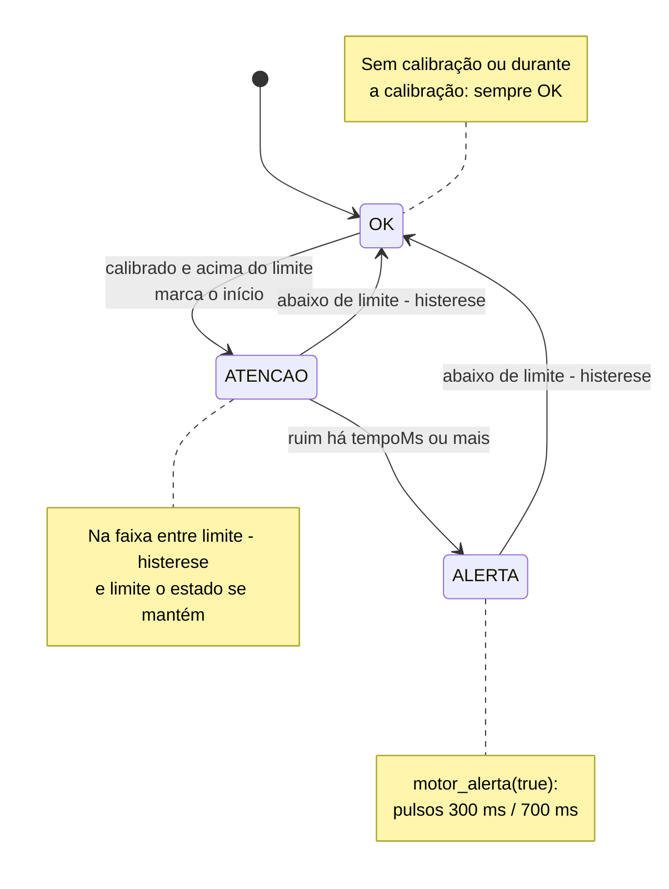
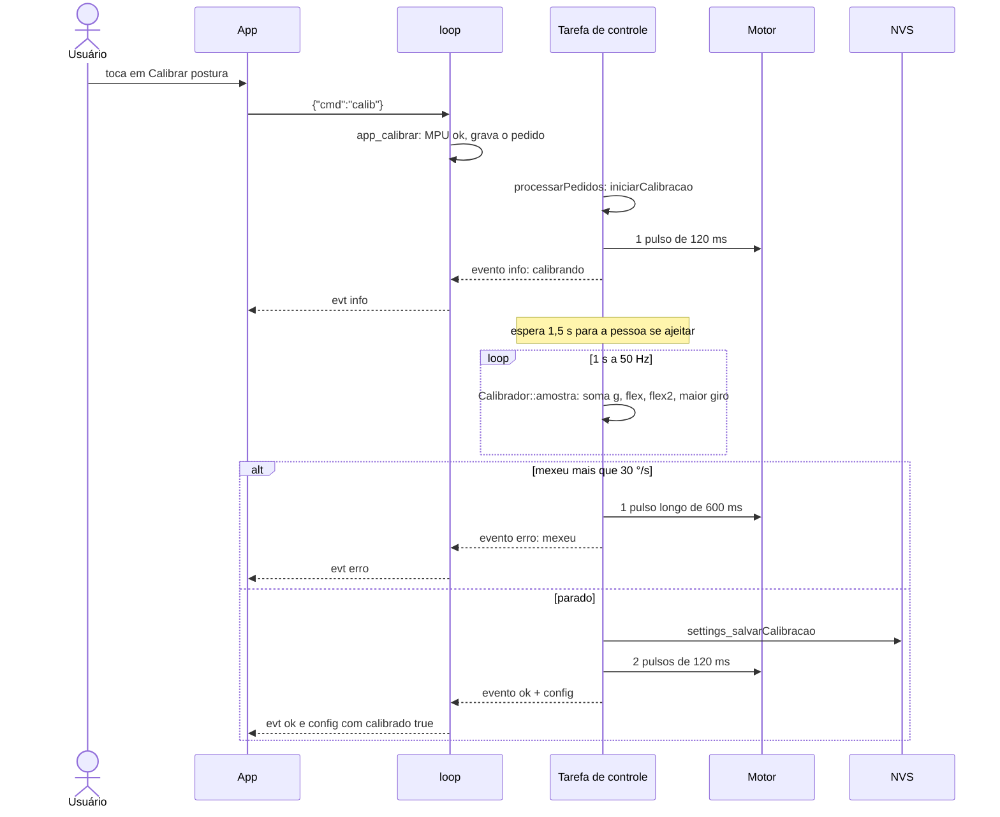

# 04 — Detecção de má postura e calibração

> Código: `src/posture.h`, `src/posture.cpp`, `src/main.cpp` (`atualizarPostura`, `iniciarCalibracao`, `concluirCalibracao`, `atualizarBotao`, `sensorAtivo`), `src/config.h` · Relacionados: [referencia/posture.md](referencia/posture.md), [referencia/main.md](referencia/main.md), [D-08 a D-10](10-decisoes-de-projeto.md#d-08)

## 1. Parâmetros

Os parâmetros da decisão ficam na struct `Params` e podem ser mudados pela serial (`set ...`) ou pelo app,
sem recompilar. São salvos na NVS ([06](06-motor-e-nvs.md)). Os padrões são folgados de propósito: funcionam
sem ajuste fino.

| Parâmetro | Significado | Padrão | Faixa aceita (`validarParams`) |
|---|---|---|---|
| `limiteGraus` | Desvio máximo aceito | 20° (`PADRAO_LIMITE_GRAUS`) | 2–60° |
| `histerese` | Margem abaixo do limite para sair do alerta (em ° para o MPU e em pontos % para o flex) | 3 (`PADRAO_HISTERESE`) | 0 até (menor limite − 1) |
| `tempoMs` | Tempo em má postura antes de vibrar (tempo mínimo) | 3000 ms (`PADRAO_TEMPO_MS`) | 0–60000 ms |
| `limiteFlex` | Curvatura máxima do flex em relação à calibração | 15% (`PADRAO_LIMITE_FLEX`) | 2–90% |
| `intensidade` | Força do motor (duty do PWM) | 100% (`PADRAO_INTENSIDADE`) | 0–100% |

`validarParams` prende cada valor na faixa (valor vindo da serial ou do app pode ser qualquer coisa, até
`NaN`, que vira o mínimo). A histerese precisa ser menor que os dois limites: se fosse igual ou maior,
"limite − histerese" seria zero ou negativo e a postura nunca sairia do alerta.

## 2. Regra de decisão

A cada 20 ms (50 Hz, `PERIODO_POSTURA_MS`), `atualizarPostura` monta uma `Entrada` e chama
`DetectorPostura::atualizar`. A regra tem três ingredientes:

1. **Limite.** A postura passa a contar como ruim quando **qualquer** sensor ativo passa do limite:

   ```
   acima  = desvio > limite
            OU (flex ativo  E flexPct  > limiteFlex)
            OU (flex 2 ativo E flex2Pct > limiteFlex)
   ```

2. **Histerese.** A postura só volta a contar como boa quando **todos** os sensores ativos ficam abaixo do
   limite menos a histerese:

   ```
   abaixo = desvio < limite − histerese
            E (flex inativo  OU flexPct  < limiteFlex − histerese)
            E (flex 2 inativo OU flex2Pct < limiteFlex − histerese)
   ```

   Entre os dois valores (por exemplo, desvio entre 17° e 20° com os padrões) o estado anterior é mantido.
   Sem essa faixa, um desvio oscilando em torno de 20° ligaria e desligaria o motor sem parar.

3. **Tempo mínimo.** A má postura só vira **alerta** (motor) depois de durar `tempoMs`. Um movimento
   rápido (pegar algo no chão, amarrar o sapato) não vibra.

Mais duas regras de segurança:

- **Sem calibração, nunca alerta** ([D-09](10-decisoes-de-projeto.md#d-09)): sem referência não existe
  "postura correta", e vibrar contra uma referência arbitrária seria incômodo e errado.
- **Sem MPU** (fio solto), o desvio é tratado como 0 e só o flex pode alertar.

### Máquina de estados

O diagrama mostra os três estados do `DetectorPostura` e o que faz mudar de um para outro.



| Estado | Nome no JSON | Motor | Cor no app |
|---|---|---|---|
| `ESTADO_OK` | `ok` | desligado | verde |
| `ESTADO_ATENCAO` | `atencao` | desligado (contando o tempo) | amarelo |
| `ESTADO_ALERTA` | `alerta` | pulsando | vermelho |

Detalhes:

- O tempo conta a partir da entrada em "ruim" e **não** recomeça enquanto o desvio fica na faixa da histerese.
- Com `tempoMs = 0` o estado vai direto de ok para alerta na mesma atualização.
- `tempoRuimMs` (no status e no app) é há quanto tempo a postura está ruim; o app usa para a barra de contagem.

### Exemplo com os padrões (limite 20°, histerese 3°, tempo 3 s)

| t (s) | desvio | Estado | Por quê |
|---|---|---|---|
| 0 | 10° | ok | abaixo do limite |
| 1 | 25° | atenção | passou de 20°: começa a contar |
| 2 | 25° | atenção | ruim há 1 s |
| 4 | 25° | **alerta** | ruim há 3 s: motor começa a pulsar |
| 5 | 18° | **alerta** | 18° está entre 17° e 20°: mantém |
| 6 | 16° | ok | abaixo de 17°: motor para |
| 10 | 30° | atenção | pico |
| 11 | 15° | ok | voltou antes de 3 s: **não vibrou** |

## 3. Calibração

A calibração grava a **postura correta** da pessoa: o vetor gravidade `g0` e as leituras dos flex
(`flex0`, `flex20`). Tudo o que o detector mede é relativo a ela.

### Como é pedida

| Origem | Como | Caminho no código |
|---|---|---|
| Botão (GPIO27) | Apertar (estável por 50 ms, `BOTAO_DEBOUNCE_MS`) | `atualizarBotao` → `iniciarCalibracao(ORIGEM_BOTAO)`, direto na tarefa de controle |
| Serial | `calib` ou `calibrar` | `app_calibrar(ORIGEM_SERIAL)` → pedido |
| Serial (BioSpine V3) | `CALIBRATE` | `app_calibrar(ORIGEM_SERIAL_JSON)` → pedido; responde JSON ao terminar |
| App | `{"cmd":"calib"}` | `protocolo_comando` → `app_calibrar(ORIGEM_APP)` → pedido |

`app_calibrar` (no loop) recusa na hora se o MPU não estiver respondendo. Os pedidos vindos do loop são
executados pela tarefa de controle no passo seguinte (`processarPedidos`), como explicado em [02](02-arquitetura.md).

### Etapas

1. **Início** (`iniciarCalibracao`): se já houver uma calibração em andamento, o pedido é ignorado. Senão,
   zera o detector, dá **1 pulso curto** (120 ms, `MOTOR_CONFIRMA_MS`: "começou, fique parado") e avisa
   a serial e o app.
2. **Espera** de 1,5 s (`CALIBRACAO_ESPERA_MS`): tempo para a pessoa soltar o botão e se ajeitar.
   O movimento de apertar o botão não entra na média.
3. **Média** durante 1 s (`CALIBRACAO_MS`): a cada atualização de postura (50 Hz, ~50 amostras),
   `Calibrador::amostra` soma o vetor gravidade, as leituras dos dois flex e guarda a maior velocidade angular.
4. **Conclusão** (`concluirCalibracao`):
   - Se a maior velocidade angular passou de 30 °/s (`CALIBRACAO_GIRO_MAX`), a pessoa se mexeu: a calibração
     é **recusada** com **1 pulso longo** (600 ms, `MOTOR_ERRO_MS`) e a calibração anterior continua valendo.
   - Senão: `g0` = direção média (soma dos vetores normalizada); `flex0`/`flex20` = média da leitura, só se o
     sensor estiver detectado (ou forçado ligado), senão 0. Grava na NVS, zera o detector,
     dá **2 pulsos curtos** ("pronto") e avisa a serial e o app (que recebe também a nova config, com `calibrado: true`).

Durante a calibração o estado fica forçado em ok e o motor não alerta.

A sequência mostra uma calibração pedida pelo app, do toque no botão até a confirmação.



### Por que assim

- **Média em vez de leitura única:** reduz o ruído da referência; somar os vetores e normalizar dá a direção média.
- **Espera antes da média:** quem aperta o botão nas costas mexe o tronco; a espera tira esse movimento.
- **Recusa se mexer:** uma referência gravada em movimento faria o colete vibrar na postura correta.
  É melhor recusar e pedir de novo, com retorno pela vibração (dá para calibrar sem olhar tela nenhuma).
- **Flex só se detectado:** gravar a referência de um pino solto criaria um flex "fantasma" na detecção.

## 4. Quando um flex entra na decisão

O flex só entra na regra se estiver **ativo** (`sensorAtivo` em `main.cpp`), o que depende do modo
configurado, da detecção automática ([05](05-sensores-analogicos.md)) e de a referência ter sido gravada com
ele ligado (100 ≤ referência ≤ 4000, `ADC_MIN_VALIDO`/`ADC_MAX_VALIDO`).

| Modo (`flexModo`, `flex2Modo`) | Detectado? | Referência válida? | Entra na decisão? | `get` mostra |
|---|---|---|---|---|
| `off` | qualquer | qualquer | não | desligado |
| `on` | qualquer | sim | sim | ativo |
| `on` | qualquer | não | não | não detectado, ou detectado, recalibre para usar |
| `auto` | sim | sim | sim | ativo |
| `auto` | sim | não | não | detectado, recalibre para usar |
| `auto` | não | qualquer | não | não detectado |

Padrões: flex 1 em `auto`, flex 2 em `off` ([D-11](10-decisoes-de-projeto.md#d-11)).
No modo `auto`, um flex que solta depois da calibração sai da decisão sozinho (deixa de ser detectado) e o colete
segue só com o MPU. **No modo `on` isso não acontece:** o modo forçado ignora a detecção, então um flex solto
(leitura ~0, curvatura ~100%) dispara o alerta. Use `on` só para teste. Um flex ligado depois da calibração só
entra depois de recalibrar.

## 5. Evidências (testes)

| Teste | O que garante |
|---|---|
| `test_sem_calibracao_nunca_alerta` | Sem calibração, nem desvio de 80° por 10 s alerta |
| `test_atencao_e_depois_alerta` | ok → atenção → alerta só depois de `tempoMs` |
| `test_histerese` | Fica em alerta na faixa entre limite − histerese e limite; sai abaixo dela |
| `test_pico_curto_nao_alerta` | Pico menor que `tempoMs` não vibra, e a contagem recomeça do zero no pico seguinte |
| `test_flex_dispara_e_respeita_histerese` | Flex sozinho leva ao alerta e respeita a histerese |
| `test_flex_inativo_e_ignorado` | Flex inativo não influencia, mesmo em 100% (flex solto lê 0) |
| `test_flex2` | Flex 2 sozinho acima do limite já leva a atenção (entra no OU), com o flex 1 em 0% |
| `test_flex_pct` | Fórmula da curvatura e casos de borda |
| `test_validar_params` | Faixas, `NaN` e histerese menor que os limites |
| `test_calibrador_media` | Espera, coleta, média e maior giro do calibrador |

O fluxo completo (botão, pulsos, recusa, NVS) é exercitado no simulador pelos roteiros de `tools/`
([09](09-simulador-testes-ferramentas.md)).
