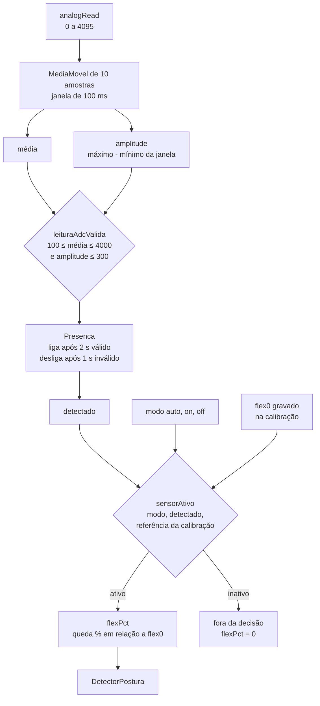
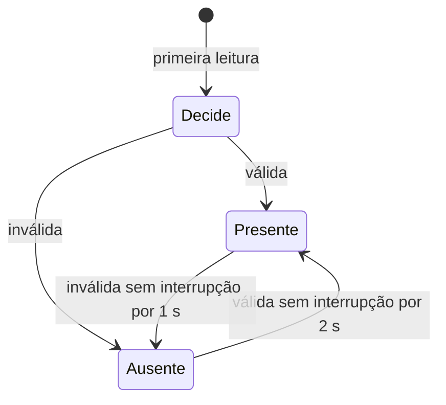

# 05 — Sensores analógicos: flex e FSR

> Código: `src/sensors.h`, `src/sensors.cpp`, `src/filters.h`, `src/posture.cpp` (`flexPct`), `src/main.cpp` (`sensorAtivo`), `src/config.h` · Relacionados: [referencia/sensors.md](referencia/sensors.md), [referencia/filters.md](referencia/filters.md), [D-11](10-decisoes-de-projeto.md#d-11)

## 1. Papel de cada sensor

| Sensor | Pino | Entra no alerta? | Padrão |
|---|---|---|---|
| Flex 1 | GPIO34 | sim, se ativo | modo `auto` |
| Flex 2 | GPIO35 | sim, se ativo | modo `off` |
| FSR (pressão, montagem BioSpine) | GPIO32 | **não**: só telemetria | sempre lido |

O MPU mede a inclinação do tronco; o flex mede a **curvatura** da coluna (a pessoa pode "corcundar" sem
inclinar muito o tronco). Os dois se completam, mas o colete **não depende do flex**: sem ele, segue só com o MPU.

## 2. Circuito e leitura

O flex é um resistor que aumenta quando dobra (~10 kΩ reto, tolerância ±30%). Ligado num divisor de tensão
com um resistor fixo de 10 kΩ:

```
3V3 ── flex ──┬── GPIO34
              └── 10 kΩ ── GND
```

$$V_{34} = 3{,}3\ \text{V} \times \frac{10\ \text{k}\Omega}{R_{flex} + 10\ \text{k}\Omega}$$

| Situação | $R_{flex}$ | $V_{34}$ | Leitura (0–4095) | Curvatura (`flexPct`) |
|---|---|---|---|---|
| Reto | ~10 kΩ | ~1,65 V | ~2048 (na prática 1800–2300) | 0% (é a referência) |
| Dobrado | ~20 kΩ | ~1,10 V | ~1365 | ~33% |
| Falta o resistor de 10 kΩ | — | ~3,3 V | ~4095 | inválido |
| Flex solto ou quebrado | aberto | ~0 V | ~0 | inválido |

**Ao dobrar, a leitura cai.** Por isso a curvatura é a queda relativa à leitura da calibração.

Configuração do ADC (`sensores_iniciar`): 12 bits (`analogReadResolution(12)`) e atenuação de 11 dB por pino
(faixa até ~3,3 V; o ADC do ESP32 é pouco linear nas pontas, o que não atrapalha porque só importa a variação
relativa). Todos os sensores ficam no **ADC1**: o ADC2 não funciona com o Wi-Fi ligado.

## 3. Do pino à decisão

O diagrama mostra o que acontece com cada leitura, a 100 Hz (`PERIODO_ADC_MS` = 10 ms).



### Média móvel (`MediaMovel<N>`)

Buffer circular de N = 10 amostras (`ADC_MEDIA_N`) com soma acumulada: cada amostra nova entra e a mais
antiga sai, sem somar a janela inteira de novo. Tira o ruído do ADC (que aumenta com o Wi-Fi ligado).
Também calcula a **amplitude** da janela (máximo − mínimo), usada para reconhecer pino solto.

### Leitura plausível (`leituraAdcValida`)

Um divisor resistivo de verdade dá leitura **dentro da faixa** e **estável**. Um pino solto ou um flex
quebrado falha numa das duas:

- média abaixo de 100 (`ADC_MIN_VALIDO`): flex solto ou quebrado;
- média acima de 4000 (`ADC_MAX_VALIDO`): falta o resistor de 10 kΩ;
- amplitude acima de 300 (`ADC_RUIDO_MAX`): pino flutuando ou mau contato (oscila muito mais que um divisor).

### Presença com persistência (`Presenca`)

A validade de uma janela só vira "sensor detectado" se durar. Assim o flex não "pisca" entre ativo e inativo
por causa de um ruído.



- Os tempos são `FLEX_LIGA_MS` (2 s) e `FLEX_DESLIGA_MS` (1 s). Qualquer leitura que concorde com o estado
  atual reinicia a contagem.
- **Flex 1** decide já no boot, depois de encher a média: ligado e bom, fica detectado na hora.
- **Flex 2** e **FSR** começam ausentes e só ficam presentes depois de 2 s de leitura estável.

### Curvatura (`flexPct`)

$$\text{flexPct} = \text{clamp}\left(\frac{\text{flex0} - \text{leitura}}{\text{flex0}} \times 100,\ 0,\ 100\right)$$

- `flex0` é a leitura média gravada na calibração (postura correta).
- Leitura maior que a referência (o flex "esticou") dá 0%, nunca negativo.
- Sem referência (`flex0` < 1) dá 0%.
- A curvatura é relativa e não está em graus: o valor de uma "corcunda" típica depende do flex e de onde ele
  está preso. Por isso o limite (`limiteFlex`, 15% por padrão) é ajustável pelo app.

## 4. O "fantasma" do ADC e o flex 2

O ADC do ESP32 tem um único conversor com um capacitor de amostragem compartilhado entre os pinos.
Um pino **solto** lido logo depois de um pino ligado devolve aproximadamente a tensão do pino anterior,
porque o capacitor ainda guarda a carga. Os ADCs são lidos na ordem flex 1 → flex 2 → FSR. Com o GPIO35
solto, o flex 2 "copia" o flex 1: leitura plausível e estável, igual a um sensor de verdade.

Consequências no código:

- **Flex 2 começa desligado** (`configPadrao`: `flex2Modo = MODO_OFF`). Quem tem o segundo flex liga com
  `set flex2 auto` (ou pelo app) e recalibra ([D-11](10-decisoes-de-projeto.md#d-11)).
- **FSR "fantasma":** uma leitura do FSR a menos de 300 (`ADC_FANTASMA_DIF`) da leitura do flex 1 é tratada
  como cópia e não conta para a detecção.

## 5. FSR

O sensor de pressão da montagem BioSpine V3 é só **telemetria** (aparece no app, no `diag` e no JSON
`pressure` dos comandos BioSpine). Detecção: leitura acima de 200 (`FSR_LIMIAR`), estável e não fantasma,
durante 2 s. Como um FSR sem pressão lê perto de 0 (igual a pino solto), **depois de detectado uma vez ele
fica detectado até reiniciar** (`Presenca` com tempo de desligar infinito).

## 6. Mensagens de diagnóstico

O `diag` usa as mesmas regras para dizer o que está errado:

| Leitura do flex 1 | Mensagem | Causa provável |
|---|---|---|
| ~2000, ✅ | dobre o sensor e veja o valor mudar | ok |
| ~4095, ❌ | falta o resistor de 10 kΩ | resistor fora do divisor |
| ~0, ❌ | flex solto ou quebrado | fio solto, flex quebrado na base |
| outro, ❌ | leitura instável: mau contato? | protoboard, jumper frouxo |

Nos três casos de ❌ o colete continua só com o MPU, desde que o flex esteja no modo `auto` (padrão). No modo
`on` a detecção é ignorada: o flex fica na decisão mesmo solto e a curvatura ~100% dispara o alerta.

## 7. Evidências (testes)

| Teste | O que garante |
|---|---|
| `test_media_movel` | Média, janela cheia, descarte da amostra mais antiga, amplitude, última amostra |
| `test_presenca_com_persistencia` | Liga só depois de 2 s válidos sem interrupção; ruído reinicia a contagem; desliga após 1 s |
| `test_leitura_adc_valida` | Aceita divisor normal; recusa ~4095, ~0 e pino flutuando |
| `test_flex_pct` | 0% na referência, 25% com queda de 25%, 0% esticado, 0% sem referência |
| `test_flex_inativo_e_ignorado` | Flex inativo não alerta, mesmo em 100% |

Flex desconectado em uso, flex 2 e FSR também são cobertos pelos roteiros do simulador ([09](09-simulador-testes-ferramentas.md)).
