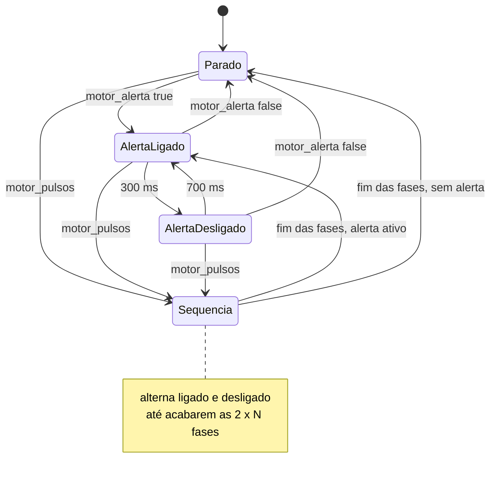

# 06 — Motor vibratório e memória não volátil (NVS)

> Código: `src/motor.h`, `src/motor.cpp`, `src/settings.h`, `src/settings.cpp`, `src/config.h` · Relacionados: [referencia/motor.md](referencia/motor.md), [referencia/settings.md](referencia/settings.md), [D-14, D-15](10-decisoes-de-projeto.md#d-14)

## 1. Circuito do motor

O motor tipo moeda consome ~60 mA; um GPIO do ESP32 não fornece isso. O GPIO25 comanda um transistor NPN
que funciona como chave do lado do terra:

```
3V3 ──┬── motor (+ vermelho)
      │      │ (− azul)
      └─|◄─┘  diodo em paralelo (listra no 3V3)
             │
          coletor
GPIO25 ── 1 kΩ ── base   NPN (2N2222 / BC337)
          emissor
             │
            GND
```

- Com o GPIO em nível alto, a corrente de base é ~(3,3 − 0,7) V / 1 kΩ ≈ 2,6 mA, suficiente para saturar
  o transistor com os 60 mA do motor.
- O **diodo** absorve o pico de tensão que a bobina do motor gera ao desligar e que queimaria o transistor.
- O **capacitor de 100 µF** (opcional) perto do motor fornece o pico de corrente da partida, para a tensão
  não cair e reiniciar o ESP32.

## 2. PWM

O motor é ligado por PWM do periférico LEDC (`motor_iniciar`), canal 0, **20 kHz** (`MOTOR_LEDC_FREQ`),
8 bits (`MOTOR_LEDC_BITS`, duty de 0 a 255).

- **Intensidade:** duty = 255 × `intensidade` / 100. Muda pela serial (`set motor 50`) ou pelo app; vale
  para alertas, confirmações e testes.
- **Por que 20 kHz:** PWM na faixa audível faz a bobina do motor "chiar". A 20 kHz o chiado fica acima do
  que se ouve.
- **LED da placa (GPIO2)** acende e apaga junto com o motor. Serve de diagnóstico: LED acendendo sem o motor
  vibrar indica problema no circuito do motor, não no firmware.
- O código compila nos cores Arduino-ESP32 2.x (`ledcSetup` + `ledcAttachPin`, escrita por canal) e 3.x
  (`ledcAttach`, escrita por pino), escolhendo pela macro `ESP_ARDUINO_VERSION_MAJOR`.

## 3. Padrões de vibração

O motor também é a interface com o usuário quando não há celular: cada situação tem um padrão diferente.

| Situação | Padrão | Constantes | Chamado por |
|---|---|---|---|
| Ligou | 1 pulso de 120 ms | `MOTOR_CONFIRMA_MS` | `setup` |
| Calibração começou ("fique parado") | 1 pulso de 120 ms | `MOTOR_CONFIRMA_MS` | `iniciarCalibracao` |
| Calibração concluída | 2 pulsos de 120 ms, 120 ms entre eles | `MOTOR_CONFIRMA_MS` | `concluirCalibracao` |
| Calibração recusada (mexeu) | 1 pulso longo de 600 ms | `MOTOR_ERRO_MS` | `concluirCalibracao` |
| Teste (`motor`, `diag`, botão do app) | 1 pulso de 1 s | `MOTOR_TESTE_MS` | `processarPedidos` |
| **Alerta de postura** | 300 ms ligado / 700 ms desligado, enquanto durar | `MOTOR_ALERTA_ON_MS`, `MOTOR_ALERTA_OFF_MS` | `atualizarPostura` → `motor_alerta` |

Pulsos incomodam menos que vibração contínua e continuam sendo percebidos (o corpo se acostuma com
estímulo constante).

## 4. Lógica do motor

O módulo não usa `delay()`: guarda a fase atual e o instante em que ela começou (`marco`), e
`motor_atualizar` (chamada a cada passo da tarefa de controle) troca de fase quando o tempo dela acaba.
Há duas fontes de vibração:

- **Alerta** (`motor_alerta(ativo)`): chamado a cada atualização de postura com `estado == ESTADO_ALERTA`.
  Só age quando o valor muda. Ao ativar, já começa ligado (resposta imediata).
- **Sequência** (`motor_pulsos(quantidade, ligadoMs, desligadoMs)`): confirmações e testes. Cada pulso tem
  duas fases (ligado e desligado), então uma sequência tem 2 × `quantidade` fases.

**A sequência tem prioridade.** Se um alerta começar ou terminar durante uma sequência, o novo valor é guardado
e aplicado quando a sequência acabar. Uma sequência nova substitui a anterior.



## 5. Memória não volátil (NVS)

O ESP32 **não tem EEPROM**. A biblioteca `Preferences` grava pares chave–valor numa partição da flash
(NVS, *non-volatile storage*), com distribuição de desgaste feita pelo próprio ESP-IDF. Os parâmetros e a
calibração sobrevivem a desligar a placa.

Namespace: `colete`.

| Chave | Tipo | Campo | Padrão ao ler |
|---|---|---|---|
| `limite` | float | `Params::limiteGraus` | 20 |
| `hist` | float | `Params::histerese` | 3 |
| `tempo` | uint32 | `Params::tempoMs` | 3000 |
| `flexlim` | float | `Params::limiteFlex` | 15 |
| `motor` | uint8 | `Params::intensidade` | 100 |
| `flexmodo` | uint8 | `Config::flexModo` (0 auto, 1 on, 2 off) | 0 (auto) |
| `flex2modo` | uint8 | `Config::flex2Modo` | 2 (off) |
| `cal_ok` | bool | `Calibracao::valida` | false |
| `g0x`, `g0y`, `g0z` | float | `Calibracao::g0` | 0, 1, 0 |
| `flex0` | float | `Calibracao::flex0` | 0 |
| `flex20` | float | `Calibracao::flex20` | 0 |

### Leitura (`settings_carregar`, no `setup`)

- Chave ausente (placa nova) usa o padrão de `configPadrao()`.
- Os parâmetros passam por `validarParams`: um valor corrompido não deixa o colete num estado absurdo.
- Modo de sensor fora de 0–2 vira `auto`.
- Calibração com |g0| < 0,5 é considerada inválida (`valida = false`): o colete pede nova calibração.

### Gravação

| Função | Grava | Quando | Tarefa |
|---|---|---|---|
| `settings_salvarConfig` | as 7 chaves de configuração | `app_definirConfig`: `set` e `reset` da serial, `set` e `reset` do app | loop |
| `settings_salvarCalibracao` | as 6 chaves de calibração | `concluirCalibracao`, quando a calibração é aceita | controle |

- `reset` (serial ou app) volta a configuração ao padrão e **mantém a calibração**.
- Só há gravação por ação do usuário, então o desgaste da flash é desprezível.
