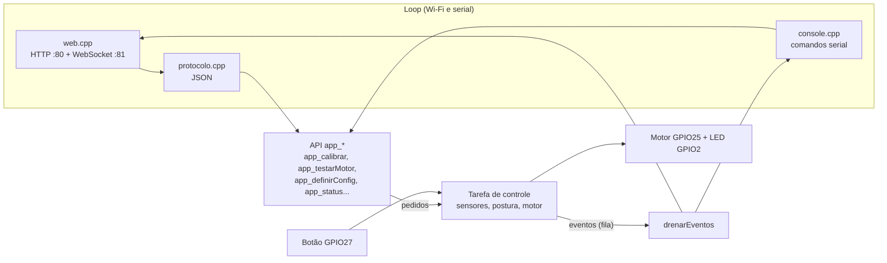
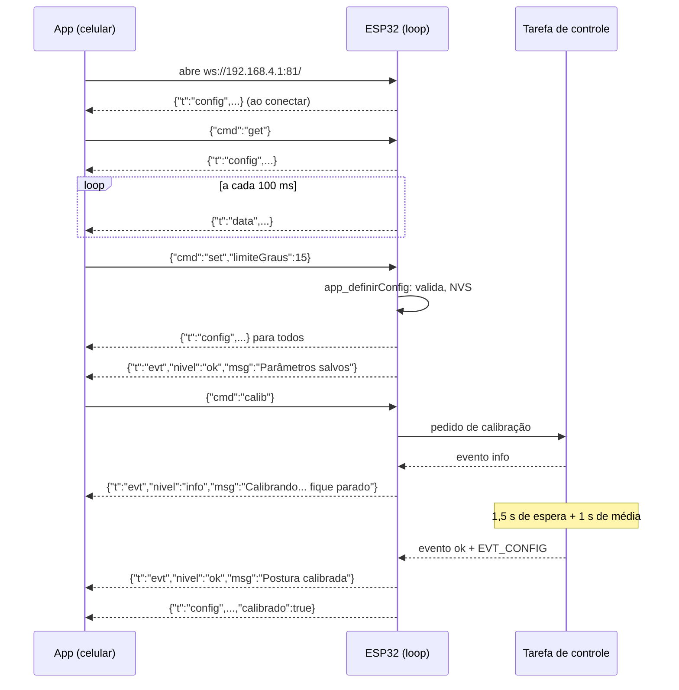
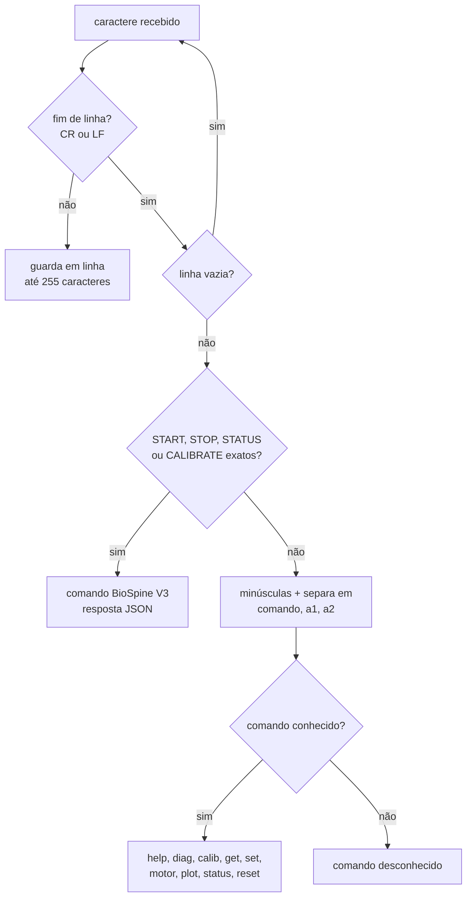

# 07 — Protocolo e interfaces

> Código: `src/protocolo.h`, `src/protocolo.cpp`, `src/web.h`, `src/web.cpp`, `src/console.h`, `src/console.cpp`, `src/app.h` · Relacionados: [referencia/protocolo](referencia/protocolo.md), [referencia/web](referencia/web.md), [referencia/console](referencia/console.md), [08 — App web](08-app-web.md), [02 — Arquitetura](02-arquitetura.md)

O colete tem quatro formas de interação. Só a primeira é necessária: o colete **funciona sozinho**.

| Interface | Meio | Para quê |
|---|---|---|
| Botão + motor | GPIO27 / GPIO25 | calibrar e receber o alerta (vibração) sem nenhum outro aparelho |
| App web | Wi-Fi (AP próprio) + HTTP + WebSocket | ver o desvio em tempo real, gráfico, 3D, ajustar parâmetros, calibrar |
| Serial | USB, 115200 baud | diagnóstico da montagem (`diag`), ajustes, gráfico para o TCC (`plot`) |
| BioSpine V3 | USB (mesma serial) | compatibilidade com os comandos e o JSON do projeto BioSpine V3 |

Todas as interfaces de software rodam no **loop** e chegam ao núcleo pela API `app_*` (`src/app.h`); a exceção é o
`diag`, que lê os sensores direto (`sensores()`, `sensores_scanI2C`, `digitalRead` do botão).
O diagrama mostra esse caminho.



---

## 1. Rede e HTTP

| Item | Valor | Constante |
|---|---|---|
| Rede (SSID) | `BioSpine` | `WIFI_SSID` |
| Senha (WPA2) | `colete123` | `WIFI_SENHA` |
| IP do colete | `192.168.4.1` (padrão do Access Point do ESP32) | — |
| Página | `http://192.168.4.1` (porta 80) | `HTTP_PORTA` |
| WebSocket | `ws://192.168.4.1:81/` | `WS_PORTA` |
| Potência do rádio | 11 dBm | `web_iniciar` |

Rotas HTTP (as quatro rotas servidas levam `Cache-Control: no-cache`; o redirecionamento 302 não):

| Caminho | Conteúdo |
|---|---|
| `/` e `/index.html` | a página do app (`src/web/index.html`, embutida na flash) |
| `/manifest.json` | manifest para "Adicionar à tela inicial" |
| `/icon.svg` | ícone do app |
| qualquer outro | `302` para `http://192.168.4.1/` |

A página calcula a porta do WebSocket como "porta da página + 1" (80 → 81). É isso que permite o
`tools/mock_server.py` e o `tools/sim_web.py` servirem a mesma página em 8080 com o WebSocket em 8081.

No celular: conectar no Wi-Fi `BioSpine`, tocar em **Manter conexão** quando o Android avisar "sem
internet" e, se a página não carregar, **desligar os dados móveis**.

---

## 2. Protocolo WebSocket (JSON)

Mensagens de texto, um objeto JSON por mensagem. O ESP32 identifica o tipo pelo campo `t`; o app manda
comandos com o campo `cmd`. Definição resumida também no topo de `src/protocolo.h`.

### 2.1 ESP32 → app: `{"t":"data"}` — 10 Hz

Enviado pelo `loop` a cada `PERIODO_ENVIO_MS` (100 ms) para todos os clientes, montado por
`protocolo_dados` a partir do `Status`. Ângulos e porcentagens com 1 casa decimal.

| Campo | Tipo | Unidade | Descrição |
|---|---|---|---|
| `t` | texto | — | sempre `"data"` |
| `pitch` | número | ° | frente/trás em relação à referência (positivo = tronco para a frente, com o sensor montado com os componentes para fora) |
| `roll` | número | ° | inclinação lateral em relação à referência |
| `desvio` | número | ° | desvio total (o que decide o alerta) |
| `flex` | inteiro | ADC 0–4095 | média móvel do flex 1 |
| `flexPct` | número | % | curvatura do flex 1 (0 se inativo) |
| `flexAtivo` | bool | — | flex 1 entra na detecção |
| `flexDetectado` | bool | — | flex 1 parece ligado |
| `flex2`, `flex2Pct`, `flex2Ativo`, `flex2Detectado` | — | — | o mesmo para o flex 2 |
| `fsr` | inteiro | ADC 0–4095 | sensor de pressão (só telemetria) |
| `fsrDetectado` | bool | — | já leu pressão estável desde o boot |
| `estado` | texto | — | `"ok"`, `"atencao"` ou `"alerta"` |
| `tempoRuimMs` | inteiro | ms | há quanto tempo a postura está ruim (0 se boa) |
| `calibrado` | bool | — | existe calibração (sem ela não vibra) |
| `calibrando` | bool | — | calibração em andamento |
| `mpuOk` | bool | — | MPU-6050 respondendo |
| `motor` | bool | — | motor ligado neste instante |
| `uptime` | inteiro | ms | `millis()` do envio (tempo desde o boot) |

Exemplo:

```json
{"t":"data","pitch":12.3,"roll":-1.2,"desvio":12.4,"flex":1873,"flexPct":6.5,"flexAtivo":true,"flexDetectado":true,"flex2":2051,"flex2Pct":0,"flex2Ativo":false,"flex2Detectado":false,"fsr":0,"fsrDetectado":false,"estado":"ok","tempoRuimMs":0,"calibrado":true,"calibrando":false,"mpuOk":true,"motor":false,"uptime":81234}
```

### 2.2 ESP32 → app: `{"t":"config"}`

Enviado **ao conectar** e em resposta a `get` (só para quem pediu), e **depois de toda mudança**
(`set`, `reset`, fim da calibração) para todos. Montado por `protocolo_config`.

| Campo | Tipo | Unidade | Faixa aceita | Descrição |
|---|---|---|---|---|
| `t` | texto | — | — | sempre `"config"` |
| `limiteGraus` | número | ° | 2–60 | limite do desvio |
| `histerese` | número | ° / pontos % | 0 até (menor limite − 1) | margem para sair do alerta |
| `tempoMs` | inteiro | ms | 0–60000 | tempo mínimo em má postura antes de vibrar |
| `limiteFlex` | número | % | 2–90 | limite da curvatura do flex |
| `intensidade` | inteiro | % | 0–100 | força do motor no alerta |
| `flexModo` | texto | — | `auto`, `on`, `off` | modo do flex 1 |
| `flex2Modo` | texto | — | `auto`, `on`, `off` | modo do flex 2 |
| `calibrado` | bool | — | — | existe calibração |
| `versao` | texto | — | — | `FIRMWARE_VERSAO` |

```json
{"t":"config","limiteGraus":20,"histerese":3,"tempoMs":3000,"limiteFlex":15,"intensidade":100,"flexModo":"auto","flex2Modo":"off","calibrado":true,"versao":"1.0.0"}
```

### 2.3 ESP32 → app: `{"t":"evt"}` — avisos

| Campo | Tipo | Descrição |
|---|---|---|
| `t` | texto | sempre `"evt"` |
| `nivel` | texto | `"info"`, `"ok"` ou `"erro"` (cor do aviso no app) |
| `msg` | texto | mensagem curta para mostrar como toast |

Avisos que o firmware envia:

| Situação | `nivel` | `msg` |
|---|---|---|
| calibração começou | info | Calibrando... fique parado |
| calibração concluída | ok | Postura calibrada |
| calibração recusada (mexeu > 30 °/s) | erro | Mexeu durante a calibração: tente de novo |
| pedido de calibração sem MPU | erro | MPU-6050 não encontrado |
| MPU caiu / voltou | erro / ok | MPU-6050 desconectado / MPU-6050 reconectado |
| `set` aplicado | ok | Parâmetros salvos |
| `reset` aplicado | ok | Parâmetros padrão restaurados |
| JSON inválido | erro | comando inválido |
| `cmd` desconhecido | erro | comando desconhecido |

### 2.4 App → ESP32: comandos

| Comando | Campos | Efeito | Resposta |
|---|---|---|---|
| `{"cmd":"get"}` | — | nada | `{"t":"config"}` só para quem pediu |
| `{"cmd":"set", ...}` | qualquer subconjunto de `limiteGraus`, `histerese`, `tempoMs`, `limiteFlex`, `intensidade` (números) e `flexModo`, `flex2Modo` (texto) | valida (prende nas faixas), aplica e salva na NVS | `{"t":"config"}` para todos + evt "Parâmetros salvos" |
| `{"cmd":"reset"}` | — | parâmetros e modos de fábrica (a calibração fica) | `{"t":"config"}` para todos + evt |
| `{"cmd":"calib"}` | — | calibração (igual ao botão) | evts info → ok/erro + `{"t":"config"}` |
| `{"cmd":"motor_test"}` | — | vibra 1 s | — |

Regras do `set`:
- O app manda **só os campos que mudaram** (mensagem curta e não sobrescreve um ajuste feito ao mesmo
  tempo pela serial ou por outro celular).
- Campo com tipo errado é ignorado; texto inválido em `flexModo`/`flex2Modo` também.
- Valor fora da faixa não dá erro: é preso no limite mais próximo (`validarParams`) e o `config` de volta
  mostra o valor realmente aplicado.

### 2.5 Sequência típica



### 2.6 Conexão e quedas

- **Servidor:** heartbeat do WebSocket (`enableHeartbeat(5000, 2000, 2)`): ping a cada 5 s; dois pongs
  perdidos (2 s cada) derrubam o cliente. Assim um celular que saiu da rede deixa de receber envios.
- **App:** se o WebSocket fecha, tenta de novo a cada 2 s e mostra "Desconectado". Se ficar 4 s sem
  receber nada (celular voltando do bloqueio com o socket "zumbi"), fecha e reconecta. Com mais de 1,5 s
  sem dados, a leitura principal fica marcada como desatualizada. Detalhes em [08 — App web](08-app-web.md).
- **Colete:** nada disso afeta a detecção, que roda na tarefa de controle ([02](02-arquitetura.md)).

---

## 3. Serial (115200 baud)

`pio device monitor` (sai com Ctrl+C). Cada linha termina em `\r`, `\n` ou `\r\n`. Os comandos do colete
aceitam maiúsculas ou minúsculas.

| Comando | Ação |
|---|---|
| `help` (ou `ajuda`, `?`) | lista os comandos |
| `diag` | testa cada componente (✅/❌) e pulsa o motor por 1 s |
| `calib` (ou `calibrar`) | calibra a postura correta (igual ao botão): 1 pulso, fique parado 2,5 s, 2 pulsos = pronto; 1 pulso longo = mexeu, repita |
| `get` | mostra parâmetros, modo e situação dos flex e a calibração |
| `set limite 20` | limite do desvio (°, 2–60) |
| `set histerese 3` | histerese (° / pontos %, menor que os limites) |
| `set tempo 3000` | tempo mínimo em má postura (ms, 0–60000) |
| `set flexlim 15` | limite da curvatura do flex (%, 2–90) |
| `set motor 100` | intensidade do motor (%, 0–100) |
| `set flex on\|off\|auto` | modo do flex 1 (`set flex2 ...` para o segundo) |
| `motor` | testa o motor (1 s) |
| `plot on` / `plot off` | liga/desliga a saída do Serial Plotter |
| `status` | uma linha JSON no formato do BioSpine V3 |
| `reset` | parâmetros e modos de fábrica (mantém a calibração) |

Tudo que `set` e `reset` alteram é salvo na NVS e avisado ao app.

Mensagens que aparecem sozinhas (eventos da tarefa de controle), no formato `[tag] texto`:
`[calib] calibrando...`, `[calib] concluída (N amostras, flex ..., flex2 ...)`,
`[calib] recusada: mexeu durante a média (.. °/s)...`, `[mpu] MPU-6050 parou de responder (fio solto?)`,
`[mpu] MPU-6050 reconectado`. No boot, `web_iniciar` também imprime direto (sem passar pela fila)
`[wifi] AP "BioSpine" senha "colete123" -> abra http://192.168.4.1`.

### 3.1 `diag`

Saída típica com tudo ligado (montagem do GUIA):

```
I2C scan ........ 0x68 ✅
MPU6050 ......... pitch 2.1° roll -0.4° desvio 2.2° ✅ (0x68, WHO_AM_I 0x68)
Flex (GPIO34) ... 1873 ✅ (dobre o sensor e veja o valor mudar)
Flex 2 (GPIO35) . 1870 desligado (se houver 2º flex: set flex2 auto)
FSR (GPIO32) .... 0 não detectado (normal se não houver FSR; aperte-o para detectar)
Botão (GPIO27) .. solto ✅ (aperte para testar: calibra)
Motor (GPIO25) .. pulsando 1 s — sentiu? (o LED azul da placa acende junto)
Wi-Fi AP ........ BioSpine @ 192.168.4.1 ✅ (1 no app)
Calibração ...... salva ✅
```

O que cada ❌ indica:

| Linha | Sintoma | Causa provável |
|---|---|---|
| I2C scan | `nada ❌` | SDA/SCL trocados, VCC/GND do MPU soltos |
| MPU6050 | `não responde ❌` | idem; ou MPU fora de 0x68/0x69 |
| MPU6050 | `giro sem offset` | placa mexeu no boot; deixe parada 2 s (o offset é recalculado sozinho) |
| Flex | `~4095` | falta o resistor de 10 kΩ do divisor |
| Flex | `~0` | flex solto ou quebrado |
| Flex | `leitura instável` | mau contato |
| Botão | `apertado` sem apertar | botão em curto para o GND (pernas erradas) |

Com o flex com defeito o colete segue **só com o MPU** (fallback automático no modo `auto`, o padrão; no modo `on` o flex continua na decisão).

### 3.2 `plot on` (Serial Plotter e gráfico do TCC)

Uma linha a cada 100 ms:

```
desvio:12.4,limite:20.0,pitch:12.3,roll:-1.2,flexPct:6.5,limiteFlex:15.0,alerta:0
```

`alerta` vale 5 durante o alerta e 0 fora dele (só para aparecer como um degrau na mesma escala).
É o formato lido pelo Serial Plotter do Arduino e pelo `tools/grafico_serial.py`, que gera CSV + PNG.

### 3.3 Interpretador

O fluxograma mostra como uma linha recebida é tratada (`console_atualizar` → `executar`).



---

## 4. Compatibilidade com o BioSpine V3

O firmware aceita os comandos serial do BioSpine V3 (outro projeto, com pinagem compatível) e responde no
formato JSON do README dele. Os comandos precisam chegar **em maiúsculas exatas**.

| Comando | Resposta |
|---|---|
| `START` | `{"success":true,"message":"Monitoring started"}` e passa a enviar o JSON de status 1 vez por segundo |
| `STOP` | `{"success":true,"message":"Monitoring stopped"}` e para o envio contínuo |
| `STATUS` | uma linha de status (abaixo) |
| `CALIBRATE` | calibração normal; ao concluir: `{"success":true,"message":"Calibration completed"}`; sem MPU: `{"success":false,"message":"MPU6050 not found"}` |

Linha de status:

```json
{"angle":12.4,"flex_left":1873,"flex_right":2051,"pressure":0,"status":"GOOD","alert":false,"calibrated":true}
```

| Campo | Origem no colete |
|---|---|
| `angle` | `desvio` (°) |
| `flex_left` | flex 1 (ADC) |
| `flex_right` | flex 2 (ADC) |
| `pressure` | FSR (ADC) |
| `status` | `GOOD` = ok, `WARNING` = atenção, `BAD` = alerta |
| `alert` | `true` no estado alerta |
| `calibrated` | existe calibração |

Limitação conhecida: se o `CALIBRATE` for recusado porque a pessoa se mexeu, não sai JSON de falha (só a
linha `[calib] recusada...`).
