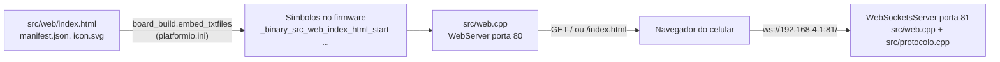
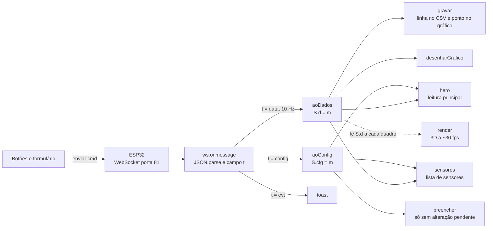
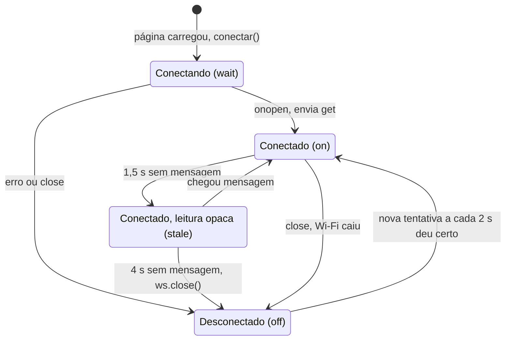
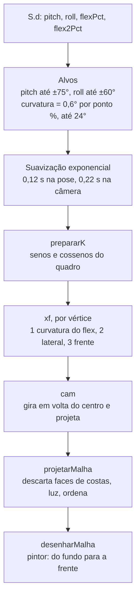

# 08 — App web embarcado

> Código: `src/web/index.html`, `src/web/manifest.json`, `src/web/icon.svg`, `src/web.cpp` · Relacionados: [02 — Arquitetura](02-arquitetura.md), [07 — Protocolo e interfaces](07-protocolo-e-interfaces.md), [09 — Simulador, testes e ferramentas](09-simulador-testes-ferramentas.md), [referencia/web.md](referencia/web.md), [referencia/protocolo.md](referencia/protocolo.md)

## 1. Objetivo

A página é o painel do colete no celular: mostra o desvio em tempo real, o estado (ok, atenção, alerta), os sensores, um gráfico dos últimos 30 s e um manequim 3D; permite calibrar, testar o motor, mudar os ajustes e baixar os dados em CSV para o TCC.

Ela **não decide nada sobre a postura**. Estado, limites, calibração e alerta são calculados no firmware; a página só mostra e manda comandos. Por isso o colete funciona igual com ou sem o celular conectado.

Decisões que moldam o arquivo:

- **Um arquivo só, sem bibliotecas e sem CDN.** Na rede Wi-Fi do colete o celular não tem internet. A fonte de 7 segmentos (subconjunto da DSEG7, licença SIL OFL 1.1) vai embutida em base64 no CSS.
- **Canvas 2D próprio para o gráfico e o 3D.** Nada de WebGL nem Three.js: menos bytes na flash e funciona em qualquer celular.
- **Tudo vai para a flash e para o Wi-Fi.** O arquivo inteiro (com comentários) é gravado no firmware e enviado a cada carga, sem compressão. Comentários curtos; hoje o arquivo tem ~85 KB.

## 2. Como a página chega ao celular

1. O `platformio.ini` lista os três arquivos em `board_build.embed_txtfiles`. O PlatformIO os grava na flash como texto terminado em `\0` e cria os símbolos `_binary_src_web_index_html_start`, `_binary_src_web_manifest_json_start` e `_binary_src_web_icon_svg_start`.
2. `src/web.cpp` declara esses símbolos (`extern const char index_html[] asm(...)`) e registra as rotas do `WebServer` (porta `HTTP_PORTA` = 80): `/`, `/index.html`, `/manifest.json`, `/icon.svg`. As quatro rotas levam `Cache-Control: no-cache` (o redirecionamento do item 3 não), para o celular não guardar uma página antiga depois de regravar o firmware.
3. Qualquer outro caminho recebe `302` para `http://192.168.4.1/` (útil para caminhos errados no próprio IP, ex.: `/favicon.ico`; não há servidor DNS, então endereços de outros sites não chegam aqui).
4. A página abre o WebSocket na porta `WS_PORTA` = 81. Ao conectar, o firmware manda o `{"t":"config"}` para esse cliente; depois envia `{"t":"data"}` 10 vezes por segundo para todos.

Mudar a página exige **recompilar e regravar o firmware** (`pio run -t upload`). Para desenvolver sem placa, ver a seção 14.

## 3. Cara de app (PWA)

- `manifest.json`: nome `BioSpine`, `display: standalone` (abre sem a barra do navegador), `start_url: /`, ícone `icon.svg` (`any` e `maskable`), cores de fundo e tema.
- `<meta name="apple-mobile-web-app-capable">` e afins fazem o mesmo no iPhone.
- `<meta name="viewport" ... viewport-fit=cover>` + `env(safe-area-inset-*)` no CSS: a página respeita o entalhe da tela.
- Uso: no navegador, **Adicionar à tela inicial**. Não há service worker: o "app" só abre com o celular conectado ao Wi-Fi do colete (o que é o caso de uso).

## 4. Estrutura da tela

Em celular, uma coluna; de 920 px para cima, duas colunas (leitura, gráfico e sensores à esquerda, 3D à direita; ajustes embaixo, na largura toda).

| Seção (`id`) | O que mostra | Atualizada por |
|---|---|---|
| Cabeçalho (`#conn`, `#bTema`) | Marca, botão de tema, indicador de conexão | `conexao`, `aplicarTema` |
| Leitura principal (`#hero`) | Selo do estado, desvio grande em 7 segmentos, barra de contagem até vibrar, frente/trás, lateral, limite, aviso, botões **Calibrar postura** e **Testar motor** | `hero`, `heroOff`, `aoConfig` |
| Vista 3D (`#viz`) | Manequim com o colete e os sensores; vistas Costas/Lado/Frente; Expandir; Ocultar 3D; caixas "Inverter frente/trás" e "Inverter lado" | `render` (laço próprio) |
| Gráfico (`#cg`) | Desvio (°) e flex (%) nos últimos 30 s, limites, faixas de atenção/alerta; botões **Baixar CSV** e **Zerar gravação** | `desenharGrafico`, `gravar` |
| Sensores (`.sens`) | MPU-6050, flex 1, flex 2 (se habilitado), motor, FSR (se detectado) | `sensores`, `linha` |
| Ajustes (`#form`) | Sliders de limite, tempo, histerese, limite do flex, intensidade; modos do flex 1 e 2; Salvar, Descartar, Restaurar padrão; versão do firmware | `aoConfig`, `preencher` |
| Avisos (`#toasts`) | Mensagens temporárias (eventos do firmware e erros locais) | `toast` |

O atributo `data-e` da leitura principal (e do painel do modo expandido) diz o estado mostrado e escolhe a cor: `ok`, `atencao`, `alerta`, `calib` (calibrando), `nocal` (sem calibração), `off` (sem conexão).

## 5. Estado e fluxo de dados

O estado global fica no objeto `S`:

| Campo | Significado |
|---|---|
| `S.on` | WebSocket aberto |
| `S.d` | última mensagem `{"t":"data"}` (ou `null` sem conexão) |
| `S.cfg` | último `{"t":"config"}` |
| `S.ultimo` | `performance.now()` da última mensagem recebida |
| `S.invP`, `S.invR` | inverter frente/trás e lado (só exibição) |

O diagrama mostra o caminho de cada mensagem dentro da página.

Comandos enviados (`enviar`): `{"cmd":"get"}` ao conectar, `{"cmd":"calib"}`, `{"cmd":"motor_test"}`, `{"cmd":"set", ...}` só com os campos alterados e `{"cmd":"reset"}`. O formato completo está em [07 — Protocolo e interfaces](07-protocolo-e-interfaces.md) e no topo de `src/protocolo.h`.

## 6. Conexão e reconexão

- **Endereço do WebSocket** (`conectar`): `ws://<host da página>:<porta>/`. Na placa a página vem da porta 80 (`location.port` vazio) e o WebSocket fica na **81**. No simulador ou no mock (página na 8080) o WebSocket fica na **porta seguinte** (8081). Sem host (arquivo aberto do disco), usa `192.168.4.1`.
- **Reconexão:** qualquer erro vira `close` (`onerror` chama `ws.close()`), e `onclose` chama `agendar`, que tenta de novo em **2 s**.
- **Socket "zumbi":** celular que volta do bloqueio pode manter um socket morto. Um temporizador de 500 ms confere `S.ultimo`: com **1,5 s** sem mensagem a leitura fica opaca (classe `stale`); com **4 s**, fecha o socket para reconectar.
- Do lado do ESP32, `ws.enableHeartbeat(5000, 2000, 2)` em `src/web.cpp` derruba clientes que sumiram da rede.

Estados do indicador de conexão:

No estado "leitura opaca" o indicador do topo continua "Conectado": só a leitura principal (`#hero`) recebe a
classe `stale` e fica opaca.

Ao desconectar, `conexao(false)` apaga `S.d`, mostra a tela "sem conexão" (`heroOff`) e redesenha o gráfico; os
pontos dos últimos 30 s vão saindo e ele fica vazio depois de ~30 s sem conexão. O 3D passa a mostrar os sensores sem estado. Durante as novas tentativas o indicador continua "Desconectado"; o estado "Conectando" só aparece na primeira carga.

## 7. Leitura principal

- **Selo e frase** (`hero`), em ordem de prioridade: `calibrando` → "CALIBRANDO"; `!calibrado` → "SEM CALIBRAÇÃO" (o colete só vibra depois de calibrado); senão o `estado` do firmware (tabela `EST`: OK, ATENÇÃO, ALERTA).
- **Desvio:** número grande com uma casa e vírgula (`fmt`), `--` sem MPU. Atrás dele, os segmentos apagados (`88,8`), como num instrumento (`mostrarDesvio`).
- **Contagem até vibrar:** no estado `atencao`, a barra mostra `tempoRuimMs / tempoMs` e o texto "Vibra em X s"; no `alerta`, barra cheia e "Vibrando há X s". `tempoRuimMs` vem do firmware (`DetectorPostura::tempoRuimMs`).
- **Frente/trás e lateral:** `pitch` e `roll` em módulo, com a direção em texto ("à frente", "à direita"...; abaixo de 0,5° = "alinhado"). As caixas "Inverter" trocam só o sinal exibido: servem para quando o sensor foi preso virado, sem regravar o firmware. O desvio não tem sinal e não muda.
- **Avisos:** MPU desconectado (borda vermelha) tem prioridade sobre "falta calibrar".
- **Botões:** Calibrar fica desabilitado enquanto `calibrando`; o ícone de Testar motor treme enquanto `motor` é verdadeiro (motor ligado de verdade, inclusive no alerta).

## 8. Lista de sensores

`estadoFlex` só **descreve** o que o firmware decidiu (o campo `flexAtivo` já vem pronto de `sensorAtivo`, em `src/main.cpp`):

| Condição | Led (`data-s`) | Texto |
|---|---|---|
| `flexAtivo` | `on` (verde) | "ativo na detecção" ou "ativo, forçado ligado" |
| modo `off` | `idle` (vazado) | "desligado nos ajustes" |
| `flexDetectado`, mas não ativo | `idle` | "detectado, calibre (de novo) para usar" |
| não detectado | `off` (vermelho) | "não detectado" |

- O **flex 2** só aparece se estiver ativo, ou se o modo não for `off` e ele for detectado ou forçado (`on`). Motivo: o GPIO35 solto "copia" a tensão do GPIO34, e o flex 2 vem desligado por padrão (ver [05 — Sensores analógicos](05-sensores-analogicos.md)).
- A barra do flex mostra a curvatura (%) com uma marca vermelha no limite do flex.
- O **FSR** aparece só depois de detectado, como "Sensor extra: pressão" (só telemetria).

## 9. Gráfico dos últimos 30 s

- Cada `data` vira um ponto em `HIST` (`gravar`): `t` (relógio do celular), `d` = desvio (null sem MPU), `f` = curvatura do flex ativo (flex 1, senão flex 2), `e` = estado. Pontos mais velhos que 30 s (`JANELA`) são descartados.
- `desenharGrafico` roda a cada `data` e no `resize`. Desenha, nesta ordem: faixas amarelas/vermelhas onde o estado foi atenção/alerta; grade com 5 linhas; rótulos de tempo (−30 s ... agora); limites tracejados (vermelho = limite em graus, cinza = limite do flex); curva do flex (cinza) e do desvio (escura, com área).
- Escala vertical automática: no mínimo 30 e 1,4 × o limite, cresce com os dados e arredonda para a dezena.
- `ajustarCanvas` faz o canvas ter a resolução da tela (densidade de pixels limitada a 2×), para as linhas saírem nítidas sem pesar no celular.

## 10. Gravação em CSV

Desde que a página conecta, cada `data` (10 Hz) vira uma linha em memória (`REG`). **Baixar CSV** gera o arquivo no próprio celular (Blob + link temporário), com o nome `postura_AAAAMMDD_HHMMSS.csv`. O formato é o mesmo lido por `tools/grafico_serial.py --csv` (figura do TCC).

| Coluna | Origem | Unidade |
|---|---|---|
| `t` | `uptime` do firmware menos o da 1ª amostra | s (2 casas) |
| `desvio` | `data.desvio` | ° |
| `limite` | `config.limiteGraus` | ° |
| `pitch` | `data.pitch` (sem a inversão da página) | ° |
| `roll` | `data.roll` (sem a inversão da página) | ° |
| `flex` | `data.flex` | leitura do ADC (0–4095) |
| `flexPct` | `data.flexPct` | % |
| `limiteFlex` | `config.limiteFlex` | % |
| `estado` | `data.estado` | `ok` / `atencao` / `alerta` |
| `alerta` | 1 se `estado` = `alerta`, senão 0 | — |

- A gravação fica **só na memória da aba**: recarregar a página ou fechar o navegador perde os dados. **Zerar gravação** apaga e reinicia o `t`.
- Limite de 200.000 linhas (`MAX_REG`, ~5,5 h a 10 Hz); depois disso as mais antigas saem.

## 11. Vista 3D

O manequim é desenhado num canvas 2D, sem bibliotecas. É ilustração: os números que valem são os da leitura principal.

### Como a inclinação vira pose

- **Coordenadas do corpo** (metros): `x` = direita da pessoa, `y` = altura a partir do quadril, `z` = frente.
- **Malha** (`MESH`, montada uma vez): tronco por seções transversais (`SEC`, superelipse entre elipse e retângulo), cabeça (elipsoide, com cabelo e olhos), braços (tubos). Cada face tem um material: `body`, `vest` (colete, entre as alturas `VEST_Y0` e `VEST_Y1`) ou `hair`.
- **Frente/trás e lateral** (`pitch`, `roll`): giram o tronco inteiro em torno do quadril (`y = 0`). Com o colete calibrado, pose zero = postura de referência.
- **Curvatura do flex:** gira a parte de cima da coluna em torno de um pivô na lombar (`YB` = 0,16 m). Cada vértice tem um peso (`peso(y)`): 0 abaixo de `YB`, 1 acima de `YT` (0,60 m, ombros), com transição suave (smoothstep). Cabeça e braços têm peso 1. A curvatura é **ilustrativa**: o flex mede um número só.
- **Câmera** (`cam`): gira o mundo em yaw e elevação em volta do ponto `(0, ALVO_Y, 0)`, afasta `DIST` e projeta em perspectiva. Botões Costas/Lado/Frente (`VISTAS`) definem a câmera alvo e ela vai até lá pelo caminho mais curto; arrastar gira à mão.
- **Desenho** (`projetarMalha`, `desenharMalha`): faces viradas para trás são descartadas; o brilho é 0,34 de luz ambiente + 0,66 de luz difusa (`LUZ`); as faces são pintadas da mais distante para a mais próxima.
- **Silhueta da postura calibrada:** quando o desvio animado passa de 2°, a malha na pose zero é desenhada translúcida num canvas fora da tela (`fantasma`) e colada atrás do manequim.

### Cores e marcadores

| Elemento | Aparência | Significado |
|---|---|---|
| Colete | cinza (tecido) | sem calibração ou calibrando |
| Colete | misturado com verde / amarelo / vermelho | estado ok / atenção / alerta; no alerta a cor pulsa |
| Flex (faixa vertical nas costas) | tira escura com miolo colorido | ativo; miolo verde até 70% do limite, amarelo até o limite, vermelho acima (`corNivel`) |
| Flex | tracejado cinza | desligado ou ausente |
| MPU (placa entre as escápulas) | placa escura com LED verde | MPU respondendo |
| MPU | placa vazada tracejada, LED vermelho | MPU sem resposta |
| FSR (lombar) | elipse escura, mais forte com mais pressão | só quando detectado |
| Motor (nuca) | círculo amarelo com ondas e tremido | vibrando agora (campo `motor`) |
| Rótulos | texto escuro / cinza | sensor ativo / inativo; marcadores atrás do corpo ficam translúcidos e sem rótulo |

As posições dos sensores no corpo ficam no objeto `POS`, no topo do script. Se a montagem mudar (por exemplo, dois flex esquerdo e direito no BioSpine), é só ajustar `x` e `y` ali.

### Modos e desempenho

- **Expandir:** o painel cobre a tela (e pede tela cheia onde o navegador deixa; o iPhone não deixa). Aparece o painel do canto (`#hud`) com estado e desvio, e os rótulos mostram as leituras de cada sensor. `Esc` ou sair da tela cheia fecha.
- **Ocultar 3D:** esconde o palco; a preferência fica salva.
- **Laço de animação** (`laco`, `atualizarLaco`): `requestAnimationFrame` limitado a ~30 fps (um quadro a cada 32 ms). Para sozinho com o 3D oculto, com o palco fora da tela (`IntersectionObserver`) ou com a aba em segundo plano (`visibilitychange`): poupa bateria do celular.

## 12. Ajustes

Os `id`s dos campos são os mesmos nomes do JSON de config, e as faixas dos sliders são as mesmas de `validarParams` (`src/posture.cpp`):

| Campo (`id`) | Faixa no slider | Passo | Unidade | Regra no firmware |
|---|---|---|---|---|
| `limiteGraus` | 2–60 | 1 | ° | 2–60 |
| `tempoMs` | 0–60000 | 500 | ms (mostrado em s) | até 60000 |
| `histerese` | 0 até (menor limite − 1) | 0,5 | ° e pontos % | 0 até (menor limite − 1) |
| `limiteFlex` | 2–90 | 1 | % | 2–90 |
| `intensidade` | 0–100 | 5 | % | até 100 |
| `flexModo`, `flex2Modo` | auto / on / off | — | — | texto inválido é ignorado |

- **Validação nos dois lados.** A página limita os sliders e ajusta o máximo da histerese ao mexer nos limites (`ajustarHisterese`), mas o firmware valida tudo de novo (`app_definirConfig` → `validarParams`), porque a serial e qualquer cliente podem mandar qualquer valor. A histerese precisa ficar abaixo do menor limite, senão a postura nunca voltaria abaixo de `limite − histerese` e o alerta não sairia.
- **Alteração pendente** (`sujo`): ao mexer, Salvar e Descartar ficam habilitados e aparece "Alterações ainda não salvas". Enquanto houver alteração pendente, um `config` que chegar (de outro celular ou da serial) não sobrescreve o formulário.
- **Salvar:** manda `{"cmd":"set"}` **só com os campos que mudaram**, para não desfazer um ajuste feito por outro cliente. O firmware valida, salva na NVS, responde com o evento "Parâmetros salvos" e manda o `config` novo para todos.
- **Descartar:** volta o formulário ao último `config`.
- **Restaurar padrão:** pede confirmação e manda `{"cmd":"reset"}` (parâmetros de `configPadrao`; a calibração é mantida).

## 13. Tema, acessibilidade e armazenamento local

**Tema.** Botão alterna automático → claro → escuro. O automático segue o sistema (`prefers-color-scheme`) e acompanha a troca em tempo real. As cores são tokens CSS em `:root`; como os canvas não leem CSS, `lerCores` copia os tokens para o objeto `C` a cada troca. A única cor forte da página é a do estado da postura.

**Acessibilidade.**
- `role="status"` e `aria-live` no indicador de conexão, no selo e nos avisos; `role="alert"` no aviso de falha; `aria-pressed` e `aria-expanded` nos botões de alternância; `aria-label` nos canvas.
- Alvos de toque com pelo menos 44 px; foco visível (`:focus-visible`); contraste de texto ≥ 4,5:1 e de bordas de controle ≥ 3:1.
- `prefers-reduced-motion`: desliga as animações do CSS.

**Armazenamento local** (`localStorage`, protegido por `try`, porque o modo privado pode bloquear):

| Chave | Valores | Uso |
|---|---|---|
| `colete.tema` | `auto`, `light`, `dark` | tema escolhido |
| `colete.invP` | `0`, `1` | inverter frente/trás |
| `colete.invR` | `0`, `1` | inverter lado |
| `colete.3d` | `0`, `1` | 3D aberto ou oculto |

A gravação do CSV **não** vai para o `localStorage`: fica só na memória.

## 14. Testar sem a placa

| Ferramenta | Quem responde | Uso |
|---|---|---|
| `python3 tools/sim_web.py` | **o próprio firmware** compilado para o PC (`sim/`), com MPU falso | conferir a página contra a lógica real. `--demo` mexe o tronco sozinho (bom para gravar a tela). No terminal: `!frente 30`, `!lado -15`, `!flex 1500`, `!botao`, `!mpu off`, `diag`, `set limite 15`... |
| `python3 tools/mock_server.py` | imitação do ESP32 em Python | desenvolver a página rápido. Opções: `--flex2`, `--fsr`, `--sem-flex`, `--falhas` (um sensor "solta" a cada ~20 s), `--port N` |

Os dois servem a página em `http://localhost:8080` e o WebSocket em 8081, a regra "porta da página + 1" de `conectar`. Detalhes em [09 — Simulador, testes e ferramentas](09-simulador-testes-ferramentas.md).

## 15. Funções principais do script

| Função | O que faz |
|---|---|
| `conectar` | Abre o WebSocket e liga os tratadores `onopen`, `onclose`, `onerror`, `onmessage` |
| `agendar` | Nova tentativa de conexão em 2 s |
| `enviar` | Manda um comando JSON; sem conexão, avisa e retorna `false` |
| `conexao` | Atualiza o indicador; ao desconectar, limpa a leitura |
| `aoDados` | Trata `{"t":"data"}`: `gravar`, `hero`, `sensores`, `desenharGrafico` |
| `aoConfig` | Trata `{"t":"config"}`: guarda, preenche o formulário, atualiza o limite mostrado |
| `hero` / `heroOff` | Leitura principal com dados / sem conexão |
| `mostrarDesvio` | Número grande + segmentos apagados |
| `aviso` | Faixa de aviso da leitura principal |
| `sensores`, `linha`, `estadoFlex` | Lista de sensores |
| `preencher`, `ajustarHisterese`, `saidas`, `marcar` | Formulário de ajustes |
| `toast` | Aviso temporário (3,5 s, no máximo 3) |
| `gravar` | Linha do CSV e ponto do gráfico |
| `aplicarTema`, `lerCores` | Tema e cores para os canvas |
| `ajustarCanvas` | Resolução do canvas conforme a tela |
| `desenharGrafico` | Gráfico de 30 s |
| `secAt`, `peso`, `MESH` | Geometria do manequim e peso da curvatura |
| `prepararK`, `xf`, `cam` | Pose e câmera (corpo → mundo → câmera → tela) |
| `projetarMalha`, `desenharMalha`, `caminho` | Projeção, descarte de faces, luz e pintura |
| `costas`, `pontoTela` | Pontos na superfície das costas para os sensores |
| `desenharMarcadores`, `desenharFlex`, `rotulo`, `corNivel`, `desenharOlhos` | Sensores, rótulos e detalhes do manequim |
| `corColete` | Cor do colete conforme o estado |
| `render` | Um quadro do 3D |
| `laco`, `atualizarLaco` | Laço de animação e pausa automática |
| `abrir3d`, `expandir` | Ocultar/mostrar e expandir o 3D |

## 16. Armadilhas e cuidados

- **Nomes compartilhados com o firmware.** Os campos do JSON (`desvio`, `flexPct`, `limiteGraus`...) aparecem na página, em `src/protocolo.cpp`, no simulador e no mock. Renomear exige mudar todos (e o comentário do topo de `src/protocolo.h`).
- **`id` dos campos = nome no JSON.** `CAMPOS`, `preencher` e o Salvar dependem disso. Campo novo no config: acrescentar o slider com o mesmo `id`, a entrada em `CAMPOS` e um `<output id="o...">`.
- **Faixas dos sliders** precisam acompanhar `validarParams`; se o firmware mudar uma faixa e a página não, o slider mostra um valor que o firmware vai cortar.
- **Cores em `#rrggbb`.** `lerCores` só entende hexadecimal de 6 dígitos; `#abc` ou `rgb()` nos tokens quebram as cores do canvas.
- **Tamanho.** Tudo vai para a flash e para o Wi-Fi a cada carga. Nada de biblioteca externa nem CDN (o celular está sem internet).
- **Comentários.** Nunca escrever `</script>` dentro de comentário JS nem `--` dentro de comentário HTML: quebram a página.
- **Porta do WebSocket.** A regra "porta da página + 1" vale para o simulador e o mock; na placa é sempre 81 (`WS_PORTA`). Mudar a porta no firmware exige mudar `conectar`.
- **Depois de mudar a página:** regravar o firmware; testar com `tools/sim_web.py --demo` antes.
