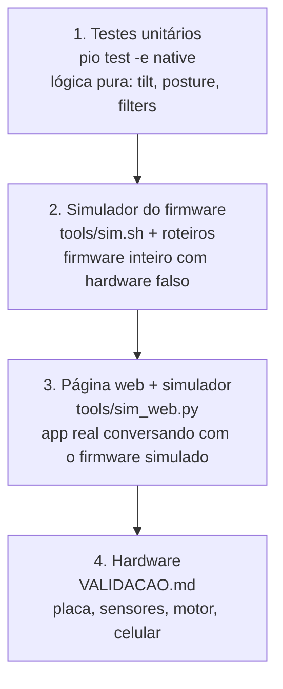
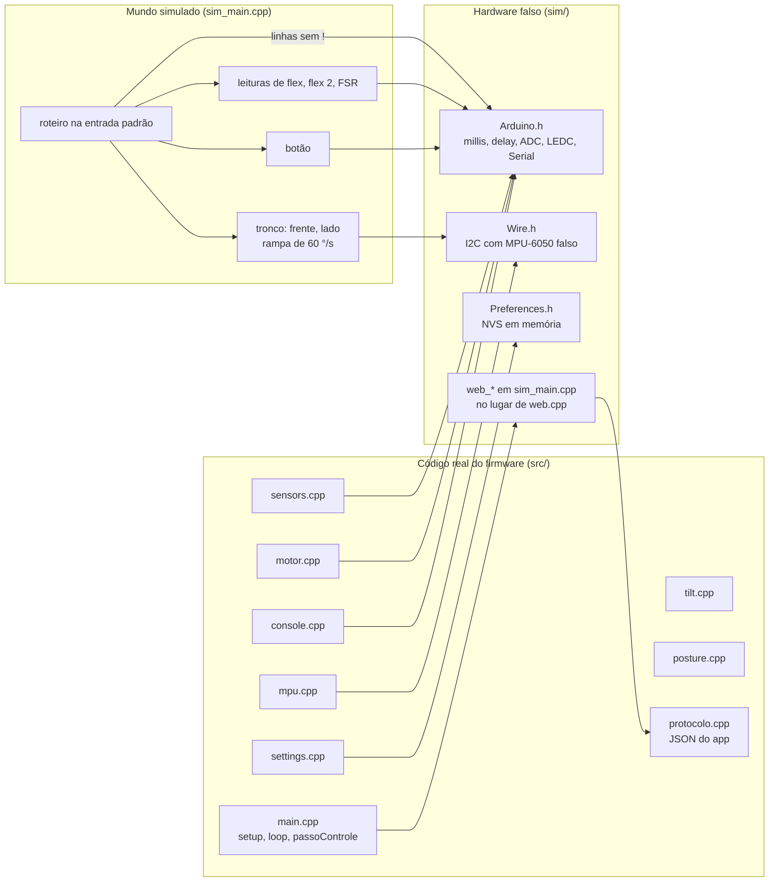
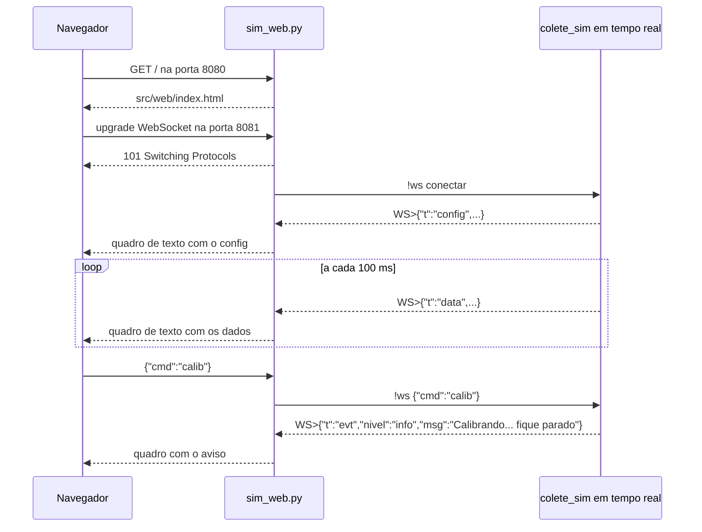
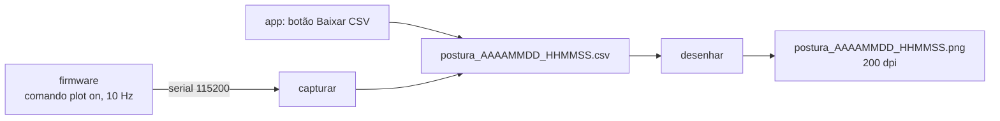

# 09 — Simulador, testes e ferramentas

> Código: `sim/Arduino.h`, `sim/Wire.h`, `sim/Preferences.h`, `sim/sim_main.cpp`, `test/test_posture/test_main.cpp`, `tools/sim.sh`, `tools/roteiro.txt`, `tools/roteiro_biospine.txt`, `tools/roteiro_sem_mpu.txt`, `tools/sim_web.py`, `tools/mock_server.py`, `tools/grafico_serial.py`, `tools/gerar_bin.sh`, `platformio.ini` · Relacionados: [02 — Arquitetura](02-arquitetura.md), [08 — App web](08-app-web.md), [MANUTENCAO](MANUTENCAO.md), `VALIDACAO.md` (raiz do repositório)

## 1. Por que existe

O hardware só ficou disponível no último dia, montado por outra pessoa. Todo o software foi
escrito e testado **sem a placa**. Para isso o projeto tem quatro camadas de verificação, da mais
barata para a mais completa, e só a última precisa do colete:



Cada camada pega um tipo de erro: os testes provam as contas e as regras (ângulo, filtro,
histerese, tempo mínimo); o simulador prova a integração (setup/loop, comandos, calibração,
motor, NVS, JSON); a página contra o simulador prova o app; o hardware prova o que nada disso
consegue simular (seção [9](#9-limitações-o-que-nada-disso-prova)).

| Ferramenta | O que faz | Precisa de |
|---|---|---|
| `pio test -e native` | roda os 21 testes da lógica pura no PC | PlatformIO |
| `tools/sim.sh [roteiro]` | compila o firmware para o PC e executa um roteiro em tempo virtual | `g++` e ArduinoJson baixado pelo PlatformIO |
| `python3 tools/sim_web.py [--demo]` | página real (`src/web/`) + firmware simulado em `http://localhost:8080` | o mesmo do `sim.sh` + Python 3 |
| `python3 tools/mock_server.py` | página real + colete **reescrito em Python** (sem firmware) | só Python 3 |
| `tools/grafico_serial.py` | captura o `plot on` da serial (ou lê um CSV) e gera CSV + PNG para o TCC | pyserial, matplotlib |
| `tools/gerar_bin.sh` | gera `dist/colete-postural.bin`, imagem única gravável em `0x0` | PlatformIO |

---

## 2. Testes unitários (`test/test_posture/test_main.cpp`)

### Como rodam

O ambiente `native` do `platformio.ini` compila para o PC, com o framework de testes **Unity**,
só o código que não depende do Arduino:

```ini
[env:native]
platform = native
test_framework = unity
test_build_src = yes
build_src_filter = -<*> +<tilt.cpp> +<posture.cpp>
build_flags = -std=c++11 -Wall
```

- `build_src_filter` tira tudo de `src/` e põe de volta só `tilt.cpp` e `posture.cpp`.
  `filters.h` é só cabeçalho e entra pelo `#include` do teste.
- Funciona porque a lógica pura foi separada do hardware de propósito ([02 — Arquitetura](02-arquitetura.md)).
- No ambiente da placa (`esp32dev`), `test_ignore = *` impede que os testes sejam gravados nela.

```bash
pio test -e native      # esperado: 21 Tests 0 Failures 0 Ignored
```

Sem o PlatformIO, dá para compilar à mão com os fontes do Unity (`unity.c`, `unity.h`,
`unity_internals.h`, repositório ThrowTheSwitch/Unity) numa pasta `<unity>`:

```bash
gcc -c -std=c99 -I<unity> <unity>/unity.c -o unity.o
g++ -std=c++11 -Wall -Isrc -I<unity> test/test_posture/test_main.cpp src/tilt.cpp src/posture.cpp unity.o -o testes
./testes
```

### Modelo usado nos testes

`gravidadeColete(frente, lado)` gera o vetor gravidade que um sensor **em pé nas costas** (eixo Y
para cima, componentes para fora) mediria com o tronco inclinado:

```
g = ( sen(lado),  cos(frente)·cos(lado),  sen(frente)·cos(lado) )
```

Inclinar para a frente leva a gravidade para +Z; para o lado, para X. É o mesmo modelo do MPU
falso do simulador (seção [3.4](#34-física-do-tronco-e-mpu-6050-falso)). `entrada(desvio)` monta a
entrada do detector já calibrada, com os dois flex inativos.

### Os 21 testes

| # | Teste | O que prova | Código testado | Requisito / decisão |
|---|---|---|---|---|
| 1 | `test_angulo_entre_vetores` | ângulo certo em 0°, 90°, 30° e preciso em 0,5° | `angleBetweenDeg` | base do desvio ([03](03-algoritmo-inclinacao.md)) |
| 2 | `test_desvio_sem_salto_perto_da_vertical` | sensor em pé, 10° de lado, passando pela vertical: o desvio varia suave (sem o salto de ~20° da MPU6050_light) | `angleBetweenDeg` | não usar a MPU6050_light ([10](10-decisoes-de-projeto.md)) |
| 3 | `test_componentes_frente_e_lado` | frente e lado separados sem misturar eixos | `tiltComponentsDeg` | exibição frente/trás e lateral no app |
| 4 | `test_componentes_com_sensor_de_cabeca_para_baixo` | placa girada 180°: "frente" continua positivo | `tiltComponentsDeg` | independe de como o sensor foi preso |
| 5 | `test_componentes_com_placa_deitada` | placa deitada (bancada) não gera NaN | `tiltComponentsDeg` | robustez |
| 6 | `test_filtro_converge_para_acelerometro` | giroscópio parado: converge ao acelerômetro (< 0,5° em 10 s) | `TiltFilter::update` | correção de deriva do filtro complementar |
| 7 | `test_filtro_segue_giroscopio` | choque (\|a\| = 2 g) ignora o acelerômetro; -90 °/s em X por 0,2 s = 18° para +Z | `TiltFilter::update` | rejeição de aceleração forte; convenção `dg/dt = g × ω` |
| 8 | `test_filtro_reinicia_com_dt_grande` | `dt` > 0,5 s reinicia no acelerômetro | `TiltFilter::update` | robustez (MPU reconectado, atraso) |
| 9 | `test_sem_calibracao_nunca_alerta` | 80° por 10 s sem calibração: continua "ok" | `DetectorPostura` | sem calibração não vibra |
| 10 | `test_atencao_e_depois_alerta` | "atenção" acima do limite; "alerta" só ao completar 3000 ms | `DetectorPostura` | tempo mínimo |
| 11 | `test_histerese` | em alerta, 18° mantém; 16,9° (< 20 − 3) volta a "ok" | `DetectorPostura` | histerese |
| 12 | `test_pico_curto_nao_alerta` | pico de 0,5 s não vibra; a contagem recomeça do zero | `DetectorPostura` | tempo mínimo |
| 13 | `test_flex_dispara_e_respeita_histerese` | flex a 20 % alerta com desvio ok; sai só abaixo de 12 % | `DetectorPostura` | flex entra no "OU" da má postura |
| 14 | `test_flex_inativo_e_ignorado` | flex inativo marcando 100 % não alerta | `DetectorPostura` | fallback: colete segue só com o MPU |
| 15 | `test_flex2` | só o 2º flex dobrado (30 %) já dá "atenção" | `DetectorPostura` | montagem com dois flex (BioSpine V3) |
| 16 | `test_flex_pct` | % de queda (2048 → 1536 = 25 %), nunca negativo, 0 sem referência | `flexPct` | curvatura do flex ([05](05-sensores-analogicos.md)) |
| 17 | `test_validar_params` | valores absurdos presos nas faixas; histerese < limites; NaN tratado | `validarParams` | entrada da serial/app não quebra o colete |
| 18 | `test_calibrador_media` | espera 1,5 s, coleta 1 s, média do flex, maior giro, gravidade média | `Calibrador` | calibração ([04](04-deteccao-e-calibracao.md)) |
| 19 | `test_media_movel` | média com janela incompleta e cheia, amplitude, última amostra | `MediaMovel` | filtro do flex ([05](05-sensores-analogicos.md)) |
| 20 | `test_presenca_com_persistencia` | presente só após 2 s válidos seguidos; ausente após 1 s inválido | `Presenca` | flex não "pisca" com ruído |
| 21 | `test_leitura_adc_valida` | rejeita sem resistor (~4095), flex solto (~0) e pino flutuando | `leituraAdcValida` | detecção automática do flex |

**Teste novo:** escreva a função em `test_main.cpp`, acrescente o `RUN_TEST` no `main()` e uma linha
nesta tabela.

---

## 3. Simulador do firmware (`sim/` + `tools/sim.sh`)

### 3.1 O que é real e o que é falso

O simulador compila o **firmware de verdade** para o PC e troca só o que toca o hardware. A troca é
feita pelos caminhos de include: `-Isim` vem antes de `-Isrc`, então `#include <Arduino.h>`,
`<Wire.h>` e `<Preferences.h>` caem nos arquivos falsos de `sim/`.



| Peça | No ESP32 | No simulador |
|---|---|---|
| Tempo | `millis()`/`micros()` do relógio da placa | relógio **virtual** (`relogioUs`), só anda quando o simulador manda |
| Tarefas | tarefa de controle (FreeRTOS) + `loop()` | com `-DSIMULADOR`, o `loop()` chama `passoControle()`: tudo numa linha só ([02 — Modo simulador](02-arquitetura.md#modo-simulador)) |
| MPU-6050 | I2C real | `TwoWire` falso: responde no endereço de `!mpuaddr`, gera aceleração e giro a partir de `frente`/`lado` |
| ADC | `analogRead` real | valor pedido pelo roteiro + ruído pequeno |
| Botão | GPIO27 | `!botao` (apertado por 200 ms) |
| Motor | PWM LEDC no GPIO25 | `ledcWrite` imprime `motor LIGA` / `motor desliga` com o instante |
| NVS | flash | mapa em memória (vale só durante a execução) |
| Wi-Fi / app | `web.cpp` (AP, HTTP, WebSocket) | `web_*` de `sim_main.cpp`: o JSON do `protocolo.cpp` sai como linhas `WS>{...}` |

### 3.2 Compilação

`tools/sim.sh` chama o `g++` diretamente:

```bash
g++ -std=c++17 -O1 -Wall -Wno-unused-parameter -DSIMULADOR -Isim -Isrc -I.pio/libdeps/esp32dev/ArduinoJson/src \
    src/main.cpp src/console.cpp src/sensors.cpp src/motor.cpp src/settings.cpp \
    src/mpu.cpp src/tilt.cpp src/posture.cpp src/protocolo.cpp sim/sim_main.cpp \
    -o .pio/sim/colete_sim
```

- `-DSIMULADOR`: em `main.cpp` as macros `TRAVAR()`/`DESTRAVAR()` ficam vazias e a tarefa de controle não é criada.
- `src/web.cpp` fica de fora (depende de `WiFi.h`); as funções `web_*` são implementadas em `sim_main.cpp`.
- O ArduinoJson vem de `.pio/libdeps/`, criado pelo PlatformIO no primeiro `pio run`. Sem PlatformIO,
  baixe o cabeçalho único `ArduinoJson-v7.2.1.h` (versão do `platformio.ini`) e troque o `-I` por
  a pasta onde ele está, salvo como `ArduinoJson.h`.
- Arquivos novos em `src/` que o firmware precise têm que entrar nesta lista também.
- Função nova do Arduino usada pelo firmware: declarar em `sim/Arduino.h` e implementar em `sim_main.cpp`.

```bash
tools/sim.sh                              # roteiro padrão (tools/roteiro.txt)
tools/sim.sh tools/roteiro_biospine.txt   # outro roteiro
tools/sim.sh --so-compilar                # só gera .pio/sim/colete_sim
```

### 3.3 Tempo virtual

- `millis()` e `micros()` leem `relogioUs`. `delay(ms)` não dorme: avança o relógio (e a física) em `ms`.
  Por isso a calibração do giroscópio no boot (200 leituras com `delay(5)`) consome 1 s virtual.
- `rodar(ms)` executa um `loop()` e avança 1 ms, repetidamente: ~1 kHz, como a tarefa de controle no
  ESP32 (`vTaskDelay(1)`).
- Um roteiro de vários minutos roda em segundos.
- A semente do ruído é fixa (`srand(42)`): a mesma entrada produz **a mesma saída**, linha por linha.
  Dá para salvar a saída de um roteiro e comparar depois de uma mudança (`diff`).

### 3.4 Física do tronco e MPU-6050 falso

**Tronco.** `!frente 25` não muda o ângulo de uma vez: muda o **alvo**. A cada passo de 1 ms,
`passoFisica` anda no máximo `RAMPA_DPS · dt` (60 °/s) até o alvo e guarda a velocidade do passo
(`taxaFrente`, `taxaLado`). Assim o giroscópio falso mede uma velocidade realista e o filtro
complementar é exercitado como no corpo.

**MPU falso** (`TwoWire::requestFrom`). A cada leitura monta um mapa de registradores:

| Registradores | Conteúdo | Escala |
|---|---|---|
| `0x3B..0x40` acelerômetro X, Y, Z | `sen(lado)`, `cos(frente)·cos(lado)`, `sen(frente)·cos(lado)` + ruído ±0,01 g | 16384 LSB/g (±2 g) |
| `0x43..0x48` giroscópio X, Y, Z | `−taxaFrente + 0,8`, `−0,5`, `taxaLado + 0,3` °/s + ruído ±0,2 °/s | 131 LSB/(°/s) (±250 °/s) |
| `0x75` WHO_AM_I | `0x68` (sempre, mesmo com `!mpuaddr 69`) | — |

- Os valores fixos do giroscópio (0,8 / −0,5 / 0,3 °/s) imitam o **offset de fábrica**, que
  `Mpu6050::calibrarGiro` precisa medir no boot e descontar.
- O sinal do giroscópio segue `dg/dt = g × ω`, a mesma convenção de `TiltFilter::update`. Por isso o
  simulador **não prova** que o sinal do sensor real está certo (seção [9](#9-limitações-o-que-nada-disso-prova)).
- As escritas de configuração (reset, escalas, filtro passa-baixa) são aceitas e ignoradas.
- `!mpu off` faz o I2C responder NACK: testa a detecção de queda e a reconexão a cada 2 s.

**ADC falso** (`analogRead`): flex 1 = valor de `!flex` ± 8; FSR = valor de `!fsr` ± 5; flex 2
"solto" (padrão) devolve qualquer valor de 0 a 4095 a cada leitura, imitando o pino flutuando, que o
firmware precisa rejeitar pela amplitude da janela (`ADC_RUIDO_MAX`).

### 3.5 Linguagem dos roteiros

Um roteiro é um arquivo de texto lido pela entrada padrão, uma linha por comando:

| Linha | Efeito |
|---|---|
| vazia, ou `#` **na 1ª coluna** | ignorada (comentário). `  # texto` com espaço antes **vai para a serial** |
| sem `!` (ex.: `diag`, `calib`, `set limite 15`, `STATUS`) | digitada na serial do firmware; o simulador roda 50 ms para o console responder |
| `!espera 3000` | avança 3000 ms de tempo virtual |
| `!frente 25` / `!lado -10` | novo alvo de inclinação do tronco (°), alcançado a 60 °/s |
| `!flex 1800` | leitura do flex 1 (GPIO34), 0–4095 |
| `!flex2 1800` / `!flex2 solto` | liga um 2º flex (GPIO35) com essa leitura / volta ao pino flutuando |
| `!fsr 300` | leitura do FSR (GPIO32) |
| `!botao` | aperta o botão de calibração por 200 ms |
| `!mpu off` / `!mpu on` | desconecta / reconecta o MPU |
| `!mpuaddr 69` | endereço I2C do MPU em hexadecimal (padrão 68) |
| `!estado` | imprime uma linha com o `Status` (ver abaixo) |
| `!eco texto` | imprime `=== texto ===` (título de bloco) |
| `!ws on` / `!ws off` | mostra / esconde o JSON que iria para o app (linhas `WS>`) |
| `!ws conectar` | simula um app conectando: recebe o `{"t":"config"}` e liga as linhas `WS>` (como `!ws on`) |
| `!ws {"cmd":"set","limiteGraus":15}` | comando vindo do app, pelo `protocolo_comando` de verdade |
| `!boot` | opcional: as linhas **antes** dele montam o hardware antes do `setup()` |

Antes do `!boot` use só comandos que mudam o hardware (`!mpu`, `!mpuaddr`, `!flex`, `!flex2`,
`!fsr`, `!frente`, `!lado`): `!espera` e `!botao` chamariam `loop()` antes do `setup()`.

**Lendo a saída:**

| Linha | Origem |
|---|---|
| `> diag` | eco de uma linha mandada para a serial |
| `[sim   22.410 s] motor LIGA (duty 255)` | transição do motor, com o instante virtual |
| `[sim   21.070 s] desvio  27.0° frente  27.0° lado 0.0° flex 1999 (0.0%) ... atencao cal 1 mpu 1` | `!estado`: desvio, frente, lado, flex (`inativo` se fora da decisão), flex 2, estado, calibrado, MPU ok |
| `[calib] ...`, `[mpu] ...` | eventos do firmware para o monitor serial (`console_evento`) |
| `[app:ok] Postura calibrada` | evento que iria para o app (com `!ws off`) |
| `WS>{"t":"data",...}` | JSON que iria pelo WebSocket (com `!ws on`) |

### 3.6 Os três roteiros

| Roteiro | Montagem | O que cobre |
|---|---|---|
| `tools/roteiro.txt` (padrão) | GUIA: MPU 0x68, flex 1, sem flex 2 e FSR | boot e `diag`; sem calibração não vibra; calibração pelo botão; pico curto não vibra; atenção → alerta com pulsos 300/700 ms; histerese (18° mantém, 16° solta); alerta só pelo flex (25 %); flex desconectado vira inativo; `set limite`/`set tempo`/`reset`; MPU cai e volta; comandos BioSpine (`STATUS`, `CALIBRATE`, `START`/`STOP`); `plot on`; calibração recusada por movimento (60 °/s) |
| `tools/roteiro_biospine.txt` | BioSpine V3: MPU 0x69, dois flex, FSR, sem botão | detecção em 0x69; `set flex2 auto`; flex 2 e FSR detectados; calibração pela serial grava as duas referências; alerta só pelo flex 2 (30 %); `STATUS` com `pressure` |
| `tools/roteiro_sem_mpu.txt` | MPU e flex soltos no boot | boot não trava; `diag` mostra ❌; calibração negada sem MPU; MPU encaixado com a placa ligada é reconectado; calibração passa a funcionar só com o MPU |

Trechos da saída esperada do roteiro padrão:

```
=== corcunda por 5 s: atenção e depois alerta com pulsos 300/700 ===
[sim   21.070 s] desvio  27.0° frente  27.0° lado   0.0° ... atencao cal 1 mpu 1
[sim   22.410 s] motor LIGA (duty 255)
[sim   22.710 s] motor desliga
[sim   23.410 s] motor LIGA (duty 255)
...
=== calibração recusada: mexeu durante a média ===
[calib] recusada: mexeu durante a média (60 °/s). Tente de novo, parado.
```

Cada bloco dos roteiros tem, em comentário, o resultado esperado.

### 3.7 Modo `--tempo-real`

`colete_sim --tempo-real` não lê o roteiro inteiro antes: o relógio virtual acompanha o relógio do
PC (`clock_gettime`) e cada linha que chega na entrada é executada na hora. Em cada volta:
`select()` sem espera verifica a entrada; roda quantos `loop()` forem precisos para alcançar o
relógio real (no máximo 200 por volta) e dorme 1 ms. `!espera` é ignorado nesse modo.
É o modo usado pelo `tools/sim_web.py`.

---

## 4. Página web sem placa: `sim_web.py` × `mock_server.py`

Os dois servem a página de verdade (`src/web/index.html`, `manifest.json`, `icon.svg`) em
`http://localhost:8080` e um WebSocket em `8081`. A página escolhe a porta do WebSocket como
"porta da página + 1" (no ESP32: página na 80, WebSocket na 81 — função `conectar()` do `index.html`).

| | `tools/sim_web.py` | `tools/mock_server.py` |
|---|---|---|
| Quem responde | o **firmware** compilado (`colete_sim --tempo-real`) | uma classe Python (`Colete`) que **reimplementa** a lógica |
| Corpo | comandos do terminal (`!frente 30`...) ou `--demo` | inventado: respiração, balanço, episódios de "corcunda" |
| Quando usar | conferir app + firmware juntos, gravar vídeo da tela | desenhar a página sem compilar nada |
| Opções | `--demo`, `--porta`, `--host` | `--flex2`, `--fsr`, `--sem-flex`, `--falhas`, `--port` |
| Cuidado | precisa do `sim.sh` compilando | se a lógica do firmware mudar, a classe `Colete` fica desatualizada |

Ponte do `sim_web.py`, do carregamento da página a um comando:



- Linhas do simulador que **não** começam com `WS>` são a serial do firmware e aparecem no terminal.
- O que for digitado no terminal vai para o simulador: comandos `!` e comandos da serial (`diag`, `get`...).
- `--demo` repete em laço uma sequência de movimentos (calibra, inclina, corcunda, lado, flex).

**WebSocket mínimo.** Os dois scripts implementam só o necessário da RFC 6455, com a biblioteca padrão:

1. *Handshake:* o navegador manda `Sec-WebSocket-Key`; o servidor responde `101` com
   `Sec-WebSocket-Accept = base64(SHA-1(chave + "258EAFA5-E914-47DA-95CA-C5AB0DC85B11"))`.
2. *Quadros:* 1º byte = FIN + opcode (`0x1` texto, `0x8` fechar, `0x9` ping, `0xA` pong); 2º byte =
   bit de máscara + tamanho (126/127 = tamanho estendido em 2/8 bytes).
3. *Máscara:* quadros do navegador vêm mascarados (XOR com 4 bytes); os do servidor vão sem máscara.

**Modelo do `mock_server.py`.** A cada 100 ms (`Colete.passo`): calcula o corpo (`corpo`), lê
sensores falsos (`adc`), detecta presença (`detectar`, versão simplificada da `Presenca`), aplica a
mesma regra do `DetectorPostura` (limite, histerese, tempo mínimo) e monta o `{"t":"data"}` com os
mesmos campos do `protocolo_dados`. Diferenças conhecidas: o desvio é aproximado por
`hypot(pitch, roll)` em vez do ângulo entre vetores; a detecção de flex não olha a amplitude da
janela; a calibração é recusada se houver um episódio de corcunda em andamento (no firmware, se o
giro passar de 30 °/s).

---

## 5. Gráfico para o TCC: `tools/grafico_serial.py`



- **Captura:** abre a porta, manda `plot on`, lê as linhas
  `desvio:..,limite:..,pitch:..,roll:..,flexPct:..,limiteFlex:..,alerta:..` (geradas por
  `console_enviarDados`), grava com a coluna `t` (segundos desde o início) e manda `plot off` no fim.
  Outras linhas (eventos, respostas) só aparecem no terminal.
- **CSV do app:** colunas `t,desvio,limite,pitch,roll,flex,flexPct,limiteFlex,estado,alerta`; a coluna
  de texto `estado` é ignorada. `alerta` vale 5 no `plot on` (para aparecer no Serial Plotter) e 1 no
  CSV do app; o gráfico usa só `alerta > 0`.
- **Figura:** desvio × limite, faixa laranja onde o motor estava em alerta e, se o flex marcou alguma
  curvatura, um 2º gráfico com a curvatura do flex × limite do flex.

```bash
~/.venvs/colete/bin/python tools/grafico_serial.py -t 60            # captura 60 s
~/.venvs/colete/bin/python tools/grafico_serial.py --csv dados.csv  # só redesenha
~/.venvs/colete/bin/python tools/grafico_serial.py -p /dev/cu.usbserial-0001 -t 60   # macOS
```

A porta automática procura só `/dev/ttyUSB*` e `/dev/ttyACM*` (Linux). Feche o monitor serial
antes: a porta só aceita um programa por vez.

---

## 6. Imagem para gravar: `tools/gerar_bin.sh`

Compila (`pio run -e esp32dev`) e junta, com o `esptool.py merge_bin`, as quatro partes que o ESP32
espera na flash de 4 MB:

| Endereço | Arquivo | Conteúdo |
|---|---|---|
| `0x1000` | `bootloader.bin` | 2º estágio do boot |
| `0x8000` | `partitions.bin` | tabela de partições |
| `0xe000` | `boot_app0.bin` | qual partição de app iniciar |
| `0x10000` | `firmware.bin` | o firmware, com a página web embutida |

Saídas em `dist/`:
- `colete-postural.bin`: imagem única, gravada no endereço **`0x0`** (preenche os buracos). Grava de
  qualquer computador, inclusive pelo navegador em `https://espressif.github.io/esptool-js/` (Chrome/Edge).
- `firmware-app-0x10000.bin`: só o app, para gravar em `0x10000` numa placa que já tem bootloader.

Parâmetros: `--flash_mode dio --flash_freq 40m --flash_size 4MB` (ESP32 DevKit, ESP32-WROOM-32).
O script usa o PlatformIO em `~/.local/bin/pio` e `~/.platformio`; outro caminho: `PIO=/caminho/pio tools/gerar_bin.sh`.

> O `dist/` só é atualizado quando o script roda. Mudou a página (`src/web/`) ou o código? Gere de novo,
> senão o `.bin` não corresponde ao código.

---

## 7. `platformio.ini`

| Ambiente | Chave | Valor | Por quê |
|---|---|---|---|
| `esp32dev` | `platform` | `espressif32@6.9.0` | versão fixa (Arduino-ESP32 core 2.0.17): atualizar pode mudar APIs (ex.: LEDC do motor) |
| | `monitor_speed` | `115200` | velocidade da serial do firmware |
| | `monitor_filters` | `esp32_exception_decoder` | traduz o backtrace de um travamento em arquivo e linha |
| | `upload_speed` | `921600` | se a gravação falhar, baixar para 460800 ou 115200 |
| | `build_flags` | `-DCORE_DEBUG_LEVEL=0` | sem logs do core: a serial fica só para comandos, `diag` e `plot on` |
| | `lib_deps` | `WebSockets@2.7.3`, `ArduinoJson@7.2.1` | versões fixas do servidor WebSocket e do JSON |
| | `board_build.embed_txtfiles` | `src/web/index.html`, `manifest.json`, `icon.svg` | página embutida no firmware, vira os símbolos `_binary_src_web_*` (com `'\0'` no fim) usados em `web.cpp` |
| | `test_ignore` | `*` | os testes não rodam na placa |
| `native` | `platform` / `test_framework` | `native` / `unity` | testes no PC |
| | `test_build_src` + `build_src_filter` | só `tilt.cpp` e `posture.cpp` | só a lógica pura compila sem Arduino |
| | `build_flags` | `-std=c++11 -Wall` | C++11 com todos os avisos: a lógica pura não usa nada mais novo |

---

## 8. Como estender

| Mudança | Onde mexer |
|---|---|
| O firmware passou a usar outra função do Arduino | declarar em `sim/Arduino.h`, implementar em `sim/sim_main.cpp` |
| Arquivo `.cpp` novo em `src/` | lista do `g++` em `tools/sim.sh`; se for lógica pura testada, `build_src_filter` do `native` |
| Comando novo de roteiro | `executarLinha` em `sim_main.cpp`, comentário do topo do arquivo e a tabela da seção [3.5](#35-linguagem-dos-roteiros) |
| Campo novo no JSON ou regra nova de postura | `src/protocolo.cpp` / `src/posture.cpp` e **também** a classe `Colete` do `mock_server.py` |
| Teste novo | função + `RUN_TEST` em `test_main.cpp` e a tabela da seção [2](#os-21-testes) |
| Cenário novo de hardware | roteiro novo em `tools/`, com comentário do resultado esperado em cada bloco, e a tabela da seção [3.6](#36-os-três-roteiros) |

---

## 9. Limitações (o que nada disso prova)

O roteiro de teste no hardware é o `VALIDACAO.md`. O que só o hardware valida:

- **Concorrência das duas tarefas.** No simulador tudo roda numa linha só: a trava, a fila de eventos e
  os pedidos entre tarefas não são exercitados ([02](02-arquitetura.md)).
- **Sinal do giroscópio.** O MPU falso usa a mesma convenção do código (`dg/dt = g × ω`); um sinal
  invertido no sensor real passaria despercebido.
- **Driver do MPU de verdade:** registradores, escalas, clones (MPU-6500), I2C a 100 kHz com fio longo.
- **ADC real:** ruído com o Wi-Fi ligado e o "fantasma" do GPIO35 solto copiando a tensão do GPIO34.
- **Wi-Fi, HTTP e WebSocket no ESP32** e no celular (o `sim_web.py` usa o servidor do PC).
- **Elétrica:** queda de tensão quando o motor liga, power bank desligando por consumo baixo.
- **NVS na flash** (o simulador guarda em memória e perde tudo ao terminar).

## 10. Particularidades conhecidas

- `tools/sim.sh -` ("interativo") lê a entrada **até o fim** (Ctrl+D) antes de executar. Para
  interagir de verdade, use `python3 tools/sim_web.py` (modo `--tempo-real`).
- Com `!mpuaddr 69` o `WHO_AM_I` continua `0x68` (só o endereço muda), como num GY-521 com AD0 em 3V3.
- No simulador, o pulso de 120 ms do boot pode não aparecer como `motor desliga` se um teste de motor
  (`diag`) começar antes dele terminar: o simulador imprime só as transições.
- Os textos de ajuda do `sim_web.py` e do `grafico_serial.py` (`--help`) são a própria docstring do
  módulo.
