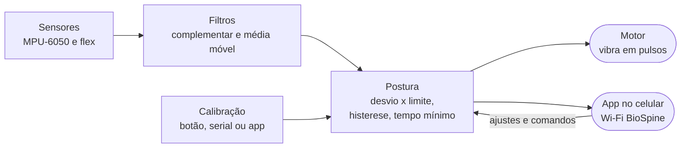

# Documentação — Colete Postural (BioSpine)

> Código: todo o repositório · Relacionados: [`../README.md`](../README.md) (comandos do dia a dia), [`../VALIDACAO.md`](../VALIDACAO.md) (teste no hardware), `montagem.pdf` (montagem; fora do repositório, na pasta acima)

Documentação do software do TCC "Colete Ortopédico Inteligente para Monitoramento Postural em Tempo Real":
o que o sistema faz, como foi pensado, como cada parte funciona e por que foi feita assim.

**Para ler, imprimir ou entregar: os PDFs em [`pdf/`](#pdf).** O `00-documentacao-completa.pdf` tem capa,
sumário com páginas e todos os documentos; há também um PDF por documento. Os `.md` desta pasta são a fonte
(é neles que se edita) e os PDFs são gerados a partir deles.

## Visão em uma figura

O colete lê a inclinação do tronco e a curvatura da coluna, compara com a postura calibrada e vibra quando a
postura ruim dura mais que o tempo configurado. O celular é opcional.



## Por onde começar

| Quem | Caminho sugerido |
|---|---|
| Quem vai escrever ou defender o TCC | [01](01-visao-geral.md) → [02](02-arquitetura.md) → [03](03-algoritmo-inclinacao.md) → [04](04-deteccao-e-calibracao.md) → [11](11-mapa-tcc.md) (correções do texto, figuras e perguntas da banca) |
| Quem vai mexer no código | [02](02-arquitetura.md) → [10](10-decisoes-de-projeto.md) → página do módulo em [referencia/](#referência-por-módulo) → [MANUTENCAO.md](MANUTENCAO.md) |
| Agente de IA | [MANUTENCAO.md](MANUTENCAO.md) primeiro (mapa arquivo → documento e regras), depois o documento do assunto |

## Capítulos

| # | Documento | Assunto |
|---|---|---|
| 01 | [Visão geral](01-visao-geral.md) | Problema, requisitos, hardware, pinagem, plataforma, estrutura do repositório |
| 02 | [Arquitetura](02-arquitetura.md) | Módulos, duas tarefas FreeRTOS, comunicação entre elas, boot, ciclo de controle, fluxo de dados |
| 03 | [Inclinação](03-algoritmo-inclinacao.md) | MPU-6050, offset do giroscópio, filtro complementar sobre o vetor gravidade, desvio, frente/lateral |
| 04 | [Detecção e calibração](04-deteccao-e-calibracao.md) | Parâmetros, limite + histerese + tempo mínimo, máquina de estados, calibração |
| 05 | [Sensores analógicos](05-sensores-analogicos.md) | Flex (divisor, média móvel, detecção, curvatura), "fantasma" do ADC, FSR |
| 06 | [Motor e NVS](06-motor-e-nvs.md) | Circuito e PWM do motor, padrões de vibração, chaves salvas na memória |
| 07 | [Protocolo e interfaces](07-protocolo-e-interfaces.md) | Wi-Fi, HTTP, JSON do WebSocket, comandos da serial, `diag`, compatibilidade BioSpine V3 |
| 08 | [App web](08-app-web.md) | Página embarcada: estrutura, fluxo de dados, gráfico, CSV, vista 3D, ajustes |
| 09 | [Simulador, testes e ferramentas](09-simulador-testes-ferramentas.md) | 21 testes, simulador do firmware, roteiros, ponte web, gráfico do TCC, geração do `.bin` |
| 10 | [Decisões de projeto](10-decisoes-de-projeto.md) | D-01 a D-20: o que foi decidido, por quê e onde está no código |
| 11 | [Mapa TCC ↔ código](11-mapa-tcc.md) | Afirmações do texto, correções, roteiro do capítulo de software, figuras, perguntas da banca |
| — | [Manutenção](MANUTENCAO.md) | Como manter esta documentação junto com o código e gerar os PDFs |

## Referência por módulo

Uma página por módulo de `src/`, com cada tipo, constante e função (o que faz, parâmetros, retorno, quem chama).

| Módulo | Página | Assunto |
|---|---|---|
| `config.h` | [config](referencia/config.md) | Todas as constantes: pinos, tempos, limites, padrões |
| `main.cpp`, `app.h` | [main](referencia/main.md) | `setup`, `loop`, tarefa de controle, trava, pedidos, eventos, calibração, botão |
| `tilt` | [tilt](referencia/tilt.md) | Vetores, `TiltFilter`, `angleBetweenDeg`, `tiltComponentsDeg` |
| `posture` | [posture](referencia/posture.md) | `Params`, `DetectorPostura`, `Calibrador`, `flexPct` |
| `filters.h` | [filters](referencia/filters.md) | `MediaMovel`, `Presenca`, `leituraAdcValida` |
| `mpu` | [mpu](referencia/mpu.md) | Driver do MPU-6050 |
| `sensors` | [sensors](referencia/sensors.md) | Agenda das leituras, `Leituras`, detecção dos canais |
| `motor` | [motor](referencia/motor.md) | PWM, alerta, sequências de pulsos |
| `settings` | [settings](referencia/settings.md) | NVS, `Config`, `Calibracao`, modos dos sensores |
| `console` | [console](referencia/console.md) | Interpretador da serial, `diag`, plotter, BioSpine |
| `protocolo` | [protocolo](referencia/protocolo.md) | Mensagens JSON do app |
| `web` | [web](referencia/web.md) | Access Point, HTTP, WebSocket |

## PDF

| Arquivo | Conteúdo |
|---|---|
| `pdf/00-documentacao-completa.pdf` | Capa, sumário com páginas e todos os documentos, na ordem desta página; os links entre documentos funcionam dentro do PDF |
| `pdf/<documento>.pdf` | Um por `.md`, no mesmo caminho (`referencia/mpu.md` → `pdf/referencia/mpu.pdf`); link para outro documento aparece como texto |

Depois de editar qualquer `.md`, gere de novo e commite a pasta `pdf/` junto:

```bash
python3 Documentação/gerar_pdf.py              # todos os PDFs (~20 s)
python3 Documentação/gerar_pdf.py --completo   # só o completo
python3 Documentação/gerar_pdf.py 05-sensores-analogicos.md   # só esse PDF separado (não refaz o completo)
```

Precisa de Node.js e de um Chrome/Chromium instalado (outro caminho: `CHROME=/caminho/do/navegador`). Na primeira
vez instala as dependências em `ferramentas/node_modules` (fora do git; versões fixas no `package-lock.json`).
Como funciona: `ferramentas/gerar_pdf.mjs` converte cada `.md` em HTML (markdown-it), desenha as fórmulas
(KaTeX) e os diagramas (mermaid.js) e o Chrome imprime em A4. Diagramas largos demais saem numa página deitada.

## Figuras para o texto do TCC

Todos os diagramas são **Mermaid** escritos dentro dos `.md`: o GitHub e o VS Code (com extensão de Mermaid)
desenham direto, e qualquer pessoa ou agente edita como texto, junto com o código.

Para colar no Word, gere as imagens:

```bash
python3 Documentação/gerar_figuras.py            # PNG (fundo branco, 2x) e SVG de todos os diagramas
python3 Documentação/gerar_figuras.py 04-deteccao-e-calibracao.md   # só de um documento
```

As imagens saem em `Documentação/figuras/<documento>-<n>.png` (`n` = ordem do diagrama no documento).
Essa pasta fica fora do git (`.gitignore`): a fonte é o texto Mermaid, e as imagens se geram de novo a qualquer momento.
Precisa de Node.js; usa o Chrome instalado. Alternativa sem instalar nada: colar o bloco em
<https://mermaid.live> e exportar. A lista de figuras sugeridas para o texto está em [11](11-mapa-tcc.md#figuras-sugeridas).

## Glossário

| Termo | Significado |
|---|---|
| ADC | Conversor analógico-digital: transforma a tensão do pino em número (0–4095 com 12 bits) |
| Access Point (AP) | Modo em que o próprio ESP32 cria a rede Wi-Fi, sem roteador |
| Calibração | Gravação da postura correta da pessoa (vetor gravidade e leituras do flex) |
| Desvio | Ângulo entre a orientação atual do tronco e a da calibração |
| Filtro complementar | Combinação do giroscópio (curto prazo) com o acelerômetro (longo prazo) |
| FreeRTOS | Sistema operacional de tempo real do ESP32; permite tarefas com prioridades |
| FSR | Sensor resistivo de força (pressão) |
| Histerese | Margem entre o valor que liga e o que desliga o alerta, para não oscilar |
| I2C | Barramento de dois fios (SDA, SCL) usado pelo MPU-6050 |
| IMU | Unidade de medição inercial: acelerômetro + giroscópio |
| LEDC | Periférico de PWM do ESP32 |
| LSB | Menor passo da leitura digital; "131 LSB/°/s" = 131 unidades por grau por segundo |
| NVS | Memória não volátil do ESP32, guardada na flash (o ESP32 não tem EEPROM) |
| PWM | Modulação por largura de pulso: liga e desliga rápido para controlar a potência |
| Serial Plotter | Gráfico em tempo real da saída serial (Arduino IDE ou `tools/grafico_serial.py`) |
| WebSocket | Conexão contínua de mão dupla entre a página e o colete |

## Situação

Tudo foi desenvolvido e testado **sem a placa** (testes nativos, simulador, página contra o firmware simulado).
O que só se confirma no hardware (driver do MPU, sinal do giroscópio, ADC real, Wi-Fi no celular, concorrência
das duas tarefas, quedas de tensão) está listado e roteirizado no [`VALIDACAO.md`](../VALIDACAO.md).
Registre os números medidos lá antes de citá-los no texto do TCC.
