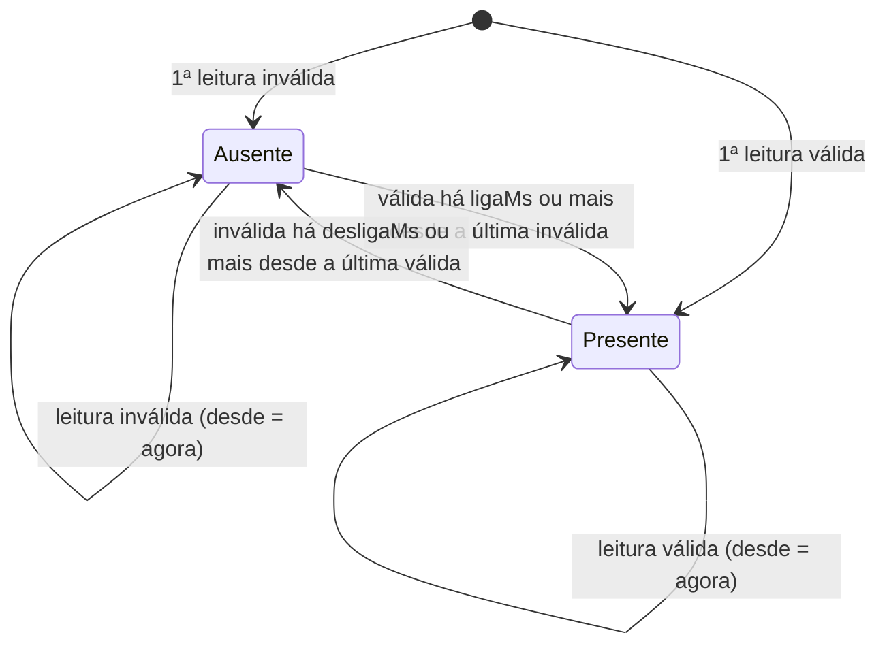

# Módulo `filters`

> Código: `src/filters.h` · Relacionados: [05 — Sensores analógicos](../05-sensores-analogicos.md), [sensors](sensors.md)

## Papel no sistema

Ferramentas pequenas para os sensores analógicos (flex 1, flex 2, FSR), usadas por `sensors.cpp`:

- `MediaMovel` suaviza a leitura do ADC e mede quanto ela oscila na janela;
- `leituraAdcValida` diz se a janela parece um divisor resistivo de verdade;
- `Presenca` transforma esse "parece válido agora" num "sensor presente" estável, com tempo mínimo para ligar e para
  desligar.

Juntas, elas implementam o **fallback do flex**: flex solto, quebrado ou sem resistor é desativado sozinho e o colete
segue só com o MPU. Tudo é header-only e sem Arduino, testado no PC.

## Dependências

- Usa: `<stdint.h>`.
- É usado por: `sensors.cpp`, testes.
- Roda em: tarefa de controle (ESP32, a 100 Hz, `PERIODO_ADC_MS`); PC (testes).

## Tipos e constantes

| Nome | Tipo | Descrição |
|---|---|---|
| `MediaMovel<N>` | template de classe | média móvel de `N` inteiros (buffer circular + soma corrente) |
| `Presenca` | classe | liga/desliga com persistência |
| `leituraAdcValida` | função inline | critério de leitura plausível de divisor resistivo |

Constantes de `config.h` usadas com estas ferramentas (em `sensors.cpp`):

| Constante | Valor | Uso |
|---|---|---|
| `ADC_MEDIA_N` | 10 amostras | tamanho da média móvel (a 100 Hz, janela de 100 ms) |
| `ADC_MIN_VALIDO` | 100 | abaixo: flex solto ou quebrado |
| `ADC_MAX_VALIDO` | 4000 | acima: falta o resistor de 10 kΩ |
| `ADC_RUIDO_MAX` | 300 | amplitude máxima da janela (pino solto oscila mais) |
| `FLEX_LIGA_MS` | 2000 ms | tempo válido contínuo para "presente" |
| `FLEX_DESLIGA_MS` | 1000 ms | tempo inválido contínuo para "ausente" |

## Funções

### `MediaMovel<N>::push(int v)`
- **O que faz:** acrescenta uma amostra. Com o buffer cheio, a mais antiga sai da soma antes de ser sobrescrita.
- **Observações:** custo O(1); a soma é `long` para não estourar com valores de 12 bits.

### `float MediaMovel<N>::media() const`
- **Retorno:** média das amostras presentes; antes de encher, divide só pelas que existem; 0 se vazia.

### `bool MediaMovel<N>::cheio() const` / `int MediaMovel<N>::ultimo() const`
- Já tem `N` amostras? / amostra mais recente (0 se vazia).

### `int MediaMovel<N>::amplitude() const`
- **O que faz:** `máximo − mínimo` da janela.
- **Por quê:** um pino solto (sem sensor) flutua e oscila muito mais que um divisor resistivo. A amplitude separa os
  dois casos mesmo quando a média cai na faixa válida. Custo O(N), com N = 10.

### `Presenca(uint32_t ligaMs, uint32_t desligaMs)`
- **Parâmetros:** `ligaMs` — tempo contínuo com a condição verdadeira para passar a presente; `desligaMs` — tempo
  contínuo com a condição falsa para passar a ausente.
- **Uso no firmware:** flex 1 e 2 com 2000/1000 ms; FSR com 2000/`UINT32_MAX` (depois de detectado, **nunca** volta a
  ausente até reiniciar, porque um FSR sem pressão lê ~0, igual a pino solto).

### `void Presenca::atualizar(bool okAgora, uint32_t agora)`
- **O que faz:** atualiza o estado com a leitura do instante.
- **Parâmetros:** `okAgora` — a leitura deste instante parece válida; `agora` — `millis()`.
- **Observações:**
  - A primeira chamada adota o valor recebido na hora, sem esperar (por isso um flex bem ligado já sai do `setup`
    como presente).
  - Enquanto a condição concorda com o estado, o cronômetro é reiniciado. Quando discorda, o estado só troca depois
    de `ligaMs`/`desligaMs` **contados desde a última amostra que concordava**. Uma única amostra concordante no meio
    reinicia a contagem (teste `test_presenca_com_persistencia`).

### `bool Presenca::presente() const`
- Estado atual (com persistência).

### `bool leituraAdcValida(float media, int amplitude, int minimo, int maximo, int ruidoMax)`
- **O que faz:** `minimo <= media <= maximo` **e** `amplitude <= ruidoMax`.
- **Chamada por:** `sensores_iniciar` e `sensores_atualizar` (`sensors.cpp`) com 100, 4000 e 300.
- **Observações:** o que cada falha indica, no divisor 3V3 → flex → pino → 10 kΩ → GND:

  | Leitura | Causa provável |
  |---|---|
  | ~0 | flex solto ou quebrado na base (pino puxado para GND pelo resistor) |
  | ~4095 | falta o resistor de 10 kΩ (pino puxado para 3V3 pelo flex) |
  | média ok, amplitude alta | mau contato ou pino flutuando |

Máquina de estados da `Presenca` (`desde` = instante da última amostra que concordou com o estado):

## Armadilhas e cuidados

- **Detectado não é o mesmo que ativo.** `Presenca` só diz se o sensor parece ligado. Para entrar na detecção de
  postura, o flex também precisa de modo `auto`/`on` e de uma referência válida gravada na calibração (`sensorAtivo`
  em `main.cpp`). Ver [05](../05-sensores-analogicos.md).
- **`ADC_RUIDO_MAX` e Wi-Fi:** o ruído real do ADC com o Wi-Fi ligado ainda precisa ser medido no hardware
  (`VALIDACAO.md`, V3.2). Se o flex alternar entre ativo e inativo, subir o limite.
- **`amplitude()` percorre a janela inteira:** barato com N = 10; se `ADC_MEDIA_N` crescer muito, considerar outra
  estrutura.
- Testes que cobrem o módulo: `test_media_movel`, `test_presenca_com_persistencia`, `test_leitura_adc_valida`.
