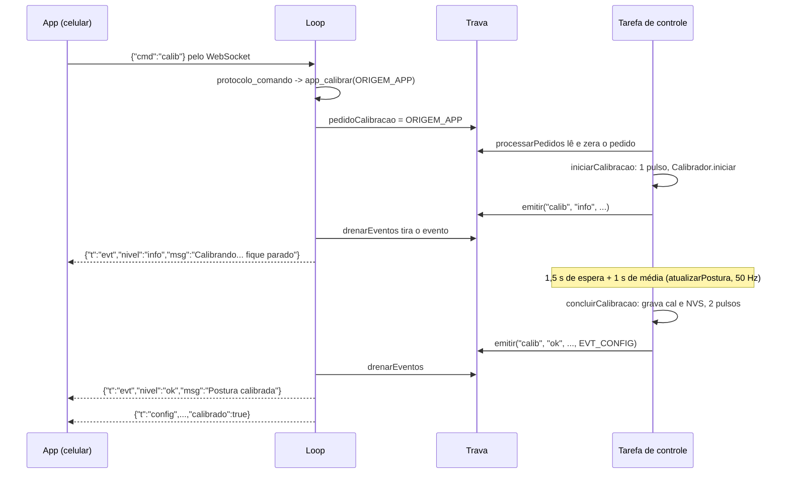
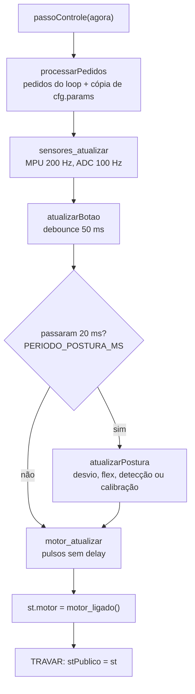

# Módulo `main` (núcleo e API `app_*`)

> Código: `src/main.cpp`, `src/app.h` · Relacionados: [02 — Arquitetura](../02-arquitetura.md), [04 — Detecção e calibração](../04-deteccao-e-calibracao.md), [console](console.md), [protocolo](protocolo.md)

## Papel no sistema

`main.cpp` liga todos os módulos: faz o boot (`setup`), roda a **tarefa de controle** (sensores → desvio →
detecção → motor, botão e calibração) e o **loop** (Wi-Fi e serial). Também implementa a API `app_*`
declarada em `app.h`, que é a porta principal pela qual a serial ([console](console.md)) e o app web
([protocolo](protocolo.md), [web](web.md)) conversam com o núcleo (as exceções, leituras diretas de `sensores()`,
estão em [02, seção 6](../02-arquitetura.md)).

A divisão em duas tarefas existe porque o Wi-Fi pode travar o `loop()` por vários segundos: quando o
celular sai do alcance, o envio TCP fica esperando dentro da biblioteca. Com a detecção numa tarefa à
parte, de prioridade maior, o colete continua detectando e vibrando nessa hora. Ele funciona sozinho, sem
celular e sem computador.

## Dependências

- Usa: [config](config.md), [sensors](sensors.md), [posture](posture.md) (`DetectorPostura`,
  `Calibrador`, `validarParams`), [tilt](tilt.md) (`angleBetweenDeg`, `tiltComponentsDeg`),
  [motor](motor.md), [settings](settings.md), [console](console.md), [web](web.md).
- É usado por: `console.cpp` e `protocolo.cpp` (pela API `app_*`); `sim/sim_main.cpp` chama `setup()` e
  `loop()` e também usa `app_status()`.
- Roda em: as duas tarefas (cada função diz qual, abaixo). No simulador (`-DSIMULADOR`) tudo roda numa
  linha só: o `loop()` chama `passoControle()` e a trava vira nada.

## Duas tarefas e como elas conversam

| | Tarefa de controle (`tarefaControle`) | Loop (`loop()` do Arduino) |
|---|---|---|
| Criada por | `xTaskCreatePinnedToCore` no fim do `setup` | core do Arduino |
| Núcleo / prioridade | núcleo 1, prioridade 3 | núcleo 1, prioridade 1 |
| Ritmo | um `passoControle` a cada 1 ms (`vTaskDelay(1)`) | o mais rápido possível |
| Faz | sensores, botão, desvio, detecção, calibração, motor | serial, HTTP, WebSocket, envio a 10 Hz |
| Pode bloquear? | não em Wi-Fi nem serial (nunca chama `Serial` nem `web_*`); esperas curtas e conhecidas: timeout do I2C, ~150 ms na reconexão do MPU, gravação da calibração na NVS | sim (Wi-Fi, serial) |

As duas tarefas trocam informação de três formas, todas protegidas pela mesma trava (fora delas, só leituras
de exibição de `sensores()` pelo loop, ver [02, seção 6](../02-arquitetura.md)):

1. **Pedidos** (loop → controle): `pedidoCalibracao` (a `Origem`, ou −1) e `pedidoMotorTeste`. O loop só
   marca; a tarefa de controle executa no próximo `processarPedidos`.
2. **Eventos** (controle → loop): fila circular `fila[FILA_N]` de `Evento`, preenchida por `emitir()` e
   esvaziada por `drenarEventos()`. É assim que a tarefa de controle "escreve" na serial e no app sem
   nunca esperar por eles.
3. **Cópias**: `cfg` (Config), `cal` (Calibracao) e `stPublico` (Status) são lidos sempre como cópia
   inteira (`app_config`, `app_calibracao`, `app_status`), para nunca ler uma struct pela metade.

A trava (`TRAVAR`/`DESTRAVAR`) é um `portMUX` do FreeRTOS: enquanto fechada, as interrupções do núcleo
ficam desligadas. Por isso dentro dela só se copia memória (microssegundos); nunca `Serial`, NVS ou Wi-Fi.

O diagrama mostra um pedido de calibração vindo do app, até a resposta voltar como evento.

## Um passo da tarefa de controle

Cada etapa tem o próprio período, controlado por `millis()`; o passo em si roda a cada 1 ms.

## Tipos e constantes

### `struct Status` (`app.h`)

Foto do colete num instante. Montada pela tarefa de controle (`st`) e publicada a cada passo em
`stPublico`. É a origem de tudo que o app e a serial mostram.

| Campo | Tipo | Unidade | Descrição |
|---|---|---|---|
| `pitch` | float | ° | componente frente/trás do desvio (só exibição) |
| `roll` | float | ° | componente lateral do desvio (só exibição) |
| `desvio` | float | ° | ângulo total entre a gravidade atual e a referência |
| `flex` | int | ADC 0–4095 | média móvel do flex 1 |
| `flexPct` | float | % | curvatura do flex 1 (0 se inativo) |
| `flexAtivo` | bool | — | flex 1 entra na detecção (`sensorAtivo`) |
| `flexDetectado` | bool | — | flex 1 parece ligado |
| `flex2`, `flex2Pct`, `flex2Ativo`, `flex2Detectado` | — | — | o mesmo para o flex 2 |
| `fsr` | int | ADC 0–4095 | média do FSR (só telemetria) |
| `fsrDetectado` | bool | — | já leu pressão estável desde o boot |
| `estado` | `Estado` | — | ok / atenção / alerta |
| `tempoRuimMs` | uint32_t | ms | há quanto tempo a postura está ruim (0 se boa) |
| `calibrado` | bool | — | existe referência gravada |
| `calibrando` | bool | — | calibração em andamento |
| `mpuOk` | bool | — | MPU-6050 respondendo |
| `motor` | bool | — | saída do motor ligada neste instante |

### `enum Origem` (`app.h`)

Quem pediu a calibração: `ORIGEM_BOTAO`, `ORIGEM_SERIAL` (comando `calib`), `ORIGEM_SERIAL_JSON`
(`CALIBRATE` do BioSpine V3) e `ORIGEM_APP`. Só muda o fim: com `ORIGEM_SERIAL_JSON`, a conclusão também
imprime `{"success":true,"message":"Calibration completed"}`.

### `struct Evento` e a fila (`main.cpp`)

| Campo | Tamanho | Descrição |
|---|---|---|
| `tag` | 8 | prefixo da serial (`calib`, `mpu`) → `[calib] ...` |
| `nivel` | 6 | nível do aviso no app: `info`, `ok`, `erro` |
| `console` | 96 | texto para a serial (`""` = não imprime) |
| `app` | 64 | texto curto para o toast do app (`""` = não envia) |
| `flags` | 1 | `EVT_CONFIG` (reenviar `{"t":"config"}`) e/ou `EVT_JSON_CALIB_OK` (resposta JSON do BioSpine) |

- Tamanho fixo: nada de alocação dinâmica dentro da tarefa de controle. Texto maior é cortado (`strlcpy`).
- `FILA_N = 8`. **Com a fila cheia, o evento novo é descartado** (perder um aviso é melhor que travar o
  controle). Na prática o loop esvazia a fila a cada volta; só enche se o loop ficar travado no Wi-Fi.

### Variáveis de estado

| Variável | Dona | Descrição |
|---|---|---|
| `cfg`, `cal`, `stPublico` | compartilhadas (trava) | config em vigor, calibração, última foto publicada |
| `pedidoCalibracao`, `pedidoMotorTeste` | compartilhadas (trava) | pedidos do loop |
| `detector`, `calibrador` | controle | máquina de estados da postura e média da calibração |
| `origemCalibracao` | controle | quem pediu a calibração em andamento |
| `st` | controle | foto em construção |
| `params` | controle | cópia de `cfg.params` tirada a cada passo |
| `intensidadeAplicada` | controle | última intensidade passada ao motor (255 = nenhuma) |
| `gBoot`, `temGBoot` | controle | referência provisória antes da 1ª calibração |
| `mpuAvisado` | controle | último estado do MPU já avisado |
| `ultimoPostura` | controle | agendamento dos 50 Hz |
| `botaoEstavel`, `botaoLido`, `botaoMudou` | controle | debounce do botão |
| `ultimoEnvio` | loop | agendamento dos 10 Hz |

## Funções

### API pública (`app.h`) — chamada pelo loop

#### `bool app_calibrar(Origem origem)`
- **O que faz:** registra um pedido de calibração para a tarefa de controle.
- **Parâmetros:** `origem` — quem pediu.
- **Retorno:** `false` (e avisa serial e app na hora) se o MPU não estiver respondendo; `true` se o pedido
  foi registrado. O resultado da calibração chega depois, como evento.
- **Chamada por:** `console.cpp` (`calib`, `CALIBRATE`), `protocolo.cpp` (`{"cmd":"calib"}`).
- **Observações:** retorna `true` mesmo se já houver uma calibração em andamento; nesse caso o pedido é
  ignorado pela tarefa de controle, sem aviso.

#### `void app_testarMotor()`
- **O que faz:** pede um pulso de `MOTOR_TESTE_MS` (1 s). Quem liga o motor é a tarefa de controle.
- **Chamada por:** `console.cpp` (`motor`, `diag`), `protocolo.cpp` (`motor_test`).

#### `Config app_config()` · `Calibracao app_calibracao()` · `Status app_status()`
- **O que fazem:** devolvem uma cópia (struct inteira, com a trava) da configuração, da calibração e da
  última foto publicada.
- **Chamadas por:** console, protocolo; `app_config`/`app_calibracao` também pela própria tarefa de
  controle (`atualizarPostura`, `concluirCalibracao`).

#### `void app_definirConfig(const Config& c)`
- **O que faz:** aplica uma configuração nova: `validarParams` (prende cada valor na faixa) → troca `cfg`
  → grava na NVS (`settings_salvarConfig`) → envia `{"t":"config"}` a todos os clientes do app.
- **Chamada por:** `console.cpp` (`set`, `reset`), `protocolo.cpp` (`set`, `reset`).
- **Observações:** só pode ser chamada do loop (envia pelo WebSocket). A tarefa de controle pega os
  parâmetros novos no próximo `processarPedidos`, em até ~1 ms.

### Eventos

#### `static void emitir(tag, nivel, console, app, flags = 0)`
- **O que faz:** monta um `Evento` e põe na fila. Fila cheia = descarta.
- **Roda em:** tarefa de controle.

#### `static void drenarEventos()`
- **O que faz:** tira os eventos um a um (com a trava) e entrega cada um com a trava aberta:
  `console_evento` (serial), `console_respostaJson` (se `EVT_JSON_CALIB_OK`), `web_evento` (app) e
  `web_enviarConfig` (se `EVT_CONFIG`).
- **Roda em:** loop, a cada volta.

### Tarefa de controle

#### `static void passoControle(uint32_t agora)`
- **O que faz:** um passo completo (diagrama acima). Termina publicando `st` em `stPublico`.
- **Chamada por:** `tarefaControle` (ESP32) ou `loop` (simulador).

#### `static void processarPedidos(uint32_t agora)`
- **O que faz:** numa trava só, lê e zera os pedidos e copia `cfg.params` para `params`. Depois executa:
  calibração, pulso de teste e, se a intensidade mudou, `motor_intensidade`.

#### `static void atualizarBotao(uint32_t agora)`
- **O que faz:** debounce. A leitura crua (`botaoLido`) só vira valor aceito (`botaoEstavel`) depois de
  ficar igual por `BOTAO_DEBOUNCE_MS`. Na transição para `LOW` (apertado) chama
  `iniciarCalibracao(ORIGEM_BOTAO)`. Segurar o botão não repete.

#### `static void atualizarPostura(uint32_t agora)` — 50 Hz
- **O que faz**, em ordem:
  1. Avisa (evento) se o MPU caiu ou voltou, só na mudança.
  2. Escolhe a referência: `cal.g0` se calibrado; senão `gBoot` (gravidade do primeiro instante com o MPU
     ok). Com `gBoot` o app já mostra o movimento, mas o detector não alerta (`Entrada::calibrado = false`).
  3. Calcula `desvio = angleBetweenDeg(g, ref)` e a decomposição `pitch`/`roll` (`tiltComponentsDeg`).
     Sem MPU, os três ficam 0 e só o flex pode alertar.
  4. Calcula `flexAtivo`/`flexPct` (e o mesmo do flex 2) com `sensorAtivo` e `flexPct`.
  5. Copia FSR, `calibrado`, `calibrando`.
  6. **Calibrando:** entrega amostras ao `Calibrador` (gravidade, flex 1 e 2, norma do giroscópio) e, ao
     terminar, chama `concluirCalibracao`. Estado fica `ok` (sem alerta durante a calibração).
     **Senão:** monta a `Entrada` e roda `detector.atualizar(e, params, agora)`.
  7. `motor_alerta(estado == ESTADO_ALERTA)`: só o alerta vibra; "atenção" é a contagem do tempo mínimo.

#### `static bool sensorAtivo(ModoSensor modo, bool detectado, float referencia)`
- **O que faz:** decide se um flex entra na detecção.

  | Modo | Resultado |
  |---|---|
  | `off` | nunca |
  | `on` | se a referência da calibração for válida (`ADC_MIN_VALIDO`–`ADC_MAX_VALIDO`) |
  | `auto` | se o sensor estiver detectado agora **e** a referência for válida |

- **Por quê:** sem uma referência gravada com o sensor ligado, `flexPct` não tem sentido. Por isso um flex
  ligado depois da calibração aparece no `get` como "detectado, recalibre para usar".

#### `static void iniciarCalibracao(Origem origem, uint32_t agora)`
- **O que faz:** se o MPU estiver ok e não houver calibração em andamento: guarda a origem, inicia o
  `Calibrador` (espera `CALIBRACAO_ESPERA_MS` + média de `CALIBRACAO_MS`), zera o detector, dá 1 pulso
  curto e emite "calibrando...". Sem MPU, emite erro.

#### `static void concluirCalibracao()`
- **O que faz:** encerra o `Calibrador` e:
  - **recusa** se `giroMax() > CALIBRACAO_GIRO_MAX` (30 °/s): 1 pulso longo (`MOTOR_ERRO_MS`), evento de
    erro, **mantém a calibração anterior**;
  - **aceita** caso contrário: `g0 = calibrador.gravidade()`; `flex0`/`flex20` = média do sensor se ele
    estiver detectado ou em modo `on`, senão 0 (fica fora da detecção); grava em `cal` e na NVS; zera o
    detector; 2 pulsos curtos; evento "Postura calibrada" com `EVT_CONFIG` (e `EVT_JSON_CALIB_OK` se veio
    do `CALIBRATE`).

#### `static void tarefaControle(void*)`
- **O que faz:** laço infinito `passoControle(millis()); vTaskDelay(1);`. O `vTaskDelay(1)` devolve a CPU
  por 1 tick (1 ms) para o loop e o watchdog.
- **Existe só no ESP32** (`#ifndef SIMULADOR`).

### Arduino

#### `void setup()`
Ordem do boot: serial 115200 → botão `INPUT_PULLUP` → `motor_iniciar` (motor desligado já no início) →
`settings_carregar` → banner → `sensores_iniciar` (bloqueia ~1 s medindo o offset do giroscópio: o colete
deve estar parado) → aviso se o MPU não respondeu → `web_iniciar` → `console_iniciar` → 1 pulso curto
("liguei") → cria a tarefa de controle.

#### `void loop()`
`drenarEventos` → `console_atualizar` → `web_atualizar` → a cada `PERIODO_ENVIO_MS` (100 ms):
`app_status()` e envio para o app (`web_enviarDados`) e a serial (`console_enviarDados`).
No simulador, chama `passoControle` antes de tudo.

## Armadilhas e cuidados

- **Nunca chamar `Serial`, `web_*`, `console_*` da tarefa de controle.** Use `emitir()`. Exceção já
  existente e segura: `settings_salvarCalibracao` (NVS) em `concluirCalibracao`.
- **Nada demorado dentro de `TRAVAR()`/`DESTRAVAR()`**: as interrupções ficam desligadas.
- **Leituras sem trava:** `app_calibrar` e `console.cpp` (`diag`) leem `sensores()` direto, sem trava. É
  aceitável para um booleano e para diagnóstico, mas não use esse caminho para lógica de decisão no loop.
- **Fila de eventos com 8 posições:** se uma mudança futura emitir muitos eventos seguidos, aumente `FILA_N`
  ou eles serão descartados em silêncio.
- **Sem calibração o colete não vibra** (decisão de projeto: sem referência não existe "postura correta").
- **Simulador:** qualquer código novo na tarefa de controle precisa compilar também com `-DSIMULADOR`
  (lá não existe FreeRTOS).
