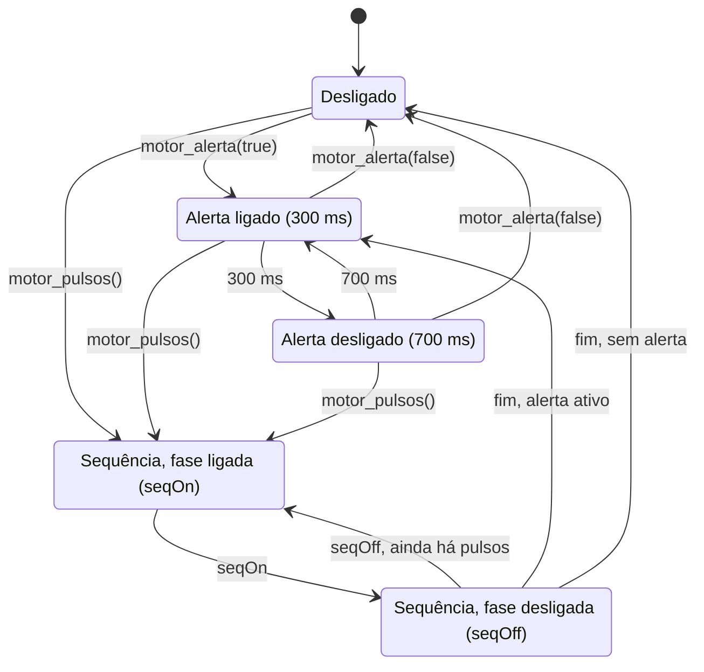
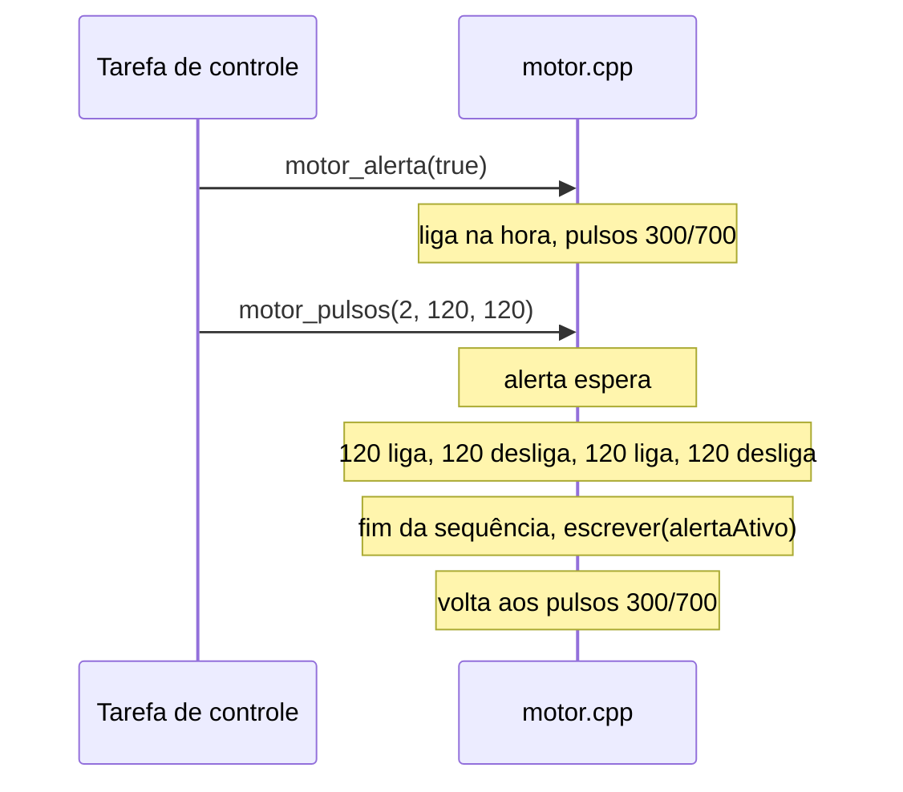

# Módulo `motor`

> Código: `src/motor.h`, `src/motor.cpp` · Relacionados: [06 — Motor e NVS](../06-motor-e-nvs.md), [main](main.md), [config](config.md)

## Papel no sistema

Controla a única saída do colete: o **motor vibratório**, por PWM, com o **LED azul da placa** acendendo junto (dá para
ver o alerta mesmo sem motor ligado). Dois usos convivem:

| Uso | Padrão | Quem pede |
|---|---|---|
| **Alerta** | 300 ms ligado / 700 ms desligado, enquanto a postura estiver em alerta | `atualizarPostura` (`main.cpp`) |
| **Sequência** | pulsos curtos de aviso | `setup`, calibração, teste do motor (`main.cpp`) |

A **sequência tem prioridade**: se começa durante o alerta, o alerta espera ela terminar e depois retoma. Tudo sem
`delay()`: cada fase guarda o instante em que começou e `motor_atualizar` troca de fase quando a duração passa.

Circuito: GPIO25 (`PIN_MOTOR`) → 1 kΩ → base do NPN (2N2222/BC337); o transistor liga o motor (3 V, ~60 mA, mais do
que um GPIO aguenta), com diodo de flyback em paralelo. Detalhes em `montagem.pdf`.

## Dependências

- Usa: `Arduino.h` (LEDC, `digitalWrite`, `millis`), `config.h` (pinos, `MOTOR_*`, `PADRAO_INTENSIDADE`).
- É usado por: `main.cpp` (único usuário).
- Roda em: tarefa de controle (e no `setup()`, antes dela existir). O loop **não** chama o motor direto: pede o teste
  com `app_testarMotor` (pedido executado pela tarefa de controle).

## Tipos e constantes

Constantes de `config.h`:

| Constante | Valor | Uso |
|---|---|---|
| `MOTOR_LEDC_CANAL` | 0 | canal do LEDC (API do core 2.x) |
| `MOTOR_LEDC_FREQ` | 20 000 Hz | frequência do PWM: acima da faixa audível, o motor não "chia" |
| `MOTOR_LEDC_BITS` | 8 | resolução do duty (0–255, passos de ~0,4 %) |
| `MOTOR_ALERTA_ON_MS` / `MOTOR_ALERTA_OFF_MS` | 300 / 700 ms | padrão do alerta (pulsado incomoda menos que contínuo e gasta menos bateria) |
| `MOTOR_TESTE_MS` | 1000 ms | teste do motor (`motor`, `diag`, botão do app) |
| `MOTOR_CONFIRMA_MS` | 120 ms | pulso curto de confirmação |
| `MOTOR_ERRO_MS` | 600 ms | pulso longo: calibração recusada |

Estado interno (`motor.cpp`):

| Nome | Descrição |
|---|---|
| `alertaAtivo` | postura em alerta (último valor de `motor_alerta`) |
| `intensidade` | potência em % |
| `saida` | motor ligado neste instante |
| `marco` | `millis()` do início da fase atual |
| `seqRestantes` | fases restantes da sequência (cada pulso = 2 fases: ligado e desligado) |
| `seqOn`, `seqOff` | duração das fases da sequência (ms) |

Padrões de pulso usados pelo firmware:

| Situação | Chamada (em `main.cpp`) | O que a pessoa sente |
|---|---|---|
| Ligou | `motor_pulsos(1, 120, 0)` | 1 pulso curto |
| Calibração começou | `motor_pulsos(1, 120, 0)` | 1 pulso curto: "fique parado" |
| Calibração concluída | `motor_pulsos(2, 120, 120)` | 2 pulsos curtos |
| Calibração recusada (mexeu) | `motor_pulsos(1, 600, 0)` | 1 pulso longo |
| Teste do motor | `motor_pulsos(1, 1000, 0)` | 1 s ligado |
| Alerta | `motor_alerta(true)` | 300 ms ligado / 700 ms desligado, repetindo |

## Funções

### `void motor_iniciar()`
- **O que faz:** configura o LED como saída e o LEDC (20 kHz, 8 bits) no `PIN_MOTOR`, com o motor desligado.
- **Chamada por:** `setup()`.
- **Observações:** o core Arduino-ESP32 3.x mudou a API do LEDC (por pino: `ledcAttach`/`ledcWrite(pino, ...)`) em
  relação ao 2.x (por canal: `ledcSetup` + `ledcAttachPin`/`ledcWrite(canal, ...)`). O projeto usa o core 2.x
  (`espressif32@6.9.0`), mas o código compila nos dois via `ESP_ARDUINO_VERSION_MAJOR`. No simulador a macro não
  existe, vale 0 e cai no ramo 2.x (que `sim/Arduino.h` imita).

### `void motor_atualizar(uint32_t agoraMs)`
- **O que faz:** avança as fases. Prioridade: sequência > alerta > desligado.
- **Parâmetros:** `agoraMs` — `millis()`.
- **Chamada por:** `passoControle` (`main.cpp`), a cada passo da tarefa de controle.
- **Observações:**
  1. Sequência em andamento: quando a fase atual acaba, decrementa `seqRestantes` e alterna ligado/desligado; ao
     terminar a última fase, volta para o estado do alerta (`escrever(alertaAtivo)`).
  2. Sem alerta: garante o motor desligado.
  3. Alerta: alterna 300 ms ligado / 700 ms desligado.

### `void motor_alerta(bool ativo)`
- **O que faz:** liga/desliga o padrão de alerta.
- **Parâmetros:** `ativo` — `estado == ESTADO_ALERTA`.
- **Chamada por:** `atualizarPostura` (`main.cpp`) a 50 Hz, sempre com o valor atual.
- **Observações:** só age quando o valor muda. Ao entrar em alerta, o motor liga **na hora** (resposta imediata). Se
  houver uma sequência em andamento, só registra; a sequência termina e o alerta assume.

### `void motor_pulsos(uint8_t quantidade, uint16_t ligadoMs, uint16_t desligadoMs)`
- **O que faz:** começa uma sequência de `quantidade` pulsos (`ligadoMs` ligado + `desligadoMs` desligado). Começa
  ligado na hora.
- **Chamada por:** `setup`, `iniciarCalibracao`, `concluirCalibracao`, `processarPedidos` (`main.cpp`).
- **Observações:** `seqRestantes = 2 × quantidade` (fases). Uma sequência nova substitui a que estiver em andamento.
  `quantidade = 0` não faz nada.

### `void motor_intensidade(uint8_t pct)`
- **O que faz:** muda a potência (duty = 255 × pct / 100). Se o motor estiver ligado, aplica na hora.
- **Chamada por:** `processarPedidos` (`main.cpp`), quando `Params::intensidade` muda.

### `bool motor_ligado()`
- **Retorno:** motor ligado neste instante. Vai para o `Status::motor` e para o app (campo `motor`).

### `static void escrever(bool ligado)` (privada)
- Calcula o duty com a intensidade, escreve no LEDC e copia o estado para o LED (`PIN_LED`, GPIO2).

Máquina de estados do motor (a sequência interrompe o alerta e devolve o controle a ele no fim):

Exemplo de linha do tempo: alerta ativo e, no meio dele, uma calibração concluída (`motor_pulsos(2, 120, 120)`):

## Armadilhas e cuidados

- **Não usar `delay()`** aqui: bloquearia a tarefa de controle (sensores e postura param).
- **20 kHz:** alguns transistores ou motores respondem mal a PWM rápido. Se a 100 % vibrar fraco ou fizer ruído,
  testar `MOTOR_LEDC_FREQ` = 1000 (`VALIDACAO.md`, V4.3).
- **Reset quando o motor liga:** o pico de corrente pode derrubar a tensão do ESP32. Mitigações no hardware
  (capacitor de 100 µF, power bank bom) e no firmware (potência do Wi-Fi reduzida em `web.cpp`).
- **`motor_alerta` e `motor_pulsos` usam `millis()` internamente**, não o `agoraMs` do passo. A diferença é de no
  máximo um passo (~1 ms).
- **Só a tarefa de controle chama este módulo.** Chamar do loop criaria acesso concorrente às variáveis estáticas sem
  trava.
