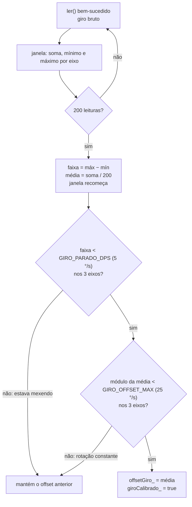

# Módulo `mpu`

> Código: `src/mpu.h`, `src/mpu.cpp` · Relacionados: [03 — Inclinação](../03-algoritmo-inclinacao.md), [sensors](sensors.md), [tilt](tilt.md)

## Papel no sistema

Driver mínimo do MPU-6050 (acelerômetro + giroscópio de 3 eixos, I2C), escrito direto nos registradores. É a única
parte do firmware que fala I2C com o sensor. Entrega aceleração em **g** e velocidade angular em **°/s** já sem o
offset do giroscópio.

Por que um driver próprio em vez da biblioteca `MPU6050_light` (decisão registrada em
[10](../10-decisoes-de-projeto.md)):

- o `calcOffsets()` da biblioteca supõe o sensor deitado; no colete ele fica em pé;
- o endereço 0x68 é fixo; aqui o sensor é procurado em 0x68 e 0x69;
- o ângulo da biblioteca salta perto da vertical (o firmware usa o vetor gravidade, ver [tilt](tilt.md));
- o texto do TCC fixa as escalas ±250 °/s e ±2 g: aqui elas são configuradas explicitamente.

## Dependências

- Usa: `Wire.h` (I2C), `Arduino.h` (`delay`, `min`, `max`), `config.h` (`MPU_ADDR_A/B`, `GIRO_PARADO_DPS`,
  `GIRO_OFFSET_MAX`), `tilt.h` (`Vec3`).
- É usado por: `sensors.cpp` (único usuário).
- Roda em: tarefa de controle (ESP32). `calibrarGiro` roda só no `setup()`. No simulador, `sim/Wire.h` +
  `sim/sim_main.cpp` imitam o MPU nos mesmos registradores.

## Tipos e constantes

### Registradores usados (datasheet / mapa de registradores MPU-6000/6050, rev. 4.2)

| Registrador | Endereço | Valor escrito | Efeito |
|---|---|---|---|
| `PWR_MGMT_1` | 0x6B | `0x80` | DEVICE_RESET: volta tudo ao padrão (estado conhecido também na reconexão); o chip fica dormindo |
| `PWR_MGMT_1` | 0x6B | `0x01` | SLEEP = 0 (acorda) e CLKSEL = 1 (PLL do giroscópio X, mais estável que o oscilador interno) |
| `SMPLRT_DIV` | 0x19 | `0x00` | taxa interna = 1 kHz / (1 + 0) = 1 kHz (com o DLPF ligado) |
| `CONFIG` | 0x1A | `0x03` | DLPF_CFG = 3: banda de ~44 Hz (acelerômetro) e ~42 Hz (giroscópio), ~5 ms de atraso |
| `GYRO_CONFIG` | 0x1B | `0x00` | FS_SEL = 0: ±250 °/s |
| `ACCEL_CONFIG` | 0x1C | `0x00` | AFS_SEL = 0: ±2 g |
| `ACCEL_CONFIG2` | 0x1D | `0x03` | só família MPU-6500: filtro do acelerômetro (~44 Hz) fica neste registrador |
| `ACCEL_XOUT_H` | 0x3B | — (leitura) | início dos 14 bytes de medida |
| `WHO_AM_I` | 0x75 | — (leitura) | identificação do chip |

### Escalas e sensibilidade

| Grandeza | Escala | Sensibilidade (`mpu.cpp`) | Por quê |
|---|---|---|---|
| Aceleração | ±2 g | 16384 LSB/g (`LSB_POR_G`) | mede só a direção de 1 g: a escala mais sensível dá a melhor resolução |
| Velocidade angular | ±250 °/s | 131 LSB/(°/s) (`LSB_POR_DPS`) | movimento de tronco fica bem abaixo de 250 °/s |

O filtro de ~44 Hz corta a vibração do motor e o ruído acima do que o corpo consegue fazer, e fica abaixo da metade
da taxa de leitura do firmware (200 Hz), o que evita aliasing.

### Campos da classe `Mpu6050`

| Campo | Descrição |
|---|---|
| `ok_` | sensor respondendo (iniciado e sem 10 falhas seguidas) |
| `addr_` | endereço I2C encontrado (0x68, 0x69 ou 0) |
| `whoAmI_` | valor de `WHO_AM_I` |
| `falhas_` | leituras seguidas com erro |
| `offsetGiro_` | offset descontado do giroscópio (°/s) |
| `giroCalibrado_` | o offset já foi medido alguma vez |
| `janSoma_`, `janMin_`, `janMax_`, `janN_` | janela do recálculo automático do offset |

## Funções

### `bool Mpu6050::iniciar()`
- **O que faz:** procura o sensor em 0x68 (`MPU_ADDR_A`, AD0 solto/GND) e depois em 0x69 (`MPU_ADDR_B`, AD0 em 3V3),
  reseta, configura os registradores da tabela e faz uma leitura de teste.
- **Retorno:** `true` se achou, configurou e leu.
- **Chamada por:** `iniciarMpu` em `sensors.cpp` (boot e reconexão a cada `MPU_REINICIO_MS` = 2 s).
- **Observações:** bloqueia ~150 ms (100 ms depois do reset + 50 ms para estabilizar). O `WHO_AM_I` é só informativo
  (aparece no `diag`): 0x68 = MPU-6050 original; 0x70, 0x71, 0x73, 0x74 = família MPU-6500 (6500, 9250, 9255...), que é
  compatível nesses registradores mas tem o filtro do acelerômetro no 0x1D. Outros valores = clones; o firmware segue
  usando.

### `bool Mpu6050::ler(Vec3* acc, Vec3* gyro)`
- **O que faz:** leitura normal (200 Hz): lê, conta falhas, alimenta o recálculo do offset e desconta o offset.
- **Parâmetros:** saídas `acc` (g) e `gyro` (°/s, sem offset).
- **Retorno:** `false` se a leitura falhou ou se o sensor já está marcado como caído.
- **Chamada por:** `sensores_atualizar` e `iniciarMpu` (`sensors.cpp`).
- **Observações:** uma falha isolada é tolerada; **10 seguidas** marcam `ok_ = false` (fio solto). Daí em diante
  `sensors.cpp` tenta `iniciar()` a cada 2 s. O recálculo do offset recebe o valor **bruto** (antes do desconto).

### `bool Mpu6050::calibrarGiro()`
- **O que faz:** mede o offset do giroscópio no boot: 200 leituras a cada 5 ms (~1 s, bloqueante).
- **Retorno:** `true` se gravou o offset. Recusa se mais da metade das leituras falhar ou se algum eixo variar mais
  que `GIRO_PARADO_DPS` (5 °/s) — a placa mexeu e o offset sairia errado. Nesse caso fica sem offset; o filtro
  complementar corrige a deriva de qualquer jeito e o recálculo automático mede depois.
- **Chamada por:** `iniciarMpu(true)` em `sensores_iniciar` (só no `setup()`, antes da tarefa de controle existir).
  Na reconexão não é chamada, para não travar a tarefa de controle por 1 s.

### `bool ok() const` / `bool giroCalibrado() const` / `uint8_t endereco() const` / `uint8_t whoAmI() const`
- Acesso aos campos `ok_`, `giroCalibrado_`, `addr_`, `whoAmI_`.

### Privadas

| Função | O que faz |
|---|---|
| `escrever(reg, valor)` | escreve um registrador (`[endereço][reg][valor]`); `true` com ACK |
| `lerBytes(reg, buf, n)` | escolhe o registrador e lê `n` bytes seguidos com *repeated start* (`endTransmission(false)`), sem soltar o barramento; o MPU incrementa o ponteiro sozinho |
| `lerBruto(acc, gyro)` | lê 14 bytes a partir de 0x3B: acelerômetro X/Y/Z, temperatura (ignorada), giroscópio X/Y/Z. Cada medida é `int16_t` big-endian (byte alto primeiro, complemento de 2); divide pela sensibilidade |
| `acumularOffset(giroBruto)` | janela do recálculo automático (abaixo) |
| `responde(addr)` (estática do .cpp) | transmissão vazia: `true` se algum dispositivo dá ACK no endereço |

### Recálculo automático do offset (`acumularOffset`)

O giroscópio parado não lê zero: cada eixo tem um offset de alguns °/s que muda com a temperatura. Integrado pelo
filtro, ele viraria deriva do ângulo. A medição do boot falha se o colete for ligado já vestido (a pessoa se mexe).
Por isso o offset é recalculado sozinho a cada janela de 200 leituras (~1 s a 200 Hz) em que o sensor ficou parado:

## Armadilhas e cuidados

- **Nunca rodou no hardware antes da validação** (`VALIDACAO.md`, F2): registradores, escala, sinal dos eixos e I2C a
  100 kHz são os maiores riscos. Se o desvio de uma inclinação de 30° der 15° ou 60°, conferir `LSB_POR_G`,
  `LSB_POR_DPS` e os valores de `GYRO_CONFIG`/`ACCEL_CONFIG`.
- **Escalas e sensibilidades andam juntas.** Mudar `GYRO_CONFIG`/`ACCEL_CONFIG` exige mudar `LSB_POR_DPS`/`LSB_POR_G`
  (e o texto do TCC, ver [11](../11-mapa-tcc.md)).
- **`calibrarGiro` é bloqueante** (~1 s): não chamar da tarefa de controle em funcionamento.
- **Recálculo absorve rotação lenta e constante:** uma rotação contínua abaixo de 5 °/s de variação e 25 °/s de média
  durante 1 s seria tomada como offset naquela janela. O acelerômetro corrige essa deriva em menos de um segundo
  (filtro complementar), então o efeito é pequeno.
- **I2C compartilhado:** o comando `diag` faz a varredura do barramento (`sensores_scanI2C`) a partir do loop,
  enquanto a tarefa de controle lê o MPU. Isso depende da trava interna do `Wire` do core Arduino-ESP32.
- **Simulador:** o MPU falso devolve `WHO_AM_I` 0x68 e usa a mesma convenção de eixos do código; ele não valida sinais
  nem escalas do chip real.
