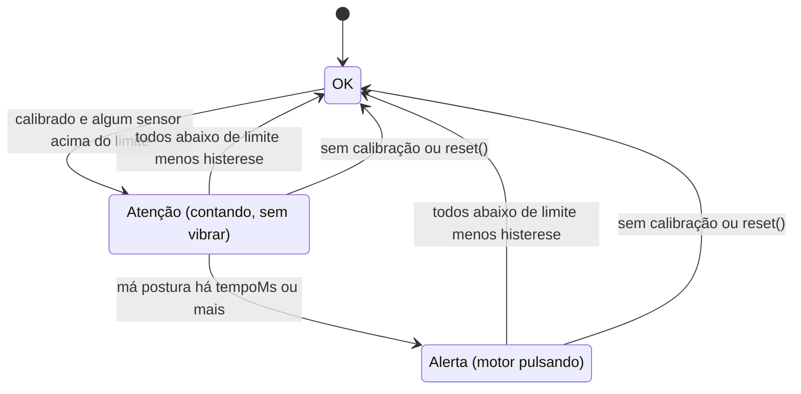
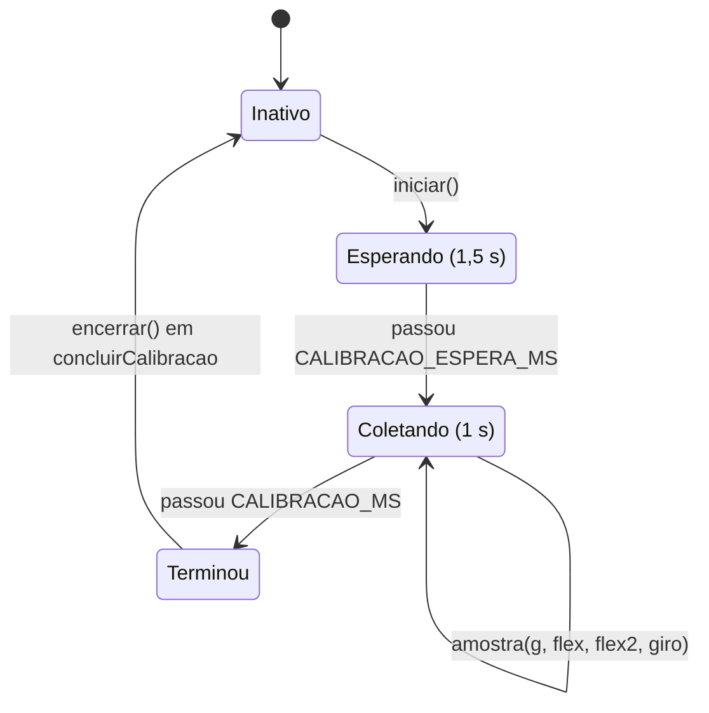

# Módulo `posture`

> Código: `src/posture.h`, `src/posture.cpp` · Relacionados: [04 — Detecção e calibração](../04-deteccao-e-calibracao.md), [main](main.md), [tilt](tilt.md), [settings](settings.md)

## Papel no sistema

Decide **quando o colete vibra** e guarda a lógica da **calibração**. Recebe o desvio (°) do MPU e a curvatura (%) dos
flex, aplica limite, histerese e tempo mínimo e devolve o estado: ok, atenção ou alerta. O `Calibrador` faz a média
da postura correta (gravidade e flex) que vira a referência salva na NVS.

Fica separado de `main.cpp` e sem Arduino para ser testado no PC: é o coração do comportamento do colete e tem o maior
grupo dos 21 testes nativos (10; `tilt` tem 8 e `filters`, 3).

## Dependências

- Usa: `tilt.h` (`Vec3`, `normalize`), `config.h` (valores `PADRAO_*`).
- É usado por: `main.cpp` (detector, calibrador, `validarParams`, `flexPct`), `settings.cpp` (`paramsPadrao`,
  `validarParams`), `protocolo.cpp` (`estadoNome`), `console.cpp` (`Estado`), `app.h` (`Estado` no `Status`),
  testes.
- Roda em: tarefa de controle (detector e calibrador, 50 Hz); `validarParams` também no loop (via
  `app_definirConfig`); PC (testes e simulador).

## Tipos e constantes

### `struct Params` — parâmetros ajustáveis (serial, app, NVS)

| Campo | Tipo | Descrição | Unidade | Padrão (`config.h`) | Faixa (`validarParams`) |
|---|---|---|---|---|---|
| `limiteGraus` | `float` | desvio máximo aceito | ° | 20 (`PADRAO_LIMITE_GRAUS`) | 2–60 |
| `histerese` | `float` | margem abaixo do limite para sair da má postura (vale para o MPU e para o flex) | ° ou pontos % | 3 (`PADRAO_HISTERESE`) | 0 até (menor limite − 1) |
| `tempoMs` | `uint32_t` | tempo mínimo em má postura antes de vibrar | ms | 3000 (`PADRAO_TEMPO_MS`) | 0–60 000 |
| `limiteFlex` | `float` | curvatura máxima do flex | % | 15 (`PADRAO_LIMITE_FLEX`) | 2–90 |
| `intensidade` | `uint8_t` | potência do motor (duty do PWM) | % | 100 (`PADRAO_INTENSIDADE`) | 0–100 |

### `enum Estado`

| Valor | Nome no app (`estadoNome`) | Nome no JSON BioSpine (`console.cpp`) | Significado |
|---|---|---|---|
| `ESTADO_OK = 0` | `ok` | `GOOD` | postura boa (ou sem calibração) |
| `ESTADO_ATENCAO = 1` | `atencao` | `WARNING` | passou do limite, contando o tempo mínimo; não vibra |
| `ESTADO_ALERTA = 2` | `alerta` | `BAD` | passou do limite há `tempoMs` ou mais; motor pulsando |

Os valores numéricos indexam a tabela `{"GOOD", "WARNING", "BAD"}` de `console.cpp`: não reordenar.

### `struct Entrada` — o que o detector recebe a cada atualização

| Campo | Tipo | Descrição |
|---|---|---|
| `calibrado` | `bool` | existe referência salva; sem ela o detector fica sempre em ok |
| `desvio` | `float` | ° em relação à postura calibrada |
| `flexAtivo`, `flexPct` | `bool`, `float` | flex 1 entra na decisão? curvatura em % |
| `flex2Ativo`, `flex2Pct` | `bool`, `float` | idem para o flex 2 |

Montada em `atualizarPostura` (`main.cpp`). "Ativo" já considera o modo (auto/on/off), a detecção e a referência
(função `sensorAtivo` de `main.cpp`).

## Funções

### `Params paramsPadrao()`
- **O que faz:** devolve os valores de fábrica (`PADRAO_*` de `config.h`).
- **Chamada por:** `configPadrao` (`settings.cpp`), testes.

### `Params validarParams(Params p)`
- **O que faz:** prende cada campo numa faixa segura (tabela acima).
- **Parâmetros:** `p` — valores vindos da serial, do app ou da NVS (podem ser qualquer coisa).
- **Retorno:** cópia corrigida.
- **Chamada por:** `app_definirConfig` (`main.cpp`), `settings_carregar` (`settings.cpp`), testes.
- **Observações:**
  - `NaN` vira o mínimo da faixa (a função interna `prender` testa `v != v`).
  - **Por que histerese < menor limite − 1:** para sair da má postura o valor precisa ficar abaixo de
    `limite − histerese`. Se a histerese fosse maior ou igual ao limite, esse valor seria ≤ 0, e desvio e `flexPct`
    nunca são negativos: o colete **nunca sairia do alerta**. Como a mesma histerese vale para o MPU (°) e para o flex
    (%), ela é limitada pelo **menor** dos dois limites. O "− 1" garante pelo menos 1 unidade de faixa para a saída.
    Na página web o controle deslizante da histerese também é limitado (`ajustarHisterese`).

### `const char* estadoNome(Estado e)`
- **O que faz:** nome do estado no protocolo do app (`"ok"`, `"atencao"`, `"alerta"`).
- **Chamada por:** `protocolo_dados` (`protocolo.cpp`), simulador.

### `float flexPct(float leitura, float referencia)`
- **O que faz:** curvatura do flex como % de queda da leitura em relação à calibração.
- **Parâmetros:** `leitura` — média atual do ADC; `referencia` — média gravada na calibração (`flex0` ou `flex20`).
- **Retorno:** `(referencia − leitura) / referencia × 100`, preso em 0–100. `0` se `referencia < 1` (sem calibração
  do flex).
- **Chamada por:** `atualizarPostura` (`main.cpp`), testes.
- **Observações:** o divisor é 3V3 → flex → pino → 10 kΩ → GND. Ao dobrar, a resistência do flex sobe e a tensão no
  pino cai; por isso a curvatura é a **queda** relativa. Ex.: referência 2048 e leitura 1536 → 25 %. Leitura acima da
  referência (flex dobrado para o outro lado) dá 0, não negativo.

### `DetectorPostura::reset()`
- **O que faz:** volta para ok e esquece o tempo acumulado.
- **Chamada por:** construtor; `iniciarCalibracao` e `concluirCalibracao` (`main.cpp`), para a referência nova
  começar do zero.

### `Estado DetectorPostura::atualizar(const Entrada& e, const Params& p, uint32_t agoraMs)`
- **O que faz:** avalia uma nova entrada e devolve o estado.
- **Parâmetros:** `e` — entrada; `p` — parâmetros já validados; `agoraMs` — `millis()`.
- **Retorno:** novo estado.
- **Chamada por:** `atualizarPostura` (`main.cpp`) a 50 Hz (`PERIODO_POSTURA_MS`), só quando não está calibrando.
- **Observações:** duas camadas.
  1. **Má postura com histerese** (`ruim_`):
     - **entra** quando *algum* sensor passa do limite: `desvio > limiteGraus` **OU** `flexPct > limiteFlex` (de cada
       flex ativo);
     - **sai** quando *todos* os sensores ativos ficam abaixo de `limite − histerese`: `desvio < limiteGraus −
       histerese` **E** `flexPct < limiteFlex − histerese`;
     - entre os dois valores (faixa de histerese), mantém o que era. Isso impede o motor de ficar ligando e
       desligando quando o desvio oscila em cima do limite.
  2. **Tempo mínimo:** com `ruim_` há menos de `tempoMs` → **atenção** (não vibra); há `tempoMs` ou mais → **alerta**.
     Um pico curto (pegar algo no chão) não vibra. O tempo é contado a partir do instante em que `ruim_` ligou e
     recomeça do zero se a postura voltar a ser boa.
  - Sem calibração (`e.calibrado == false`), `ruim_` é forçado a `false`: sem referência não existe "postura
    correta". Por isso o colete **não vibra antes da primeira calibração**.
  - A conta `agoraMs − inicio_` é em `uint32_t`: continua certa quando `millis()` dá a volta (~49 dias).

### `Estado estado() const` / `bool ruim() const` / `uint32_t tempoRuimMs(uint32_t agoraMs) const`
- Último estado / se está em má postura (atenção ou alerta) / há quantos ms está em má postura (0 se não está; vai
  para o app como `tempoRuimMs`, que desenha a barra de contagem até vibrar).

Máquina de estados do detector:

Exemplo com os padrões (limite 20°, histerese 3°, tempo 3000 ms), combinando os testes `test_atencao_e_depois_alerta`
e `test_histerese` (os valores 18° e 16,9° vêm do segundo, que os testa em outros instantes):

| t (ms) | desvio | Estado | Por quê |
|---|---|---|---|
| 0 | 10° | ok | abaixo do limite |
| 1000 | 25° | atenção | passou de 20°; começa a contar |
| 3999 | 25° | atenção | 2999 ms < 3000 ms |
| 4000 | 25° | alerta | 3000 ms em má postura |
| 4100 | 18° | alerta | abaixo de 20°, mas acima de 17° (20 − 3): faixa de histerese |
| 4200 | 16,9° | ok | abaixo de 17° |

### Classe `Calibrador`

Faz a média da postura correta. A linha do tempo é: `iniciar()` → espera `CALIBRACAO_ESPERA_MS` (1,5 s, para a pessoa
se ajeitar depois de apertar o botão) → coleta durante `CALIBRACAO_MS` (1 s) → `terminou()`. Quem decide aceitar ou
recusar é `concluirCalibracao` em `main.cpp`, olhando `giroMax()` contra `CALIBRACAO_GIRO_MAX` (30 °/s).

| Método | O que faz |
|---|---|
| `iniciar(agoraMs, esperaMs, duracaoMs)` | zera as somas, marca o início e fica ativo |
| `coletando(agoraMs)` | `true` depois da espera (as amostras contam) |
| `amostra(g, flex, flex2, giroDps)` | soma uma amostra; guarda o maior `giroDps` (módulo do giroscópio, °/s). Ignorada se inativo |
| `terminou(agoraMs)` | `true` quando espera + coleta já passaram |
| `encerrar()` | fica inativo; as médias continuam legíveis |
| `ativo()`, `amostras()` | em andamento? quantas amostras entraram |
| `gravidade()` | soma das gravidades normalizada = direção média (vira `Calibracao::g0`) |
| `flex()`, `flex2()` | média das leituras (viram `flex0` e `flex20`; 0 se não houve amostras) |
| `giroMax()` | maior velocidade angular durante a coleta (°/s) |

`main.cpp` chama `amostra` a 50 Hz enquanto `coletando()`: cerca de 50 amostras por calibração.

## Armadilhas e cuidados

- **OR para entrar, AND para sair.** Trocar a lógica faria o colete sair do alerta com um sensor ainda ruim, ou nunca
  entrar com o flex.
- **Uma histerese só** para graus e para %. Se um dia precisarem de histereses diferentes, `validarParams` e a página
  web (`ajustarHisterese`) também mudam.
- **Sem calibração não alerta** (decisão de projeto, ver [10](../10-decisoes-de-projeto.md)). Não "consertar"
  usando a gravidade do boot: ela serve só para mostrar movimento antes da calibração.
- **Ordem do `enum Estado`** é usada como índice em `console.cpp`.
- Testes que cobrem o módulo: `test_sem_calibracao_nunca_alerta`, `test_atencao_e_depois_alerta`, `test_histerese`,
  `test_pico_curto_nao_alerta`, `test_flex_dispara_e_respeita_histerese`, `test_flex_inativo_e_ignorado`,
  `test_flex2`, `test_flex_pct`, `test_validar_params`, `test_calibrador_media`.
