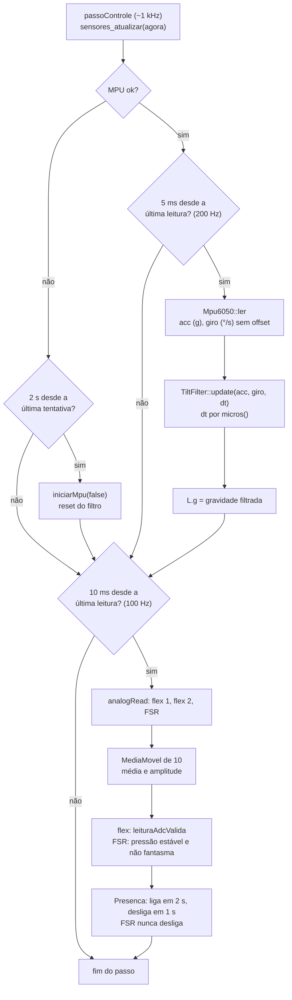

# Módulo `sensors`

> Código: `src/sensors.h`, `src/sensors.cpp` · Relacionados: [03 — Inclinação](../03-algoritmo-inclinacao.md), [05 — Sensores analógicos](../05-sensores-analogicos.md), [mpu](mpu.md), [tilt](tilt.md), [filters](filters.md), [main](main.md)

## Papel no sistema

Junta todo o hardware de entrada num único struct `Leituras`: a gravidade filtrada do MPU-6050, os dois sensores flex
e o FSR (sensor de pressão). Cada sensor é lido no seu próprio período, sem `delay()`, e cada um é **detectado**
(presente ou não), para o colete seguir funcionando com o que estiver ligado:

- MPU caído → tenta reconectar a cada 2 s; enquanto isso, só o flex pode alertar;
- flex solto, quebrado ou sem resistor → deixa de ser detectado; no modo `auto` (padrão) sai da decisão e o colete segue só com o MPU;
- flex 2 e FSR → opcionais (atendem a montagem BioSpine V3, ver [01](../01-visao-geral.md)).

## Dependências

- Usa: `mpu.h` (`Mpu6050`), `tilt.h` (`TiltFilter`, `Vec3`), `filters.h` (`MediaMovel`, `Presenca`,
  `leituraAdcValida`), `config.h` (pinos, períodos, limiares), `Wire.h`, `Arduino.h` (`analogRead`, `millis`,
  `micros`).
- É usado por: `main.cpp` (postura, calibração, `app_calibrar`), `console.cpp` (`diag`), simulador.
- Roda em: tarefa de controle. `sensores_iniciar` roda no `setup()`.

## Tipos e constantes

### `struct CanalAdc` — um canal analógico

| Campo | Tipo | Descrição | Unidade |
|---|---|---|---|
| `bruto` | `int` | última leitura | ADC 0–4095 |
| `media` | `float` | média móvel de `ADC_MEDIA_N` (10) amostras | ADC 0–4095 |
| `amplitude` | `int` | máximo − mínimo da janela | ADC |
| `detectado` | `bool` | leitura plausível há tempo suficiente (`Presenca`) | — |

### `struct Leituras` — tudo que os sensores informam

| Campo | Tipo | Descrição | Unidade |
|---|---|---|---|
| `mpuOk` | `bool` | MPU respondendo | — |
| `mpuEndereco` | `uint8_t` | 0x68, 0x69 ou 0 | — |
| `mpuWhoAmI` | `uint8_t` | identificação do chip | — |
| `giroCalibrado` | `bool` | offset do giroscópio já medido | — |
| `acc` | `Vec3` | aceleração (última leitura boa) | g |
| `gyro` | `Vec3` | velocidade angular sem offset | °/s |
| `g` | `Vec3` | gravidade filtrada (`TiltFilter`) | unitário |
| `flex` | `CanalAdc` | flex 1 (GPIO34, `PIN_FLEX`) | — |
| `flex2` | `CanalAdc` | flex 2 (GPIO35, `PIN_FLEX2`), opcional | — |
| `fsr` | `CanalAdc` | FSR (GPIO32, `PIN_FSR`), opcional, só telemetria | — |

### Estado interno (`sensors.cpp`)

| Nome | Descrição |
|---|---|
| `mpu`, `filtro`, `L` | driver, filtro complementar (peso `MPU_FILTRO_GIRO` = 0,98) e as leituras |
| `mFlex`, `mFlex2`, `mFsr` | médias móveis |
| `pFlex`, `pFlex2` | `Presenca(FLEX_LIGA_MS, FLEX_DESLIGA_MS)` = 2 s para ligar, 1 s para desligar |
| `pFsr` | `Presenca(FLEX_LIGA_MS, UINT32_MAX)`: detectado uma vez, fica detectado até reiniciar |
| `ultimoMpu`, `ultimoAdc`, `ultimaTentativaMpu` | agendamento por `millis()` |
| `ultimoMpuUs` | `micros()` da última leitura do MPU: dá o `dt` real do filtro |

## Funções

### `void sensores_iniciar()`
- **O que faz:** configura o I2C (`PIN_I2C_SDA`/`PIN_I2C_SCL`, 100 kHz = `MPU_I2C_HZ`, timeout de 20 ms) e o ADC (12
  bits, atenuação de 11 dB = faixa até ~3,3 V); inicia o MPU **medindo o offset do giroscópio** (~1 s bloqueante);
  enche as médias móveis com 10 leituras; faz a primeira detecção.
- **Chamada por:** `setup()` em `main.cpp`, com o colete parado (o firmware avisa na serial: "Mantenha o colete parado
  por 2 s").
- **Observações:**
  - o flex 1 já sai do `setup` como presente se a leitura for plausível (a primeira chamada da `Presenca` adota o valor
    na hora);
  - o flex 2 e o FSR começam **ausentes**: o GPIO35 fica solto na montagem padrão e só passa a presente depois de
    `FLEX_LIGA_MS` de leitura estável.

### `void sensores_atualizar(uint32_t agoraMs)`
- **O que faz:** um passo de leitura; cada sensor só é lido quando o seu período venceu.
- **Parâmetros:** `agoraMs` — `millis()`.
- **Chamada por:** `passoControle` em `main.cpp` (a cada passo da tarefa de controle, ~1 ms).
- **Observações:**
  - **MPU (200 Hz, `PERIODO_MPU_MS` = 5 ms):** `Mpu6050::ler` → `dt` medido com `micros()` → `TiltFilter::update` →
    `L.g`. Leitura com falha mantém os valores anteriores; depois de 10 falhas seguidas `mpu.ok()` vira `false`.
  - **MPU caído:** nova tentativa de `iniciar()` a cada `MPU_REINICIO_MS` (2 s), **sem** medir o giro (não bloqueia a
    tarefa de controle; o offset anterior continua valendo e o recálculo automático do `mpu.cpp` cuida do resto). O
    filtro recomeça pela direção do acelerômetro.
  - **ADC (100 Hz, `PERIODO_ADC_MS` = 10 ms):** lê flex 1, flex 2 e FSR, nessa ordem; atualiza as médias e a detecção.
  - **Flex:** presente se `leituraAdcValida(média, amplitude, 100, 4000, 300)` valer por 2 s seguidos; ausente depois
    de 1 s inválido.
  - **FSR:** critério próprio, porque sem pressão ele lê ~0 (igual a pino solto): presente quando lê pressão estável
    (`media > FSR_LIMIAR` = 200 e amplitude ≤ 300) que **não** seja o fantasma do ADC.
  - **Fantasma do ADC:** um pino analógico solto fica com a tensão que sobrou no capacitor de amostragem do canal lido
    antes. O FSR é lido depois do flex 2, que solto também copia o flex 1; por isso uma leitura do FSR a menos de
    `ADC_FANTASMA_DIF` (300) da do flex 1 é descartada. É o mesmo motivo de o flex 2 vir desligado por padrão
    (`configPadrao` em `settings.cpp`).

### `const Leituras& sensores()`
- **Retorno:** referência para as últimas leituras. Não guardar entre passos.
- **Chamada por:** `main.cpp` (postura, calibração, `app_calibrar`), `console.cpp` (`diag`).

### `int sensores_scanI2C(uint8_t* encontrados, int maximo)`
- **O que faz:** varre os endereços 0x01 a 0x7E com transmissão vazia; ACK = tem dispositivo.
- **Retorno:** quantos achou (até `maximo`).
- **Chamada por:** `diag` em `console.cpp` (loop).

### Estáticas do `.cpp`

| Função | O que faz |
|---|---|
| `iniciarMpu(bool medirGiro)` | `mpu.iniciar()`, copia endereço/`WHO_AM_I`, mede o offset se `medirGiro`, reinicia o filtro pela primeira leitura e marca `ultimoMpuUs` |
| `lerAdc(pino, media, canal)` | `analogRead` → `push` na média → atualiza `bruto`, `media`, `amplitude` |

Pipeline de um passo de `sensores_atualizar`:

## Armadilhas e cuidados

- **Sem trava nas leituras:** só a tarefa de controle escreve em `L`; o loop lê `sensores()` direto (`diag`,
  `app_calibrar`). Para mostrar e para checar `mpuOk` isso basta, mas uma leitura do loop pode pegar o struct no meio de
  uma atualização. Para decisões, usar o `Status` protegido de `main.cpp` (`app_status`).
- **Reconexão do MPU bloqueia ~150 ms** (reset do chip em `Mpu6050::iniciar`) dentro da tarefa de controle. Aceitável a
  cada 2 s com o sensor caído.
- **Ordem de leitura do ADC importa** para o fantasma (flex 1 → flex 2 → FSR). Mudar a ordem muda qual canal o pino
  solto copia.
- **ADC2 não funciona com Wi-Fi ligado:** todos os pinos analógicos estão no ADC1 (GPIO 32–39). Não mover sensor
  analógico para fora dessa faixa.
- **Atenuação de 11 dB:** o ADC do ESP32 não é linear perto das pontas da faixa. Como a curvatura é relativa à
  calibração (`flexPct`), isso não afeta a detecção.
