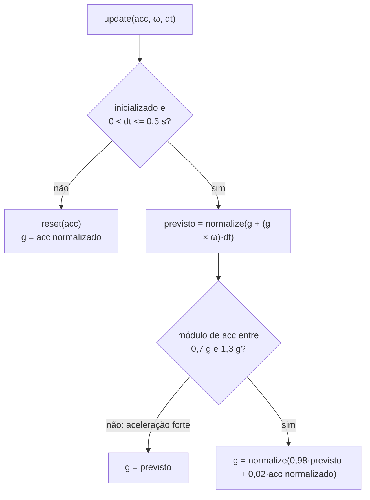

# Módulo `tilt`

> Código: `src/tilt.h`, `src/tilt.cpp` · Relacionados: [03 — Inclinação](../03-algoritmo-inclinacao.md), [sensors](sensors.md), [mpu](mpu.md), [main](main.md)

## Papel no sistema

É a matemática da postura. Transforma as leituras do MPU-6050 (aceleração em g e velocidade angular em °/s) numa
estimativa estável da **direção da gravidade** vista pela placa, e mede o **desvio**: o ângulo entre essa gravidade
e a gravidade gravada na calibração (referência `g0`).

O módulo existe porque a abordagem clássica (ângulos de Euler pitch/roll, como na biblioteca `MPU6050_light`) falha
no colete: o sensor fica **em pé** nas costas, perto da singularidade das fórmulas de pitch/roll, e o ângulo salta
~20° ao passar pela vertical com um pouco de inclinação lateral. Trabalhar com vetores evita isso e deixa o
resultado independente de como o sensor foi preso (ver [10 — Decisões](../10-decisoes-de-projeto.md)).

É lógica pura (só `<math.h>`): roda igual no ESP32, nos testes nativos e no simulador.

## Dependências

- Usa: `<math.h>` (`sqrtf`, `atan2f`, `fabsf`).
- É usado por: `sensors.cpp` (`TiltFilter`), `main.cpp` (`angleBetweenDeg`, `tiltComponentsDeg`, `norm`),
  `posture.h` (`Vec3` no `Calibrador`), `mpu.h`/`mpu.cpp` (`Vec3`), `settings.h` (`Vec3` em `Calibracao`),
  `test/test_posture/test_main.cpp`.
- Roda em: tarefa de controle (ESP32); PC (testes e simulador).

## Convenção de eixos e de "gravidade"

- Os vetores estão nos **eixos da placa** do MPU (X, Y, Z).
- "Gravidade" é o que o acelerômetro mede parado: **+1 g apontando para cima** (a reação do apoio). Só a direção
  importa, então os vetores de gravidade são sempre normalizados (unitários).
- Montagem esperada no colete: placa em pé entre as escápulas, eixo **Y para cima** e eixo **Z saindo das costas**
  (componentes virados para fora). Inclinar o tronco para a frente leva a gravidade para +Z; para o lado, para X.
  Essa é a mesma convenção do MPU falso do simulador e da função `gravidadeColete` dos testes.

## Tipos e constantes

| Nome | Tipo | Descrição | Unidade |
|---|---|---|---|
| `Vec3` | `struct { float x, y, z; }` | vetor 3D nos eixos da placa | g, °/s ou sem unidade (unitário) |
| `v3(x, y, z)` | função inline | monta um `Vec3` (o struct fica agregado simples, sem construtor) | — |
| `+`, `-`, `* k` | operadores inline | soma, subtração, multiplicação por escalar | — |
| `dot(a, b)` | inline | produto escalar = \|a\|·\|b\|·cos θ | — |
| `cross(a, b)` | inline | produto vetorial (regra da mão direita), módulo \|a\|·\|b\|·sen θ | — |
| `norm(a)` | inline | módulo do vetor | — |
| `RAD_PARA_GRAU`, `GRAU_PARA_RAD` | `static const float` (tilt.cpp) | conversões | — |
| `TiltFilter` | classe | filtro complementar sobre o vetor gravidade | — |

## Funções

### `Vec3 normalize(Vec3 a)`
- **O que faz:** devolve `a / |a|`.
- **Parâmetros:** `a` — qualquer vetor.
- **Retorno:** vetor unitário na direção de `a`. Se `|a| < 1e-6`, devolve `a` sem mudança (evita divisão por zero).
- **Chamada por:** `tiltComponentsDeg`, `TiltFilter`, `Calibrador::gravidade` (posture.h), testes.
- **Observações:** quem chama decide o que fazer com vetor nulo (ex.: `TiltFilter::reset` não se considera
  inicializado).

### `float angleBetweenDeg(Vec3 a, Vec3 b)`
- **O que faz:** ângulo entre dois vetores, em graus (0–180).
- **Parâmetros:** `a`, `b` — não precisam ser unitários.
- **Retorno:** `atan2(|a × b|, a · b)` convertido para graus.
- **Chamada por:** `atualizarPostura` em `main.cpp` (o **desvio** = `angleBetweenDeg(L.g, ref)`), testes.
- **Observações:** a forma "óbvia" `acos(a · b)` perde precisão justamente perto de 0°, onde o colete passa a maior
  parte do tempo: o cosseno é quase constante ali (cos 0,5° = 0,99996), então o erro de arredondamento do `float`
  vira alguns centésimos de grau (até ~0,04°); e um `a · b` de 1,0000001 por arredondamento daria `NaN`. Com `atan2` as duas partes
  (seno e cosseno) entram juntas e a precisão é boa em toda a faixa. O teste `test_angulo_entre_vetores` confere
  0,5° com erro < 0,01°.

### `void tiltComponentsDeg(Vec3 g, Vec3 ref, float* frente, float* lado)`
- **O que faz:** decompõe a inclinação de `g` em relação a `ref` em dois ângulos com sinal: frente/trás e lateral.
- **Parâmetros:** `g` — gravidade atual; `ref` — gravidade de referência; `frente`, `lado` — saídas em graus
  (podem ser `NULL`).
- **Retorno:** nada (escreve nas saídas). `frente` positivo = tronco para a frente (com os componentes do sensor
  virados para fora).
- **Chamada por:** `atualizarPostura` em `main.cpp` (campos `pitch` e `roll` do `Status`), testes.
- **Observações:** **só para exibição** (app, serial, plotter). A detecção usa o desvio total, que não tem sinal e
  não depende de rótulos. Como funciona:
  1. Monta uma base ortonormal presa à postura calibrada: `ref` (cima), `f` (frente) e `l` (lado).
  2. `f` = eixo Z da placa sem a parte paralela a `ref` (Gram-Schmidt: `Z − ref·(Z·ref)`), normalizado.
  3. Se Z for quase paralelo a `ref` (`|Z·ref| > 0,9`, menos de ~26° entre eles), a projeção fica curta e instável:
     usa o eixo Y no lugar. É o caso da placa deitada na bancada.
  4. `l = ref × f`.
  5. `frente = atan2(g·f, g·ref)` e `lado = atan2(g·l, g·ref)`.

  Se o sensor for montado com os componentes virados para o corpo, `frente` sai com sinal trocado; o desvio e o
  alerta não mudam. O app tem as caixas "Inverter frente/trás" e "Inverter lado" para isso.

### `TiltFilter::TiltFilter(float gyroCoef = 0.98f)`
- **O que faz:** cria o filtro não inicializado.
- **Parâmetros:** `gyroCoef` — peso do giroscópio na mistura (0–1). O firmware passa `MPU_FILTRO_GIRO` (0,98).

### `void TiltFilter::reset(Vec3 acc)`
- **O que faz:** recomeça a estimativa pela direção do acelerômetro.
- **Parâmetros:** `acc` — aceleração (g).
- **Retorno:** nada. Fica inicializado só se `|acc| > 1e-3` (leitura não nula).
- **Chamada por:** `iniciarMpu` em `sensors.cpp` (boot e reconexão) e pelo próprio `update`.

### `void TiltFilter::update(Vec3 acc, Vec3 gyroDps, float dt)`
- **O que faz:** um passo do filtro complementar (200 Hz).
- **Parâmetros:** `acc` em g; `gyroDps` em °/s (já sem offset); `dt` em segundos (medido com `micros()`).
- **Retorno:** nada; a estimativa nova fica em `gravity()`.
- **Chamada por:** `sensores_atualizar` em `sensors.cpp`.
- **Observações:** passos, na ordem:
  1. **Proteção:** se não inicializado, ou `dt <= 0`, ou `dt > 0,5 s`, chama `reset(acc)` e sai. Integrar o
     giroscópio com um intervalo absurdo daria lixo.
  2. **Previsão pelo giroscópio:** `previsto = normalize(g + (g × ω)·dt)`, com ω em rad/s. A gravidade é fixa no
     mundo; quando a placa gira com velocidade angular ω, um vetor fixo no mundo, visto nos eixos da placa, gira
     com −ω: `dg/dt = −ω × g = g × ω`. É um passo de integração de Euler; ele aumenta um pouco o módulo a cada
     iteração, e a normalização mantém o vetor unitário.
  3. **Rejeição de aceleração:** se `|acc|` estiver fora de [0,7; 1,3] g, há aceleração do corpo somada (passo,
     batida) e a direção de `acc` não é a vertical. Nesse instante usa só a previsão.
  4. **Mistura:** `g = normalize(0,98·previsto + 0,02·normalize(acc))`. O giroscópio é bom no curto prazo e deriva;
     o acelerômetro é ruidoso e não deriva. Com `dt` = 5 ms, a constante de tempo é
     `τ = coef·dt / (1 − coef) ≈ 0,25 s`.

### `Vec3 TiltFilter::gravity() const` / `bool TiltFilter::initialized() const`
- Gravidade estimada (unitária) / se já recebeu uma aceleração válida.

O fluxo do `update` em um passo:

## Armadilhas e cuidados

- **Sinal do giroscópio:** a convenção `dg/dt = g × ω` foi conferida contra a da `MPU6050_light`, mas o simulador usa
  a mesma convenção do código, então ele não prova o sinal. Se no hardware um movimento rápido "repicar" (ir para o
  lado errado e voltar devagar), trocar `cross(g_, w)` por `cross(w, g_)` em `TiltFilter::update` e inverter o sinal
  do giro em `test_filtro_segue_giroscopio` (ver `VALIDACAO.md`, item V2.6).
- **Não trocar `atan2` por `acos`** em `angleBetweenDeg` (precisão perto de 0°, `NaN`).
- **Limiar 0,9 em `tiltComponentsDeg`:** é o que separa "placa em pé" de "placa deitada". Mudar o eixo de referência
  (Z) muda o significado de frente/lado no app.
- **`MPU_FILTRO_GIRO`** (config.h): subir (0,99) suaviza mais e corrige a deriva mais devagar; descer deixa o desvio
  mais ruidoso com a vibração do motor.
- Testes que cobrem o módulo (`test/test_posture/test_main.cpp`): `test_angulo_entre_vetores`,
  `test_desvio_sem_salto_perto_da_vertical`, `test_componentes_frente_e_lado`,
  `test_componentes_com_sensor_de_cabeca_para_baixo`, `test_componentes_com_placa_deitada`,
  `test_filtro_converge_para_acelerometro`, `test_filtro_segue_giroscopio`, `test_filtro_reinicia_com_dt_grande`.
